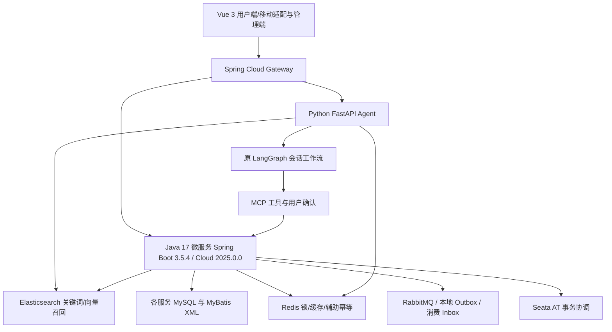

# Simlect AI Mall 最终项目验收

验收日期：2026-11-04（Asia/Shanghai）。本轮只执行验收、测试和文档整理，未新增或修改业务功能、数据库结构、用户配置、密钥或运行环境。

**结论：源码与自动化层面的有条件验收；尚不能认定真实环境业务闭环全部通过。** 本轮网关、订单、支付、商品、库存、Agent、MCP、ES、Redis、RabbitMQ本地端口均未监听，未擅自启动、导入数据库或调用真实支付。服务不可用不能用Mock测试通过代替真实联调。

证据分级：**源码实现**指存在可追踪调用链；**自动化通过**指本轮实际执行的测试；**真实联调**指已连接真实依赖完成业务请求；**未实现/延期**明确保留功能缺口。历史阶段报告只作为历史证据，不冒充本轮执行。

## 1. 项目架构



Java使用MyBatis XML Mapper，不描述为MyBatis-Plus。AI负责理解、召回和提案；Java负责身份、订单、SKU、真实价格、库存及关键状态校验。没有新增第三个Agent。

## 2. 微服务模块说明

| 模块 | 主要职责 | 本地脚本端口 |
|---|---|---:|
| Simlect-gateway | API路由、鉴权与内部调用边界 | 8080 |
| Simlect-user/app | 账户、用户信息、通知等 | 8105 |
| Simlect-product/app | 商品、SKU、属性及AI最终筛选 | 8099 |
| Simlect-stock/app | SKU库存及幂等库存操作 | 8102 |
| Simlect-cart/app | 购物车 | 8084 |
| Simlect-order/app | 下单、订单状态、物流模拟与售后 | 8093 |
| Simlect-pay/app | 支付渠道、交易记录、回调校验 | 8096 |
| Simlect-coupon/app | 优惠券、预占和释放 | 8087 |
| Simlect-search | 商品搜索、FAQ与向量同步 | 8108 |
| Simlect-admin | 后台管理入口 | 8111 |
| Simlect-common | 共享配置、Feign、Outbox/Inbox与工具 | 非独立进程 |
| Simlect-agent | FastAPI、LangGraph、确认恢复 | 7050 |
| 同模块MCP进程 | 已有工具服务，非新增Agent | 7060 |

前端实际目录为 Simlect-web 与 Simlect-admin，没有将移动适配虚构成已独立部署的第三个前端服务。端口来自当前部署脚本，只是计划监听配置，不表示已运行。

## 3. AI 导购工作流

原图拓扑 entry → build_context → agent_loop/tools → finalize → post_turn → cleanup。导购分支：shopping_turn → Pydantic ShoppingPatch → 合并/清除/重置需求 → RECOMMEND_PRODUCTS → 每路最多50候选 → RRF去重保留最多100 → 原Java接口分两批核验 → Python有证据软排序 → 卡片与当前SKU引用。

Java校验品类、SKU价格、库存及eq/ne/gte/lte硬属性；品牌排除也是硬条件。Python软偏好不得突破预算。歧义追问、解析失败不降级成未核验商品推荐。对比仅使用当前实际展示的2～3款商品/SKU，重新核验库存与价格，未知配置、缺点或场景不推测。

T09已有40条固定需求与15条服务评测场景。本轮运行回归；LLM结构化输出、召回与Java接口以Mock提供，不等同真实自然语言理解准确率。

## 4. AI 售后工作流

用户订单/政策/物流咨询 → after_sale_turn → 本人订单上下文 → Java资格核验与版本化演示政策 → AI生成原requestId提案 → 用户确认卡 → Python确认状态 → Java创建PENDING_REVIEW申请。

人工审核 → 必要的退货物流登记 → 人工验货 → 受开关控制的模拟退款。换货申请展示不等于换货履约。APPLICATION_ONLY只表示可提交审核；POLICY_MISSING/RECEIPT_MISSING等不被转换为期限承诺。Java与Python政策版本均demo-v3，没有可信签收时间或正式运费/到账政策。

确认使用 PENDING/EXECUTING/SUCCEEDED/FAILED/UNKNOWN/CANCELLED/EXPIRED。网络超时进入UNKNOWN，再根据原requestId查询Java；只在用户再次确认且允许时使用原键重试。提交动作成功不表示审核通过或资金已退款。

## 5. MCP 工具调用流程

LangGraph分支 → McpToolRouter → 强制注入当前userId/白名单参数 → MCP Streamable HTTP → 原工具Service → Java内部只读接口，或创建待用户确认提案。

售后写操作不直接使用内部token冒充用户；用户确认后使用登录token调用Java用户接口。旧直接退款工具被阻断，PROPOSE_REFUND复用售后提案。商品对比路由覆盖模型提供的旧SKU/条件，取当前会话真实展示引用。

## 6. RAG 检索流程

关键词与向量独立有界召回 → RRF → Java业务核验。ES故障时复用Java关键词降级，Embedding异常不拖掉已有关键词结果。政策当前是版本化本地词法检索，不能描述成已验证向量政策RAG。

Java Spring AI1.1.2默认向量字段embedding；Python已对齐，索引默认simlect_vectorstore、维度1024，metadata.dataType区分product/faq，productId绑定商品。商品删除按业务ID；FAQ不再先删除旧文档后才生成新向量。

初始配置探测向量开关true、Embedding Key未配置，且ES/Agent/MCP未监听。以上契约有源码与Mock证据，真实索引mapping、Embedding服务、召回相关性和端到端时延未验证。

## 7. Java 订单支付流程与业务验收矩阵

购物车/商品选择 → Java创建订单与SKU库存操作 → Seata全局事务标注与本地事务 → 本地Outbox → RabbitMQ延迟关单。支付成功回调经原证书验签、商户身份、完整字段与金额格式校验后，经Feign进入订单生命周期锁，再核对支付单关联、真实金额、渠道单号，执行原状态机/条件SQL和支付记录幂等。

超时关单与支付使用原生命周期锁：支付先完成不能回补库存；关单先完成不能复活发货，保留原迟到支付处理。原SDK调用、Seata、Redis锁和SQL模型测试不等于真实渠道/跨库事务故障注入。

| 业务流程 | 源码状态 | 本轮自动化证据 | 真实环境 |
|---|---|---|---|
| 登录与商品搜索 | 有实现 | Java模块回归；Python鉴权/搜索回归 | 未联调 |
| SKU选择、库存查询 | 有实现 | AiProductFilter与库存模块测试 | 未联调 |
| 购物车与下单 | 有实现 | 购物车/订单回归 | 未联调 |
| 支付及回调 | 有实现，严格校验已修 | SDK/验签Mock，金额/身份/重复通知测试 | 未调用支付宝 |
| 超时关闭 | 有实现 | 状态机、超时任务、支付竞争模型 | 未跑真实TTL链 |
| AI预算推荐 | 有实现 | 固定语料、Java硬筛、故障夹具 | 未连真实模型/商品服务 |
| AI商品对比 | 有实现 | 当前SKU与缺失字段测试 | 未真实多轮UI联调 |
| AI条件修改 | 有实现 | 修改/清除/重置/失败清旧结果 | 未真实模型验证 |
| AI售后咨询 | 有实现，演示政策 | 版本/规则/上下文测试 | 未真实联调 |
| 用户确认提交申请 | 有实现 | 超时恢复、重复确认、MockMvc身份绑定 | 未真实跨语言调用 |
| 审核、退货、验货、模拟退款 | 有实现，退款受开关控制 | 现有售后Workflow与入口测试 | 未操作真实数据库或资金 |

## 8. T01～T10 实际完成情况

| 阶段 | 实际情况 | 保留限制 |
|---|---|---|
| T01 | 旧退款门禁、Agent统一售后入口已实现 | 真实渠道退款未验证 |
| T02 | Outbox租约、Confirm、过期恢复、有限重试 | 业务库迁移/部署未执行；隔离容器验证仅为历史证据 |
| T03 | Inbox与本地业务同事务、提交后ACK、失败持久化 | 跨服务副作用不由本地事务覆盖 |
| T04 | 原requestId确认结果查询恢复 | Redis全记录丢失、其他动作UNKNOWN存在边界 |
| T05 | 轻查通过、规则保留 | 正式政策和签收资料缺失 |
| T06 | 图级用户锁、旧消息拦截、售后旧上下文修复 | send_message咨询态预处理仍在图锁外 |
| T07 | 字段、商户、精确金额、查单DTO边界已修 | 真实sellerId配置与支付宝联调未执行 |
| T08 | 删除ID、FAQ更新、ES字段契约已修 | 真实向量数据未验证 |
| T09 | 解析、候选、排序、当前SKU对比、异常处理已修 | 在线模型质量与真实检索评测待做 |
| T10 | ignore、回环端口、健康检查已修 | 无Git历史审计；Python/MCP TraceId未贯通 |

技术验收：Spring Cloud/OpenFeign、Seata注解与调用、RabbitMQ配置、Outbox/Inbox、Redis锁、LangGraph、MCP、Pydantic及Java/Python契约有源码；Mock/契约测试结果见下一节。所有真实基础设施及跨服务链路本轮均未连接。Redis标记不再是消费完成唯一依据，Inbox只保证本服务数据库原子性。

## 9. 本轮测试结果

| 本轮执行 | 通过 | 失败/错误 | 跳过 | 结果与日志 |
|---|---:|---:|---:|---|
| Java定向 | 371 | 0/0 | 0 | BUILD SUCCESS；logs/final-java-targeted.log |
| Java全模块test+package | 1614 | 0/0 | 2 | BUILD SUCCESS；logs/final-java-regression.log |
| Python定向 | 118 | 0 | 0 | logs/final-python-targeted.log |
| Python Agent tests全回归 | 251 | 0 | 0 | logs/final-python-regression.log |
| PC/移动适配工程vue-tsc -b | exit 0 | 0 | 不适用 | logs/final-web-types.log，无错误输出 |
| 确认卡SSR状态渲染 | 7 | 0 | 0 | logs/final-confirm-card.log |

Java全回归共1616项；两项跳过为AfterSaleMapperMySqlTest与AfterSaleWorkflowMySqlTest，不能算作实际数据库测试通过。前端初次命令在根目录执行而找不到tsconfig.json，已在Simlect-web正确目录重跑，最终exit 0，没有修改配置来规避错误。


定向命令：

```powershell
# Simlect-backend
mvn -o -pl Simlect-order/app,Simlect-pay/app,Simlect-product/app,Simlect-search -am test '-Dtest=AfterSaleServiceTest,AfterSaleWorkflowServiceTest,AfterSaleControllerTest,AfterSaleWorkflowControllerTest,OrderInfoServiceImplTest,LocalDemoPaymentServiceTest,OrderStateMachineTest,PayChannel4AliPayTest,PayChannel4AliPaySecurityTest,PayNotifyControllerTest,AiProductFilterServiceTest,RagLightweightSafetyTest,InboxTransactionTest,MqListenerHelperTest,OutboxMessageServiceImplTest' '-Dsurefire.failIfNoSpecifiedTests=false'
mvn -o package
# Simlect-backend/Simlect-agent；仅测试进程设置非生产测试token
.venv/Scripts/python.exe -m pytest tests -q -p no:cacheprovider -o asyncio_default_fixture_loop_scope=function
# Simlect-front/Simlect-web
node_modules/.bin/vue-tsc.cmd -b --pretty false
# 项目根目录
node Simlect-front/Simlect-web/scripts/test-agent-confirm-card.cjs
```

测试没有相加为“总覆盖”：定向与回归有重叠。MockMvc/ASGI接口测试是真实框架请求处理，但依赖Service/鉴权上下文可能Mock，不能代替Gateway生产过滤器联调。管理端为JS项目，未发现独立TypeScript工程配置，没有凭空宣称其类型检查通过。未运行会生成部署产物的管理端发布流程。

T02/T03历史独立MySQL/RabbitMQ测试见阶段报告，本轮未重跑，不能算本轮实时中间件验证。T09指标文件为合成夹具，仅能衡量契约与安全行为；不能把亚毫秒Mock耗时称为在线Agent响应时间。

## 10. 未完成与延期功能

- 正式签收事件、商家退货期限、运费承担、退款到账承诺没有可信数据。
- 换货出库履约、真实物流接入、真实退款均未作为本轮功能实现或开启。
- Python/MCP端到端TraceId未贯通；咨询预处理锁外并发边界尚存。
- 真正的LLM输出质量、向量索引/Embedding兼容、真实商品召回质量、真实接口延迟待评测。
- Seata跨库回滚、RabbitMQ真实TTL/DLQ、网络分区、进程退出、真实库存与支付回调竞争尚未完成生产形态故障注入。
- 工作目录及父目录未发现Git仓库，不能审计提交历史、断言“密钥从未提交”。本地凭据不输出，未擅自轮换或清理。
- 未连接业务库执行阶段SQL迁移；部署须核对原Outbox及T02租约、T03 Inbox迁移。没有因测试通过宣称数据库已更新。

## 11. 本地部署说明

1. 项目根目录为本文件上级目录的上级目录；后端在Simlect-backend，AI在其Simlect-agent，前端在Simlect-front。
2. 使用现有deploy/.env.local.example作为人工核对参考；保留已有deploy/.env.local，不直接覆盖。配置实际数据库/Redis/RabbitMQ/注册中心等依赖、内部token；需要真实渠道时另核对证书和真实sellerId，演示保持模拟开关。
3. 数据库操作须由部署人先备份和确认。T02租约脚本sql/26_outbox_lease.sql、T03 sql/28_mq_consumer_inbox.sql需应用到相应本地服务库；不可把Redis旧标记导入Inbox DONE。原基础表/初始化脚本按当前部署记录核对，本验收不替人执行。
4. deploy/start-middleware.ps1会启动中间件并调用初始化，执行前理解其数据库影响。Compose端口现在仅绑定127.0.0.1；容器之间使用Compose服务名，不要因此打开公网端口。
5. deploy/start-local.ps1提供CheckOnly、Rebuild、SkipAI、WebOnly选项。先人工检查配置与依赖后使用CheckOnly；依赖健康再启动本地服务。start-full.ps1只启动中间件并打印微服务清单，不误称自动启动全部Java。
6. Java 17、现有Maven依赖、Python虚拟环境和前端依赖就绪后，启动脚本管理的Java模块及FastAPI/MCP。先确认内部HTTP后端、真实商品索引和密钥，再验证AI；不要仅把vector_search_enabled=true当成已接通向量检索。
7. 各服务Outbox恢复需要原dispatch/scheduling开关；真实商户资料缺失时支付回调故意拒绝，演示使用已有本地模拟付款入口，不伪造回调签名。
8. 依赖可用后检查服务健康：网关使用/actuator/health并要求UP；Agent健康包含依赖状态。若网关Actuator受保护，需部署人配置探测权限，不将401解释成健康。

本轮没有执行上述启动、迁移或初始化；这里只提供现有脚本使用边界。

## 12. 项目演示流程

准备真实本地测试账号、已上架且属性齐全/有库存的商品、管理员账号；使用测试数据库和模拟支付，不使用真实收款。

1. 登录，搜索商品，展示SKU实际价格及库存；加入购物车、创建订单。
2. 用本地模拟付款完成订单，查看状态、支付记录和物流模拟；另建未支付订单，演示延迟关单和库存释放。没有基础设施时只能展示对应自动化测试。
3. 输入“耳机预算100到300元，不要索尼”，查看预算与库存已核验的卡片；改为“预算提高到500”，确认不再引用旧结果。
4. 从新卡片选择第1和第2款对比，展示同SKU、当前价格/库存、配置，以及缺失参数明确未知。改库存后再次对比，不应偷偷换SKU。
5. 提问售后期限/运费，说明demo-v3与人工核实限制。查询本人订单项，提供售后类型和原因，生成确认卡，先证明未点击时没有申请。
6. 用户确认后进入待审核；重复确认返回同请求结果。网络超时恢复可使用既有Mock测试演示，不为演示修改生产网络或真实渠道。
7. 管理员审核、用户登记演示退货、人工验货，再按已有开关模拟退款；不把申请提交成功描述成真实到账。

以上为待具备依赖后的可执行演示清单，本轮没有实际完成这些UI到数据库操作。

## 13. 面试技术重点

- 为什么保留旧接口但必须在Service层统一退款门禁；审核、验货与支付生命周期锁如何协作。
- Outbox租约如何恢复过期SENDING，Confirm为什么不能保证业务exactly-once。
- Inbox为什么必须与业务同本地事务；Redis SET NX不能证明数据库已提交；提交后ACK失败如何重投。
- Seata全局事务与本地事务的作用范围，外部支付/ES/MQ为什么不能随意当作可回滚数据库操作。
- Agent两阶段用户确认、稳定requestId、UNKNOWN恢复，以及申请成功与退款成功的区别。
- 支付验签后为何仍需核对商户、订单、金额和渠道交易号；主动查单不能成为空金额豁免。
- RRF只是相关性候选，Java硬约束后再排序；多轮需绑定当前实际SKU，未知属性不能由模型补齐。
- 测试如何区分单元、Mock接口、隔离依赖集成与真实端到端；明确承认未验证范围比虚构“全闭环上线”更可信。

阶段详细证据见docs/improvement下T01～T10记录。本轮结束后不自动进行新开发或部署。
