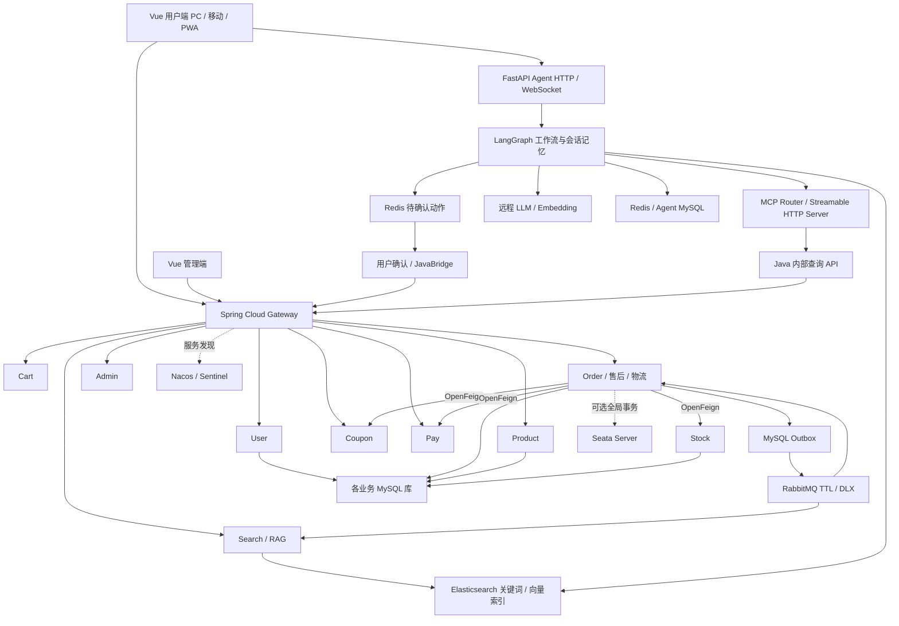
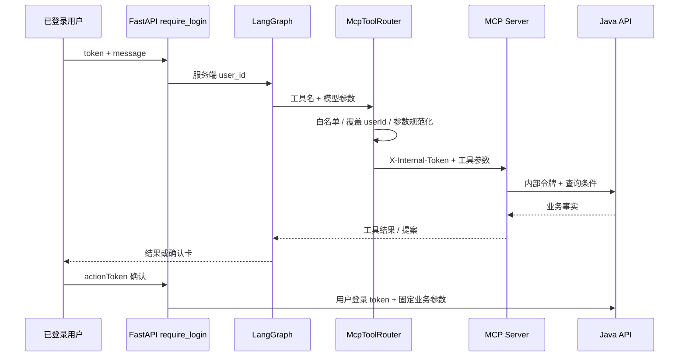
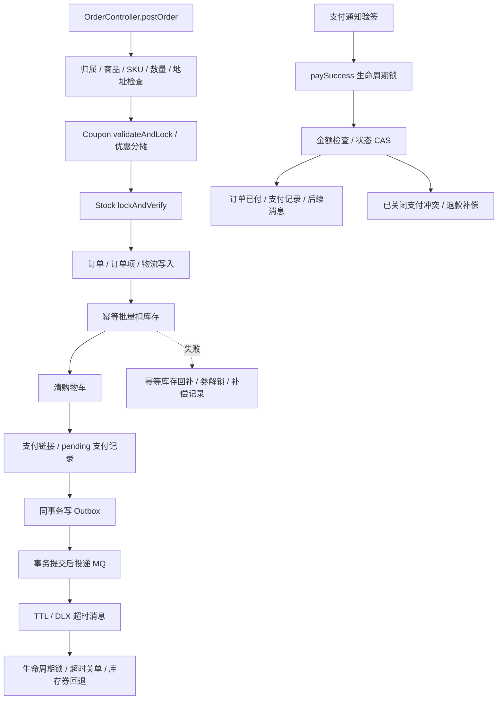

# Simlect AI Mall 全面审查与二次完善计划

审查日期为 2026-11-04。项目根目录为 E:/Simlect-AI-Mall-main/Simlect-AI-Mall-main。本文仅审查及制定计划，业务代码、配置、数据库和密钥文件均未修改。测试产生正常的 target、覆盖率和类型检查构建产物。

## 1. 审查结论与证据口径

当前已有完整的商城业务代码及 Agent 集成，后续工作的重点应放在交易故障恢复、售后入口一致性、导购约束可靠性、检索验证和工程基线复现。已有 LangGraph、结构化需求解析、RRF、Java SKU 精筛、商品对比、售后资格规则、确认卡与人工审核，均应继续完善现有实现。

报告采用三类结论。

- **代码缺陷**表示已追踪到具体条件和执行路径，具备静态证据，但本轮未对生产或业务数据进行故障复现。
- **潜在风险**表示存在可行失败窗口，需要隔离环境的故障注入或并发测试确认。
- **能力缺口**表示当前实现或配置不提供该能力，不能作为上线能力承诺。

本轮覆盖入口、主要业务服务、关键 Mapper、Agent 图、MCP、RAG、部署脚本和现有测试。未对每个通用 CRUD 方法逐行证明正确性，也未连接运行中的业务数据库、支付渠道或模型服务。静态配置与现存进程状态文件不能证明进程实际采用这些配置。

## 2. 当前架构

Java 采用 Java 17、Spring Boot 3.5.4、Spring Cloud 2025.0.0、Spring Cloud Alibaba 2025.0.0.0。当前父 POM 与 common 使用 **MyBatis Spring Boot Starter 3.0.5** 和 XML Mapper，本轮未发现 MyBatis-Plus 依赖，后续方案按实际 MyBatis 体系设计。Agent 为 Python FastAPI、LangGraph、MCP，RAG 写入侧使用 Java Spring AI，查询侧包含 Python ES HTTP 客户端。

## 3. 模块与真实入口

下表路径相对项目根目录，Java 服务入口均在各自 src/main/java/com/simlect 下，业务拆分模块的实现一般在 app 子模块，远程契约在 api 子模块。

| 模块 | 真实入口与主要实现 | 职责 |
|---|---|---|
| Simlect-gateway | cloud/gateway/filter/AuthGlobalFilter、InternalTokenGlobalFilter；application.yml | 用户和内部调用过滤、路由、服务发现 |
| Simlect-user/app | controller/AccountController、UserAddressController、SignController、UserMemberController | 账户、地址、签到、会员、收藏、足迹、通知及图片 |
| Simlect-product/app | controller/ProductController；controller/internal/ProductAgentInternalController；biz/AiProductFilterService.filter | 商品、分类、SKU、快照及 AI 候选精筛 |
| Simlect-stock/app | controller/internal/StockInternalController；biz/SkuStockService；mappers/SkuStockMapper.xml | 权威 SKU 库存、条件扣减、幂等操作及补偿前置记录 |
| Simlect-cart/app | controller/ProductCartController；biz/impl/ProductCartServiceImpl | 购物车及订单后清理 |
| Simlect-order/app | controller/OrderController、AfterSaleController、AfterSaleProgressController；biz/impl/OrderInfoServiceImpl | 交易编排、支付入账、关单、评价、售后、物流 |
| Simlect-pay/app | controller/PayNotifyController；biz/impl/PayChannel4AliPay | 支付链接、回调、查单、退款、关单和交易记录 |
| Simlect-coupon/app | controller/DiscountCouponController；biz/impl/UserCouponServiceImpl | 发券、购券、锁券、使用及回退 |
| Simlect-search | controller/SearchController；component/EsSearchComponent、RabbitMQRagListenerComponent | 商品搜索、热词、推荐、FAQ 与商品向量同步 |
| Simlect-admin | controller/admin/HomeController、StatisticsInfoController、SettingController | 运营统计、设置、消息、审计、补偿管理 |
| Simlect-common | web/InternalApiAuthFilter、TraceIdFilter；constants/TransactionalMqSender；service/impl/OutboxMessageServiceImpl | 鉴权、链路标识、可靠消息、补偿与共享契约 |
| Simlect-agent | app/main.py → api/routes/agent.py → services/agent_service.py | 对话编排、鉴权、异步任务、会话状态 |
| MCP 进程 | app/mcp_server/__main__.py → server.py | 内部令牌认证、工具注册、执行业务工具 |
| 用户前端 | Simlect-front/Simlect-web/src/router/index.ts、api/modules.ts | 用户页面、PC/移动适配、AI 卡片和确认动作 |
| 管理前端 | Simlect-front/Simlect-admin/src/router/index.js、views | 运营、发货、售后审核验货、内容管理 |

父 POM 注册 common、gateway、admin、user、product、stock、cart、order、pay、coupon、search。当前物流归订单域，不存在父 POM 注册的独立 logistics 服务。deploy/start-full.ps1 仍展示 Simlect-logitics，应按现有模块更新。

## 4. AI 导购完整调用链

1. 用户端 agentApi.sendMessage 调 /api/agent/sendMessage，FastAPI 路由通过 require_login 从 Redis 登录令牌解析用户，进入 AgentOrchestrator.send_message。
2. 编排器限流、过滤输入、保存消息，以 asyncio.create_task 启动 _run_agent。AgentEngine.assistant_answer → run_agent_graph。
3. 图为 entry → build_context → agent_loop ↔ tools → finalize → post_turn → cleanup。entry 负责前置控制，build_context 构造记忆、咨询态及模型消息。
4. agent_loop_node 优先尝试 after_sale_turn，再尝试 shopping_turn。购物分支从会话记忆读取 shoppingRequirement，parse_shopping 用 ShoppingPatch 结构化输出，merge_requirement 支持 clear、reset 与保留旧条件。
5. RECOMMEND_PRODUCTS 通过 McpToolRouter.invoke → MCP HTTP → server.recommend_products → mcp_tools_service → shopping_service.recommend。
6. recommend 并发请求关键词与向量商品 ID，rrf_merge 融合候选，verified_rows 使用独立 JavaInternalClient 调 /internal/product/ai/filter。
7. AiProductFilterService.filter → ProductInternalService.snapshotBatch → Product Mapper 快照；StockFeignSupport.readBatch → SkuStockService.readBatch → SkuStockMapper.selectByProductIds。Java 检查上架状态、价格、库存、分类、SKU 属性硬匹配。
8. Python rank_rows 按偏好证据、价格排序并按商品去重，构造卡片及已核验事实。shoppingResults 写回会话，用于下一轮引用。
9. 对比通过 comparison_indices 解析第几款 → COMPARE_PRODUCTS → shopping_service.compare，再次核验 Java 数据。支持 2～3 款不同商品。
10. finalize/post_turn 保存回复、卡片和记忆，通过现有 WebSocket 推送展示。

现有保护包括 Decimal 预算校验、禁止未知字段、价格区间检查、Java 事实核验、库存不可用时失败、解析失败明确标为普通搜索。仍存在有限候选召回、属性字面精确匹配、预算解析语义依赖 LLM、并发会话覆盖及无整轮总时限等问题。

## 5. AI 售后完整调用链

1. 同一对话入口到 agent_loop_node → after_sale_turn。该分支使用有限中文规则识别政策、资格、申请、进度、物流与查单。
2. 查询订单走 GET_ORDER_DETAIL/QUERY_ORDERS，Java 内部查询按 userId 限定本人，再取订单项。明确新订单时不会直接继承旧订单项。
3. 政策走 QUERY_AFTER_SALE_POLICY → after_sale_policy.query_policy，读取 knowledge/after_sale_policy.json，按关键词返回原文、文档 ID、来源、版本与限制。这是本地词法检索。
4. 资格走 CHECK_AFTER_SALE_ELIGIBILITY → after_sale_service.eligibility → /internal/order/afterSale/eligibility → AfterSaleService.check → decision → AfterSalePolicyRules.evaluate。
5. 规则返回 APPLICATION_ONLY、人工审核标记、期限状态以及运费/到账时效未配置。当前 decision 明确传 Receipt.unavailable 和 Applicability.UNKNOWN，不以订单时间或模拟物流当作签收证据。
6. 申请工具只做 eligibility 复查并创建 Redis AFTER_SALE_REQUEST 提案，params 包含固定 requestId、订单项、类型、原因，用户收到确认卡。
7. confirmAction → PendingActionService.confirm，检查归属、锁与 CAS → ActionExecuteService.execute，使用用户登录 token 调 Java /api/order/afterSale/create。
8. AfterSaleController.create → AfterSaleService.create → AfterSaleMapper.lockOrder/lockItem，先验归属，再按 requestId 验幂等载荷、复查资格，写 PENDING_REVIEW 和日志。
9. 管理端 AfterSaleAdminController.review → AfterSaleWorkflowService.review。退货退款要求配置退货地址，进入 WAIT_RETURN；用户 submitReturn → WAIT_INSPECTION；人工 inspect → READY_REFUND 或 REJECTED。
10. 管理员 refund 在开关允许时使用支付生命周期锁、固定退款标识、订单及订单项锁、状态校验，调 OrderInfoService.refundAfterSale → PayFeignSupport → 支付渠道。检查实际订单项结果后记录 COMPLETED 或失败。当前本地配置走模拟退款。

AfterSalePolicyRules 独立计算器已经实现来源和天数配置校验、签收缺失/异常、适用性、期限内外及截止时刻包含规则。其期限算法为配置天数乘 24 小时，不能替代正式商家期限定义。最新规则工作应保留，下一步接入可信事实和版本治理。

## 6. MCP 身份、权限与异常链

模型 userId 在 Router 被强制覆盖，snake_case 兼容参数最终也优先使用服务端 camelCase userId。普通 Agent 调用中未发现模型直接覆盖当前用户身份的路径。MCP Server 默认监听 127.0.0.1，并以恒定时间比较验证内部令牌。Java 内部过滤器对未配置令牌或不匹配请求拒绝。

信任边界仍较宽。MCP 直接工具调用依靠共享内部令牌，持有该令牌的调用者可以自己提交 userId，未携带与用户绑定的委托凭证。ToolGuardrail.validate_tool_args 只校验 userId 一致性，细粒度字段约束主要依靠各工具 Pydantic、服务实现与 Java。get_settings 只拒绝空值和两个弱默认值，未验证令牌强度。应作为内部凭证泄露后的权限扩大风险处理，不能声称普通用户已可越权。

只读与提案工具有白名单和标签，写入在用户确认后走 Java 用户接口。仍有遗留 PROPOSE_REFUND → /order/refundOrder 路径，见 F01。MCP 客户端默认单次 30 秒超时，每次新建会话；SEARCH_PRODUCTS 成功返回后 Router 又无条件执行本地搜索覆盖，造成重复检索和结果漂移风险。

## 7. Java 订单交易流程

OrderInfoServiceImpl.postOrder 有 @GlobalTransactional 与 @Transactional。Stock 的 lockAndVerify 是库存服务本地事务，不能在 Seata 关闭时保证该锁跨越后续远程调用。最终 changeStock SQL 使用 stock + changeAmount >= 0 和影响行数检查，批量扣减有 operationId 唯一记录、前置操作墓碑与事务回滚。现有保护应保留，不能只因远程预检查锁释放就判定必然超卖。

失败时已有库存补偿、券解锁和持久化补偿记录。生产审查重点是进程中断窗口、补偿与 Seata 是否重复作用、提交失败、远程扣减超时晚到、共享支付单的回退幂等。普通创建订单未看到客户端稳定请求号复用，重复提交是否允许应明确业务契约。

支付通知已有证书验签、订单归属链、金额核对、支付生命周期锁和 SQL 状态条件更新。assertCallbackAmountMatches 允许缺失金额直接通过，渠道层对金额解析失败只记日志。回调入口还应核对 app_id/seller_id 和严格金额契约，见 F07。支付/关单的 Redis 锁与数据库事务提交顺序也应在真实并发测试中覆盖。

## 8. 功能状态矩阵

| 状态 | 范围 | 当前证据及边界 |
|---|---|---|
| 已有实现 | 用户、地址、商品、SKU、库存、购物车、订单、支付、评价、优惠券、会员签到、收藏足迹、通知、后台运营 | 前后端入口和实现已存在，详见既有功能盘点及本报告链路 |
| 已有实现 | LangGraph、结构化需求、多轮修改、关键词候选、RRF、Java 精筛、2～3 款对比 | 已追踪具体函数，当前自动化仅部分覆盖其运行 |
| 已有实现 | 售后规则、APPLICATION_ONLY、政策缺失状态、确认申请、人工审核、退货物流、验货、模拟退款 | Java 规则与服务定向测试通过，不能据此认定真实退款上线 |
| 已实现但未验证 | 商品向量召回、Java Spring AI 向量同步、FAQ 向量查询 | 源码存在，本地 VECTOR_SEARCH_ENABLED=false，本轮未发 Embedding 请求或验证索引 |
| 已实现但未验证 | Seata 跨库回滚、MQ 故障恢复、并发下单/重复回调的全链路一致性 | 本地启动脚本强制 SEATA_ENABLED=false，本轮未启动隔离集成环境 |
| 已实现但未验证 | 支付宝真实/沙箱支付、退款与回调 | 本地模拟开关开启，本轮未调用外部渠道 |
| 部分实现 | 售后期限判定 | 独立算法已有，服务仍使用不可用签收事实与未知适用性，正式期限来源缺失 |
| 部分实现 | 售后政策检索 | 版本化 JSON 词法检索已运行于代码路径，向量政策 RAG 尚未接入并验证 |
| 部分实现 | RAG 内容处理与质量体系 | 商品/SKU、FAQ 结构化转文档和分批写入已有，未看到通用文件解析及可追踪文本切块流水线 |
| 部分实现 | TraceId、健康检查和启动编排 | Java HTTP/Feign 已有标识，Python 到 Java/MCP 未发现统一透传；健康通过不足以证明模型/向量功能可用 |
| 尚未实现 | 可信签收时间事件接入与适用性证据 | AfterSaleService 显式使用 Receipt.unavailable/UNKNOWN |
| 尚未配置 | 正式商家退货期限、运费、退款到账时效 | 返回 POLICY_MISSING 或 UNCONFIGURED，需业务提供规则及来源 |
| 尚未实现 | 换货履约 | 可提交 exchange 申请，但未形成替换 SKU、出入库、补发、物流和完成闭环 |
| 当前不可确认 | Git 历史、分支策略、提交基线与密钥提交历史 | 当前内层目录及外层工作区均无可用 Git 仓库，git status 报 not a git repository |

## 9. 问题与潜在风险清单

优先级 P1 为可能导致资金、库存、消息或关键状态错误的问题，P2 为正确性、恢复性和部署风险。下列具体源码位置汇总在文末证据索引。

### F01 · P1 · 代码缺陷 · 旧退款入口可绕过新售后审核

OrderController.refundOrder → OrderInfoServiceImpl.refund → refundInLock(reviewed=false, restockable=true)。无处理中申请时，旧路径允许 SHIPPED 状态，OrderStateMachine 也允许普通 FULL_REFUND/PARTIAL_REFUND，并继续 doRefund。它未经过 AfterSaleWorkflowService.refund 的审核、验货及 refundEnabled 门禁。Agent 仍注册 PROPOSE_REFUND，ActionExecuteService 的 REFUND 分支调用此旧接口。

复现条件为本人已发货、正常订单项且无活跃售后申请。用户直接调用旧退款接口即可进入退款执行路径，缺少退货验收依据并可能回补库存。当前模拟渠道同样会改变业务状态。应统一已发货售后入口，未发货直退若保留，应显式限定订单和物流状态。

### F02 · P1 · 代码缺陷 · Outbox 发送中记录无法自动恢复

OutboxMessageServiceImpl.tryDispatch 先 CAS 为 SENDING，再调用 replaySend 和写 SENT/FAILED。dispatchPendingBatch 只扫描 PENDING/FAILED，tryDispatch 对 SENDING 直接返回。进程在 CAS 后中断，或数据库在发送后的状态更新阶段不可用，会留下无法重新扫描的发送中记录。静态搜索未找到超时租约回收路径。

需要带租约与持有者的恢复协议，不能简单把所有 SENDING 重置导致并发重复。恢复后的重复投递交由业务 Inbox 幂等处理。

### F03 · P1 · 潜在风险 · 消费前 Redis 标记与数据库提交脱节

MqConsumerIdempotencyHelper.tryBeginConsume 用 SET NX EX 在执行业务之前写入统一标记。RabbitMQPayOrderDeadListenerComponent 发现标记已存在就 basicAck。正常异常会 releaseConsume，但进程在标记后、事务提交前退出时不会执行清理。消息随连接断开重投，存活标记使其被确认，业务没有完成。标记 TTL 到期后消息已经 ACK，也不会自动再来。

需要区分 PROCESSING/DONE，结合数据库 Inbox 与事务提交，只有已完成事件才直接 ACK。消费中的事件应延后重试。

### F04 · P2 · 代码缺陷 · 删除不存在商品的向量条件值错误

RabbitMQRagListenerComponent.save2vectorDB4Product 在 getRagIndex 返回 null 时调用 deleteByPrefix(prefixId)，prefixId 为 PRODUCT 类型前缀加商品 ID。deleteByPrefix 却使用该参数匹配 metadata.productId，写入 metadata.productId 时保存的是原始 productId。因此该分支不能正确删除旧向量。Java 精筛能挡住无效推荐，但候选库残留与检索质量仍受影响。

### F05 · P2 · 代码缺陷/恢复缺口 · 确认状态与执行结果不一致

PendingActionService.confirm 执行前将 PENDING CAS 为 CONFIRMED，网络错误后保持该状态，却返回“请稍后重试”。重试会被拒绝。执行成功但删 Redis 失败还返回 success=false。当前方案可以防盲目重复写，但没有 UNKNOWN/查询恢复语义，用户无法得知 Java 是否已提交。

售后已有固定 requestId 与 Java 幂等，可用它查询最终结果后完成恢复。其余写动作也需要稳定操作号和结果查询。

### F06 · P2 · 潜在风险 · 同用户并行会话覆盖条件与商品引用

AgentOrchestrator 使用进程级全局任务槽，未发现按用户序列化整轮对话。shopping_turn 和 after_sale_turn 对同用户会话做 load→修改→save。多标签页或快速发送时，旧轮可覆盖新购物条件、shoppingResults、售后上下文，导致“第二款”对应错误列表。压缩锁仅保护压缩，不保护整轮修改。

应为同用户状态增加版本 CAS 或有序执行，商品引用绑定展示消息和快照，而非仅使用最新用户级数组。

### F07 · P1 · 风险/契约缺口 · 支付金额和收款方验证可放行缺失事实

PayChannel4AliPay.payNotify 验签后读取 total_amount，解析失败仅日志；OrderInfoServiceImpl.assertCallbackAmountMatches 对 null 直接跳过。当前验签保护有效，但合法签名不替代本商户 app_id/seller_id、支付单、币种及严格金额关联。本轮 payNotify 方法未见 app_id/seller_id 对预期配置核对。应分离回调和内部查单 DTO，不以兼容旧调用为由允许资金通知缺少金额。

这不是已证实的外部伪造支付漏洞，风险条件是异常签名载荷、跨应用数据或内部调用契约失守。

### F08 · P2 · 代码缺陷/可用性风险 · 检索兼容与同步存在故障窗口

Python _vector_search 遇 404 才把 content_vector 改为 vector，而同一索引字段名不匹配通常应按明确映射配置解决，当前分支不能可靠兼容映射错误。FAQ 同步先 delete 后 add，Embedding 或 ES 写入失败会在重试前产生知识空窗。商品采用先写后清理，比 FAQ 更完整。

当前政策走本地 JSON，不受 FAQ 向量结果直接支配。需要验证 Java/Python 的索引名、向量字段、1024 维、模型、metadata 类型与过滤条件，并用版本切换或原子文档更新保障 FAQ。

### F09 · P2 · 潜在风险 · 导购召回损失与异常耗时

recommend 只以 category 做候选召回，关键词及向量各取有限候选、融合后截断，再做预算和属性过滤；符合预算的商品可能在截断前被丢弃。Java 的类别 contains 和属性名/值完全相等限制会放大同义词损失，scenario 未参与硬核验。解析成功也不能保证模型正确理解预算，应引入带歧义澄清的解析评测。

shopping_service 外层 25 秒，Embedding 单请求 30 秒、ES 单请求 20 秒，gather 会等待两支。向量变慢可能拖垮已有关键词结果。Router._backfill_structured 对 SEARCH_PRODUCTS 总是再本地执行一次。Agent _run_agent 和 run_agent_graph 未见整轮总截止时间，工具循环和多步等待可能长时间占槽。

### F10 · P2 · 部署风险 · 中间件对所有网卡发布端口

deploy/docker-compose.middleware.yml 使用 3306:3306、6379:6379、9200:9200 等绑定，未限定回环地址。文件还包含本地演示固定认证配置。是否能被其他机器访问取决于防火墙及宿主网络，本轮未进行网络扫描。应将本地和生产配置分开，明确网络边界、凭证注入与启动配置校验。

### F11 · P2 · 可观测性与版本治理缺口

Java 已有 TraceIdFilter 和 FeignTraceInterceptor；Python JavaInternalClient、JavaBridge 与 MCP 客户端未见统一 TraceId 透传，跨语言定位困难。health_service 对 ES/Java 使用 status_code < 500，401/404 也可能显示可用，不能证明内部工具和索引可用。AfterSaleService.POLICY_VERSION 为硬编码 demo-v3，与政策 JSON、期限来源无统一快照约束。当前目录无 Git 元数据，无法绑定本次结论到 commit 或检查历史密钥。

## 10. 最优先的 10 项任务

工作量为熟悉项目的工程师人日，含必要测试，不含等待业务政策、渠道账号或外部系统接入。总体约 25～37 人日。两周计划按两名工程师合计 20 人日制定，优先完成交易安全和恢复；其余有明确延期边界。

| ID | 任务及关联问题 | 难度 | 改动风险 | 预计工作量 | 依赖 |
|---|---|---|---|---|---|
| T01 | 统一旧退款与售后执行边界，F01 | 高 | 高 | 2～3 人日 | 业务确认未发货直退规则 |
| T02 | Outbox SENDING 租约和崩溃恢复，F02 | 高 | 高 | 2～3 人日 | T03 的消费幂等约定 |
| T03 | 消费端 Inbox 与事务完成幂等，F03 | 高 | 高 | 3～4 人日 | 隔离 MySQL/RabbitMQ 测试环境 |
| T04 | 确认动作结果可查询与不确定态恢复，F05 | 高 | 中高 | 2～3 人日 | Java 稳定操作号契约 |
| T05 | 售后政策版本与可信事实接口，F11及能力缺口 | 中高 | 中 | 2～3 人日 | 商家期限、来源及签收系统契约 |
| T06 | 会话修改顺序和展示引用一致性，F06 | 中高 | 中 | 2～3 人日 | 会话状态版本策略 |
| T07 | 支付事实严格校验与竞争回归，F07 | 高 | 高 | 2～3 人日 | 支付账号与回调字段契约 |
| T08 | 修复向量删除、统一检索契约并隔离验证，F04/F08 | 中高 | 中 | 3～5 人日 | Embedding 配额及隔离 ES |
| T09 | 导购解析、召回与总耗时治理，F09 | 中高 | 中 | 3～5 人日 | T06/T08，商品属性字典 |
| T10 | 可复现基线、部署隔离、MCP 委托身份及 Trace，F10/F11 | 中高 | 中 | 4～5 人日 | Git 仓库、CI 与部署环境 |

### T01 具体实现范围与验收

文件为订单域 controller/OrderController.java 的 refundOrder，biz/impl/OrderInfoServiceImpl.java 的 refund、refundInLock、doRefund，state/OrderStateMachine.java 的 buildTransitions；Agent services/action_execute_service.py 的 execute、mcp/tools.py 的 build_mcp_tools、mcp_server/server.py 的 propose_refund。

复用 AfterSaleWorkflowService，不另建第二套售后。未发货快捷退款与已发货申请明确分流，统一门禁与状态。验收要求已发货调用旧接口不能改变资金、订单项或库存；仅审核验货通过后可执行；新旧入口并发、重复确认、活跃售后均只产生一次结果。模拟与关闭开关两种环境均测试。

### T02 具体实现范围与验收

文件为 common/service/impl/OutboxMessageServiceImpl.java 的 tryDispatch、dispatchPendingBatch，mappers/LocalMessageOutboxMapper.java 及同名 XML，task/OutboxDispatchTask.java 的 dispatch，constants/TransactionalMqSender.java 的 sendAfterCommit。

增加持有者、租约或版本并限定抢占，保留幂等键与发布确认。验收要求在领取后、发送后、写 SENT 前分别中断进程，消息均能自动恢复；多实例只持有有效租约；最终投递允许重复但业务执行一次；重试耗尽有告警和人工处理入口。

### T03 具体实现范围与验收

文件为 common/component/MqConsumerIdempotencyHelper.java 的 tryBeginConsume/releaseConsume、MqListenerHelper.java 的 nackWithRetryOrDlq，order/component/RabbitMQPayOrderDeadListenerComponent.java 的 handlePayTimeoutOrder/processOrderConfirm/processLogistics，相关 Mapper 与数据库 Inbox 迁移文件在确认开发时新增。

在业务事务中写事件完成记录，处理中和已完成分开，Redis 只做辅助协调。验收要求消费前、事务中、提交后 ACK 前退出并重投，不丢关单、不重复回库、不重复退券；Redis 不可用、TTL 到期、多消费者并行均验证。避免将模拟物流事件视作真实签收。

### T04 具体实现范围与验收

文件为 Agent services/pending_action_service.py 的 confirm/cancel，redis_service.py 的 cas_pending_status/try_mark_pending_executing，action_execute_service.py 的 execute，api/routes/agent.py 确认路由；Java AfterSaleService.create 及结果查询接口。

保留先验归属、固定请求号和谨慎禁止盲重试，增加 EXECUTING/SUCCEEDED/FAILED/UNKNOWN 和结果查询。验收要求 Java 已提交但响应丢失可恢复同一 requestId；双击只执行一次；过期、取消、跨用户均拒绝；删除 Redis 失败不能将已成功业务显示为失败。

### T05 具体实现范围与验收

文件为 order/biz/AfterSalePolicyRules.java 的 evaluate、AfterSaleService.java 的 decision/create、AfterSaleWorkflowService.java 的 review；Agent services/after_sale_policy.py 的 query_policy 与 knowledge/after_sale_policy.json。可信签收适配器及政策版本存储在开发确认后补充。

将规则版本、来源、期限语义、适用商品范围和事实来源形成不可变决策快照。未获取可信签收或正式政策时继续保持 APPLICATION_ONLY 和人工审核。验收要求起止边界、未来时间、缺失来源、特殊商品、历史版本均可追踪；正式期限与运费/到账时效未提供时保持未知。两周内只完成接口契约和存证基础，真实事件对接取决于外部系统。

### T06 具体实现范围与验收

文件为 Agent services/agent_service.py 的 send_message/_run_agent，shopping_turn.py 的 shopping_turn，after_sale_turn.py 的 after_sale_turn，memory/session_memory_service.py 的 load/save，前端 AgentChatList.vue/AgentSendPanel.vue 的商品引用交互。

采用同用户有序执行或版本 CAS，展示商品列表绑定消息 ID。验收要求同用户两个并发请求、换品类后旧请求晚返回、重连重发均不覆盖最新状态；对比明确使用所选消息的商品；新订单不继承旧订单项，不增加全站串行瓶颈。

### T07 具体实现范围与验收

文件为 pay/biz/impl/PayChannel4AliPay.java 的 payNotify/queryOrder，controller/PayNotifyController.java，order/biz/impl/OrderInfoServiceImpl.java 的 assertCallbackAmountMatches/paySuccess/paySuccessInLock/handlePaySuccessConflict，state/OrderStateMachine.java 的 transition。

资金通知要求非空且格式正确的金额、预期应用和收款方，内部查询与外部回调分离 DTO，明确金额分差策略。验收要求缺失/错误金额、错误应用/卖方、重放通知拒绝或幂等；支付与关单并发、事务提交延迟、锁续期、渠道成功但本地失败均可恢复且不复活已关单。

### T08 具体实现范围与验收

文件为 search/component/RabbitMQRagListenerComponent.java 的 save2vectorDB4Product/deleteByPrefix/save2vectorDB4FAQ，search/src/main/resources/application.yml，Agent rag/retriever.py 的 _vector_search、rag/embedding.py 的 embed_text、rag/rrf.py 的 rrf_merge。

先修删除参数，再明确索引字段和模型维度契约，FAQ 更新避免先删后写知识空窗。验收要求隔离库内插入、修改、删除商品及 FAQ 均收敛，Java 写入能被 Python KNN 检索，1024 维与 metadata 过滤一致；Embedding/ES 故障不伪称有检索依据；记录 Recall@K、nDCG 与版本。政策仍保持词法路径，政策向量 RAG 作为后续扩展单独验收。

### T09 具体实现范围与验收

文件为 Agent models/shopping.py 的 merge_requirement，services/shopping_parser.py 的 parse_shopping，shopping_service.py 的 recommend/compare/rank_rows，shopping_turn.py 的 shopping_turn，mcp_tool_router.py 的 _backfill_structured，agent_service.py 的 _run_agent；Java AiProductFilterService.filter。

复用现有解析和 RRF，加入预算/属性评测、类别属性标准化、带筛选的候选扩展与有限回填，按业务事实输出并带核验时间。整轮统一截止时间，关键词分支可用时不被慢向量无限等待，取消传播到工具。验收要求预算内且有货结果无硬约束违规；覆盖取消预算、换品类、否定、歧义、属性缺失、旧卡片；注入商品文本不改变身份和写操作门禁；MCP/Embedding 超时在预定 SLA 内终止，不重复执行本地搜索。

### T10 具体实现范围与验收

文件为 deploy/docker-compose.middleware.yml、start-local.ps1、local-stack-common.ps1、start-full.ps1；common/web/TraceIdFilter.java、api/feign/FeignTraceInterceptor.java；Agent services/java_internal_client.py 的 _headers、mcp_streamable_client.py 的 _session、health_service.py 的 check_all、mcp_server/server.py 的 _InternalTokenMiddleware、harness/guardrails/tool_guard.py 的 validate_tool_args。

恢复可用 Git 基线和测试清单，锁定 Python 环境，分离本地/生产开关和网络，增加功能就绪探针、跨语言 TraceId、MCP 服务角色和用户委托范围。验收要求无密钥进入报告或日志；本地端口限定预期网卡；错误内部令牌拒绝，服务角色不能越范围调工具，模型 userId 无效；ES 401/404、索引缺失和工具不可用不显示功能就绪；一轮消息可关联 Java、MCP 与 MQ。两周先完成基线、配置清单和 Trace 最小闭环，凭证细分分阶段实施。

## 11. 两周开发安排

假设两名工程师、10 个工作日、每天合计 2 人日。以下为确认后执行的计划，不包含本轮改动。若仅一名工程师，两周范围应收缩为 T01～T04 和 T07 的关键保护，其他进入下一迭代。

| 时间 | Java 工程师 | AI/平台工程师 | 可验收产物 |
|---|---|---|---|
| 第 1 天 | T01 旧退款边界与状态约定 | T10 固定当前基线、测试环境与配置矩阵 | 接口行为清单、可复现基线 |
| 第 2 天 | T01 编码与回归 | T04 动作状态与 Java 结果查询契约 | 已发货旧入口受限、确认协议 |
| 第 3 天 | T02 Outbox 租约恢复 | T04 结果恢复和前端状态 | 中断恢复用例 |
| 第 4 天 | T02 完成故障注入 | T06 会话版本/引用绑定 | Outbox 可回收、并发引用用例 |
| 第 5 天 | T03 Inbox 事务实现 | T06 完成、T08 删除参数修复 | 消费幂等与向量删除回归 |
| 第 6 天 | T03 重投/崩溃测试 | T09 去重复搜索、统一超时 | 消费不丢失、耗时受控 |
| 第 7 天 | T07 回调字段与状态竞争 | T09 预算和多轮评测 | 支付与导购关键回归 |
| 第 8 天 | T07 完成、T05 政策版本契约 | T08 隔离索引字段/维度冒烟 | 真实向量验证记录或明确阻塞 |
| 第 9 天 | 联合交易故障回归与风险修复 | T10 Trace 与功能就绪最小闭环 | 跨语言问题定位记录 |
| 第 10 天 | 联合验收及回滚演练 | 联合验收、更新状态与下一迭代 | 发布候选、验收报告、未完成清单 |

两周承诺范围为 T01～T04、T06、T07 主要闭环，T08 的确定性缺陷与索引冒烟，T09 的重复调用和截止时间，T10 最小基线。T05 真实签收对接、正式政策上线、换货履约、真实退款投产、完整 MCP 凭证分权及检索质量全面优化不纳入该时间承诺。第 8 天前无 Embedding 配额或隔离索引时，保留词法路径并明确记录向量验收未完成，不通过打开生产开关替代验证。

## 12. 本轮测试与核验记录

- 用户端执行 npx --no-install vue-tsc -b --pretty false，退出码 0。此结果是类型检查通过。
- Python 默认解释器缺少 langgraph/fastapi 等依赖，首次收集失败。改用项目 .venv 后发现缺少测试内部令牌，使用仅本次测试进程有效的虚构令牌执行，不读取或改写密钥配置。
- 沙箱内完整 Python 回归与 Java 首个 Mockito 测试长时间无进展，已中止本轮启动的相应测试进程。沙箱外重跑 Python 单元回归，命令为 .venv/Scripts/python.exe -m pytest tests --ignore=tests/integration -q -p no:cacheprovider，结果 **115 passed in 4.87s**。这是当前所选 tests 目录范围，不等同于历史 257。
- Python 另执行提示词边界、商品文本、商品 ID、业务卡片、搜索相关性、内部客户端后端 6 个文件，**33 passed in 6.25s**，与上述 115 有重叠，不能相加。
- Java 定向执行 mvn -o -pl Simlect-order/app -am test -Dtest=AfterSalePolicyRulesTest,AfterSaleServiceTest,OrderStateMachineTest -Dsurefire.failIfNoSpecifiedTests=false，结果 **43 tests，0 failures，0 errors，0 skipped，BUILD SUCCESS**。其中规则 14、申请服务 22、状态机 7。
- pytest 报异步 fixture loop scope 未显式配置的弃用提示，应在固定测试环境时处理。
- 本轮没有调用真实模型、Embedding、支付、物流或生产业务接口，没有启停业务中间件，没有删除数据或重置数据库。Maven 正常测试阶段不等于启用 Failsafe 集成测试，不能据此认定 Seata/MQ 故障场景通过。

全量 Maven 离线打包命令为 mvn -o package，结果 BUILD SUCCESS，26 个 Reactor 模块成功，总耗时 03:40。按本次执行时间窗口内的 175 份 Surefire XML 汇总，Tests=1465、Failures=0、Errors=0、Skipped=2，即 1463 项通过。两个跳过项 realWorkflow(boolean) 和 realMapperCreatesRequestAndAuditAndReplays 因缺少 SIMLECT_AFTER_SALE_DB_TEST 环境变量未执行，不能视为 MySQL 售后集成验证通过。该统计与历史 Java 284 项并非相同范围。

## 13. 源码证据索引

以下索引在报告生成时按源码方法或关键表达式查找行号。路径相对项目根目录，便于编辑器定位。行号会随未来修改变化，方法名和问题编号应一并使用。

| 范围 | 源码位置 |
|---|---|
| F01 | [Simlect-backend/Simlect-order/app/src/main/java/com/simlect/controller/OrderController.java L174](../Simlect-backend/Simlect-order/app/src/main/java/com/simlect/controller/OrderController.java#L174) |
| F01/F07 | [Simlect-backend/Simlect-order/app/src/main/java/com/simlect/biz/impl/OrderInfoServiceImpl.java L239](../Simlect-backend/Simlect-order/app/src/main/java/com/simlect/biz/impl/OrderInfoServiceImpl.java#L239) |
| F01/F07 | [Simlect-backend/Simlect-order/app/src/main/java/com/simlect/biz/impl/OrderInfoServiceImpl.java L1002](../Simlect-backend/Simlect-order/app/src/main/java/com/simlect/biz/impl/OrderInfoServiceImpl.java#L1002) |
| F01/F07 | [Simlect-backend/Simlect-order/app/src/main/java/com/simlect/biz/impl/OrderInfoServiceImpl.java L1271](../Simlect-backend/Simlect-order/app/src/main/java/com/simlect/biz/impl/OrderInfoServiceImpl.java#L1271) |
| F01/F07 | [Simlect-backend/Simlect-order/app/src/main/java/com/simlect/biz/impl/OrderInfoServiceImpl.java L1438](../Simlect-backend/Simlect-order/app/src/main/java/com/simlect/biz/impl/OrderInfoServiceImpl.java#L1438) |
| F01/F07 | [Simlect-backend/Simlect-order/app/src/main/java/com/simlect/biz/impl/OrderInfoServiceImpl.java L1467](../Simlect-backend/Simlect-order/app/src/main/java/com/simlect/biz/impl/OrderInfoServiceImpl.java#L1467) |
| F02 | [Simlect-backend/Simlect-common/src/main/java/com/simlect/service/impl/OutboxMessageServiceImpl.java L67](../Simlect-backend/Simlect-common/src/main/java/com/simlect/service/impl/OutboxMessageServiceImpl.java#L67) |
| F02 | [Simlect-backend/Simlect-common/src/main/java/com/simlect/service/impl/OutboxMessageServiceImpl.java L108](../Simlect-backend/Simlect-common/src/main/java/com/simlect/service/impl/OutboxMessageServiceImpl.java#L108) |
| F03 | [Simlect-backend/Simlect-common/src/main/java/com/simlect/component/MqConsumerIdempotencyHelper.java L22](../Simlect-backend/Simlect-common/src/main/java/com/simlect/component/MqConsumerIdempotencyHelper.java#L22) |
| F03 | [Simlect-backend/Simlect-order/app/src/main/java/com/simlect/component/RabbitMQPayOrderDeadListenerComponent.java L91](../Simlect-backend/Simlect-order/app/src/main/java/com/simlect/component/RabbitMQPayOrderDeadListenerComponent.java#L91) |
| F03 | [Simlect-backend/Simlect-order/app/src/main/java/com/simlect/component/RabbitMQPayOrderDeadListenerComponent.java L120](../Simlect-backend/Simlect-order/app/src/main/java/com/simlect/component/RabbitMQPayOrderDeadListenerComponent.java#L120) |
| F04/F08 | [Simlect-backend/Simlect-search/src/main/java/com/simlect/component/RabbitMQRagListenerComponent.java L102](../Simlect-backend/Simlect-search/src/main/java/com/simlect/component/RabbitMQRagListenerComponent.java#L102) |
| F04/F08 | [Simlect-backend/Simlect-search/src/main/java/com/simlect/component/RabbitMQRagListenerComponent.java L150](../Simlect-backend/Simlect-search/src/main/java/com/simlect/component/RabbitMQRagListenerComponent.java#L150) |
| F04/F08 | [Simlect-backend/Simlect-search/src/main/java/com/simlect/component/RabbitMQRagListenerComponent.java L286](../Simlect-backend/Simlect-search/src/main/java/com/simlect/component/RabbitMQRagListenerComponent.java#L286) |
| F05 | [Simlect-backend/Simlect-agent/app/services/pending_action_service.py L89](../Simlect-backend/Simlect-agent/app/services/pending_action_service.py#L89) |
| F06/F09 | [Simlect-backend/Simlect-agent/app/services/agent_service.py L54](../Simlect-backend/Simlect-agent/app/services/agent_service.py#L54) |
| F06/F09 | [Simlect-backend/Simlect-agent/app/services/agent_service.py L128](../Simlect-backend/Simlect-agent/app/services/agent_service.py#L128) |
| F06/F09 | [Simlect-backend/Simlect-agent/app/services/shopping_turn.py L13](../Simlect-backend/Simlect-agent/app/services/shopping_turn.py#L13) |
| F07 | [Simlect-backend/Simlect-pay/app/src/main/java/com/simlect/biz/impl/PayChannel4AliPay.java L164](../Simlect-backend/Simlect-pay/app/src/main/java/com/simlect/biz/impl/PayChannel4AliPay.java#L164) |
| F08 | [Simlect-backend/Simlect-agent/app/rag/retriever.py L93](../Simlect-backend/Simlect-agent/app/rag/retriever.py#L93) |
| F09 | [Simlect-backend/Simlect-agent/app/services/shopping_service.py L53](../Simlect-backend/Simlect-agent/app/services/shopping_service.py#L53) |
| F09 | [Simlect-backend/Simlect-agent/app/services/shopping_service.py L96](../Simlect-backend/Simlect-agent/app/services/shopping_service.py#L96) |
| F09 | [Simlect-backend/Simlect-agent/app/services/shopping_service.py L128](../Simlect-backend/Simlect-agent/app/services/shopping_service.py#L128) |
| F09 | [Simlect-backend/Simlect-agent/app/services/mcp_tool_router.py L49](../Simlect-backend/Simlect-agent/app/services/mcp_tool_router.py#L49) |
| F09 | [Simlect-backend/Simlect-agent/app/services/mcp_tool_router.py L86](../Simlect-backend/Simlect-agent/app/services/mcp_tool_router.py#L86) |
| 政策 | [Simlect-backend/Simlect-order/app/src/main/java/com/simlect/biz/AfterSalePolicyRules.java L19](../Simlect-backend/Simlect-order/app/src/main/java/com/simlect/biz/AfterSalePolicyRules.java#L19) |
| 政策/幂等 | [Simlect-backend/Simlect-order/app/src/main/java/com/simlect/biz/AfterSaleService.java L32](../Simlect-backend/Simlect-order/app/src/main/java/com/simlect/biz/AfterSaleService.java#L32) |
| 政策/幂等 | [Simlect-backend/Simlect-order/app/src/main/java/com/simlect/biz/AfterSaleService.java L61](../Simlect-backend/Simlect-order/app/src/main/java/com/simlect/biz/AfterSaleService.java#L61) |
| 售后 | [Simlect-backend/Simlect-order/app/src/main/java/com/simlect/biz/AfterSaleWorkflowService.java L78](../Simlect-backend/Simlect-order/app/src/main/java/com/simlect/biz/AfterSaleWorkflowService.java#L78) |
| 售后 | [Simlect-backend/Simlect-order/app/src/main/java/com/simlect/biz/AfterSaleWorkflowService.java L121](../Simlect-backend/Simlect-order/app/src/main/java/com/simlect/biz/AfterSaleWorkflowService.java#L121) |
| MCP | [Simlect-backend/Simlect-agent/app/mcp_server/server.py L74](../Simlect-backend/Simlect-agent/app/mcp_server/server.py#L74) |
| MCP | [Simlect-backend/Simlect-agent/app/mcp_server/server.py L252](../Simlect-backend/Simlect-agent/app/mcp_server/server.py#L252) |
| 库存 | [Simlect-backend/Simlect-stock/app/src/main/resources/com/simlect/mappers/SkuStockMapper.xml L33](../Simlect-backend/Simlect-stock/app/src/main/resources/com/simlect/mappers/SkuStockMapper.xml#L33) |
| 库存 | [Simlect-backend/Simlect-stock/app/src/main/resources/com/simlect/mappers/SkuStockMapper.xml L67](../Simlect-backend/Simlect-stock/app/src/main/resources/com/simlect/mappers/SkuStockMapper.xml#L67) |
| F11 | [Simlect-backend/Simlect-agent/app/services/health_service.py L14](../Simlect-backend/Simlect-agent/app/services/health_service.py#L14) |
| 配置 | [deploy/start-local.ps1 L141](../deploy/start-local.ps1#L141) |
| 配置 | [deploy/start-local.ps1 L226](../deploy/start-local.ps1#L226) |

