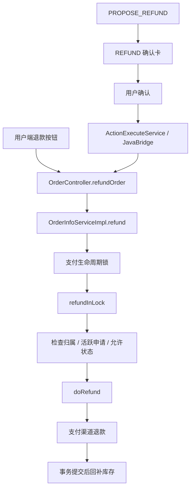
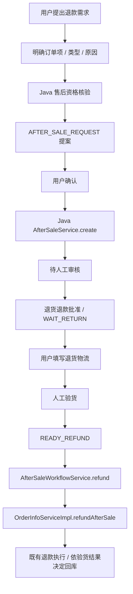

# T01 退款与售后入口安全修复开发记录

本记录用于项目复盘与面试准备，依据 T01 的实际修改及测试结果整理。代码路径均相对项目根目录。T01 完成的是入口安全修复，真实支付、真实退款、真实数据库并发联调仍待验证。

## 1. 原来存在什么问题

商城同时保留了快捷退款和完整售后两条路径。新售后需要申请、人工审核，退货退款还需要寄回和人工验货；旧接口却允许已发货订单直接进入退款执行。

这会产生两个业务后果。一是已发货商品没有经过退货验收就退款。二是旧路径默认允许回补库存，可能把用户仍持有的商品重新计入可售库存。

Agent 中的 PROPOSE_REFUND 原来生成 REFUND 确认卡，用户确认后调用旧接口，继承了同一风险。

## 2. 为什么会出现这个问题

新售后系统增加后，旧快捷退款入口的适用范围没有同步收紧。Controller 有登录校验，Service 有订单归属验证，但这些只能证明用户有权访问订单，不能证明订单当前允许直接退款。

原来的 refundInLock 允许 PAID、SHIPPED、PARTIALLY_REFUNDED，普通退款事件也允许从 SHIPPED 转移。PARTIALLY_REFUNDED 只描述资金处理结果，无法单独证明商品是否发出，因此还必须检查物流状态。

原路径使用 Controller 先前取得的订单项对象，并在加锁前后做普通查询。并发发货、申请或退款发生时，传入对象或 REPEATABLE READ 快照可能已经过时。业务决策需要锁内当前读。

## 3. 原来的代码执行流程



问题出现在 G 的业务范围过宽。用户已登录、订单属于本人、订单项正常，仍不足以允许已发货订单直接执行 R。

## 4. 修改后的代码执行流程

### 4.1 未发货快捷退款

旧 HTTP 接口保留，签名和返回规范保持兼容。

1. Controller 获取当前登录用户和订单项，调用 refund。
2. Service 先验证订单归属，再进入支付生命周期锁。
3. refundInLock 按订单、订单项的顺序获取数据库行锁。
4. selectForRefundByOrderId 使用 SELECT ... FOR UPDATE 读取订单和完整订单项，替换调用方传入的旧订单项数据。
5. activeForUpdate 检查是否存在处理中售后，有则引导用户继续现有申请。
6. selectRefundLogisticsStatus 当前读物流状态。仅订单状态为 PAID 或 PARTIALLY_REFUNDED，并且物流状态明确为待发货 0，才允许快捷退款。物流记录缺失、状态未知或与订单状态冲突均拒绝。
7. 验证订单项仍为正常状态，进入既有退款幂等、金额分摊、状态条件更新和渠道处理。

allowsQuickRefund 规则放在现有 AfterSaleWorkflowService 中，快捷退款与售后退款审核共同复用。普通退款事件不再接受 SHIPPED，已审核退款继续使用 AFTER_SALE_FULL_REFUND / AFTER_SALE_PARTIAL_REFUND。

### 4.2 已发货售后退款



流程复用现有系统。通过人工审核不等于可以跳过退货验货。不可再售商品退款后保持隔离，只有符合回库规则的商品才进入幂等回补。

### 4.3 Agent 的兼容处理

PROPOSE_REFUND 工具名保留，增加可选 type、reason 参数。缺少明确类型或原因时要求补充；信息完整后委托现有 after_sale_service.propose，生成 AFTER_SALE_REQUEST，而不是直接退款卡。

用户确认后，ActionExecuteService 只向 Java 创建售后申请，参数仅包含 requestId、orderItemId、type、reason。用户身份来自登录 token，金额由 Java 计算。

已有 REFUND 类型的历史确认卡被明确拒绝，要求重新生成售后申请卡。JavaBridge.refund_order 保留方法，但拒绝执行。历史确认内容没有售后类型和原因，不能把旧确认静默解释成对新申请的同意。

### 4.4 修改文件

Java 业务文件位于 Simlect-backend/Simlect-order/app/src/main/java/com/simlect。

| 文件 | 修改内容 |
|---|---|
| biz/impl/OrderInfoServiceImpl.java | 锁内重读、权威订单项、物流门禁和状态校验 |
| biz/AfterSaleWorkflowService.java | 统一未发货判定规则 |
| state/OrderStateMachine.java | 普通退款拒绝已发货，保留售后审核退款事件 |
| mappers/OrderInfoMapper.java | 新增退款当前读方法 |
| src/main/resources/com/simlect/mappers/OrderInfoMapper.xml | 锁定查询、订单项归属及已有 refund_amount 字段映射 |

上表最后一行路径相对 order/app，其余相对 Java 包根目录。补齐 refund_amount 映射使剩余退款金额计算能够读取此前已退款金额，没有新增数据库字段。

Python 文件位于 Simlect-backend/Simlect-agent/app。

| 文件 | 修改内容 |
|---|---|
| services/mcp_tools_service.py | PROPOSE_REFUND 委托现有售后提案 |
| services/mcp_tool_router.py | 透传售后类型和原因，保留服务端身份覆盖 |
| mcp/tools.py | 工具参数和说明同步 |
| mcp_server/server.py | MCP 服务端参数和说明同步 |
| services/action_execute_service.py | 阻止历史 REFUND 卡及旧桥接路径直接退款 |

Vue 和数据库结构没有变更。AfterSaleService 的创建、归属和幂等逻辑继续复用。

## 5. 涉及的设计模式和技术

| 模式或技术 | 项目中的作用 | 本阶段边界 |
|---|---|---|
| 状态机 | 显式限定普通退款和售后审核退款的可用状态转换 | 收紧原有转换规则 |
| 应用服务编排 | AfterSaleWorkflowService 组织审核、退货、验货与退款 | 复用现有流程 |
| 兼容适配 | 保留旧 HTTP 接口及 MCP 工具名，在内部收紧行为或委托新流程 | 不保留危险的旧退款语义 |
| 人工确认 Human-in-the-loop | Agent 生成提案，用户确认才提交申请，管理员决定退款履约 | 用户确认与人工审核是不同授权步骤 |
| Spring 本地事务与 MyBatis | 保持订单项、订单状态的本地更新原子性 | 不能原子提交外部支付系统 |
| MySQL 行锁与当前读 | 并发时重核最新订单、订单项和物流事实 | 真实锁竞争仍待数据库联调 |
| Redis 生命周期锁与幂等标记 | 协调同支付单操作，拦截重复退款 | 不单独承担全部一致性保证 |
| 条件更新与固定退款号 | 订单项状态 CAS、订单状态机及重试关联 | 复用现有实现 |
| 事务提交后处理与补偿 | 本地提交成功后幂等回补库存，失败留补偿记录 | 外部故障恢复不由本阶段完全解决 |

## 6. 如何保证数据一致性

**身份与业务事实分开验证。** 登录态证明请求是谁发起，订单归属证明是否有权操作，订单项归属和锁内状态决定当前是否允许执行。Agent 不提供可信金额或库存事实。

**统一关键锁顺序。** 退款与售后创建按订单、订单项的顺序加锁，降低交叉加锁风险。数据库锁由事务持有到提交或回滚，不能仅依赖 Redis 锁覆盖完整数据库提交窗口。

**在锁后做决定。** 使用独立的 FOR UPDATE 查询读取退款所需事实，不继续信任 Controller 的对象和此前的普通查询快照。

**多层幂等共同工作。** 活跃售后拦截用于避免业务流程冲突；退款标记防止重复进入；订单项条件更新和状态机阻止重复状态推进；退款标识用于关联渠道重试；库存回补使用稳定幂等操作号。创建售后申请仍复用固定 requestId 和载荷比对。

**库存与资金按规则处理。** 快捷退款限未发货，退货退款根据人工验货结果决定是否可再售。库存回补放在本地事务提交后，失败走原有补偿机制。

需要明确，本地事务不能回滚已成功的远程渠道退款。进程中断、退款结果未知、Redis 过期等跨系统恢复仍需要渠道查单、固定操作号和补偿机制。本阶段没有完成这些机制的全部故障验证，也没有借用 Seata 宣称外部支付强一致。

## 7. 如何测试异常场景

| 场景 | 测试设计 | 验收结果 |
|---|---|---|
| 已发货调用旧接口 | MockMvc 调真实 Controller 和退款 Service，支付与库存用 Mock | 返回业务错误，支付、库存及订单项更新均未调用 |
| 未发货快捷退款 | 待发货物流，正常订单项，覆盖 PAID 与 PARTIALLY_REFUNDED | 保留正常退款和幂等库存回补 |
| 已有处理中申请 | 返回活跃 requestId | 旧路径拒绝执行 |
| 已审核未寄回、未验货 | 分别停在 WAIT_RETURN、WAIT_INSPECTION 后执行退款 | 均拒绝，不调用退款业务 |
| 验货通过 | 分别设置可再售、不可再售 | 正常退款，回库行为与验货结果一致 |
| 重复申请 | 相同 requestId 重放、不同载荷复用、活跃申请 | 复用原有幂等和冲突拒绝测试 |
| Agent 重复确认 | Mock Redis 状态 CAS，HTTP 使用 MockTransport | 只提交一次认证后的售后申请 |
| 历史退款卡 | 提交 REFUND 动作 | 不调用旧 Java 退款接口 |
| 新旧入口并发 | 两线程及受控锁、Latch 模拟关键交错 | 售后申请先落定后旧退款拒绝；审核退款与旧退款竞争时只有审核路径执行 |
| 过时数据 | 加锁前待发货、锁后已发货，或传入项与持久化状态不一致 | 使用锁后状态，拒绝不安全退款 |
| 物流缺失或冲突 | 缺失记录、已运输、已送达、PAID 与物流矛盾 | 快捷退款失败关闭 |
| Mapper 契约 | 解析实际 XML，检查绑定 SQL 和结果映射 | FOR UPDATE 和 refund_amount 映射存在 |

并发测试是受控 Mock 交错验证，没有启动真实 MySQL 并发事务。Mapper 契约测试验证 SQL 与映射定义，没有执行数据库查询。

主要 Java 测试包括 OrderInfoServiceImplTest、OrderStateMachineTest、AfterSaleWorkflowServiceTest，以及新增 LegacyRefundSafetyControllerTest、RefundMapperContractTest。可选 AfterSaleWorkflowMySqlTest 补齐测试物流记录。原有售后创建、鉴权及幂等测试继续运行，未删除测试。

Python 新增 test_refund_application_safety.py，覆盖提案复用、缺少原因、历史卡、重复确认、登录身份和请求白名单字段，并运行原有确认测试及离线售后评测。

### 实际执行记录

在 Simlect-backend 目录执行以下命令。

```powershell
mvn -o -pl Simlect-order/app -am test
```

订单模块 432 项，其中 430 通过、2 跳过、0 失败，依赖 common 模块 229 项全部通过，BUILD SUCCESS。两个跳过项因 SIMLECT_AFTER_SALE_DB_TEST 未启用而没有执行真实 MySQL 测试。

在 Simlect-backend/Simlect-agent 目录使用项目虚拟环境、仅测试进程有效的虚构内部令牌执行以下命令。

```powershell
.\.venv\Scripts\python.exe -m pytest tests ../../evals/test_after_sale.py -q -p no:cacheprovider
```

结果为 198 passed。pytest 有异步 fixture loop scope 弃用提示。本轮没有使用真实支付渠道。

最后又定向复核了 AfterSaleWorkflowServiceTest、AfterSaleWorkflowMySqlTest、RefundMapperContractTest，共 29 通过、1 跳过、0 失败。该结果与前面的 Java 回归有重叠，不能相加统计。

Java 日志保存在 [完整相关回归](../../logs/t01-java-regression.log) 和 [最后定向复核](../../logs/t01-java-final-contract.log)。Python 数字来自 T01 当时实际工具执行结果，当前记录补写时没有重新运行测试。

## 8. 面试官可能如何提问

1. 用户订单属于本人，为什么退款仍然不安全？
2. 为什么部分退款状态不能直接判断未发货？
3. 为什么不直接删除旧退款接口？
4. 已有 Redis 分布式锁，为什么还需要数据库锁？
5. 为什么加锁以后还要重新查询？
6. 如何防止 AI 伪造退款金额、userId 或越过人工审核？
7. 用户确认卡片以后，是否应该立即退款？
8. 如何保证新旧入口并发时不重复退款或回补库存？
9. 支付成功、本地事务失败时怎么办？
10. 你如何证明改动有效，测试有哪些局限？

## 9. 自己应该如何回答

### 问题 1 与 2，权限和业务资格

“订单属于本人只解决访问权限。已发货退款还涉及商品是否寄回、是否验货、是否可再销售。部分退款状态表达资金处理结果，其他商品可能已经发出，所以我把订单状态和物流事实一起作为快捷退款门禁。缺失物流时选择拒绝快捷退款并引导售后。”

### 问题 3，兼容旧调用方

“我保留旧 HTTP 接口供明确未发货的快捷退款使用，在 Service 中统一做安全检查。已发货必须走现有售后流程。同时收紧状态机，避免其他普通退款调用误用已发货状态。这样兼容接口形式，同时修正危险的业务范围。”

### 问题 4 与 5，锁与快照

“Redis 生命周期锁负责协调同一支付单的并发操作，数据库行锁保护本地事实和更新，二者职责不同。在 MySQL REPEATABLE READ 下，普通查询可能沿用旧快照，因此我在数据库锁内使用 FOR UPDATE 当前读，再校验归属和状态。行锁由事务持有到完成，而不是假设 Redis 锁一定覆盖提交阶段。”

### 问题 6 与 7，Agent 的职责

“AI 负责理解、补充信息和生成提案。服务端注入当前用户身份，Java 复核业务事实。PROPOSE_REFUND 现在委托现有售后提案，用户确认后也只创建待审核申请。人工审核、退货、验货和退款执行仍由业务系统控制。历史直接退款卡片缺少新申请信息，我拒绝执行并要求重新确认。”

### 问题 8，并发和幂等

“我复用了支付生命周期锁，并让售后创建与退款遵循订单到订单项的锁顺序。锁后检查活跃申请及最新订单项，再依靠状态条件更新、退款标识和库存幂等号处理重复请求。测试覆盖了售后申请先落定和审核退款与旧退款竞争的交错，但目前是受控 Mock，还需要隔离数据库验证真实锁等待和事务提交。”

### 问题 9，外部支付与本地事务

“数据库事务不能撤销已成功的外部退款。我保留现有固定退款标识、退款结果核对及补偿路径，库存回补放在本地提交后执行。系统级的结果未知恢复和故障注入不应由 T01 的入口修复冒充完成，后续要通过渠道查单和持久化操作状态继续完善。”

### 问题 10，测试证据

“我对旧 HTTP 接口执行了实际 Controller 到 Service 的 MockMvc 测试，明确验证支付、库存、订单项都没有写调用。还测试了未验货拦截、正常验货退款、重复确认、并发交错和 Mapper 当前读。最终订单模块 430 项通过、2 项数据库测试跳过，Python 198 项通过。没有进行真实渠道联调，因此我只承诺代码和相关自动化回归结果。”

## 10. 简短项目介绍

“这个项目的一个安全问题是新售后上线后，旧退款入口仍然允许已发货订单直接退款。我保留了未发货快捷退款，在服务层通过支付生命周期锁、数据库当前读和物流门禁收紧执行范围，同时让 Agent 的退款动作统一生成售后申请。用户确认后进入人工审核，退货退款必须经过验货，再按可再售结果回补库存。我用接口测试和受控并发测试验证了旧路径不会提前改变支付、订单项和库存，并明确保留了真实数据库与渠道联调的验证边界。”
