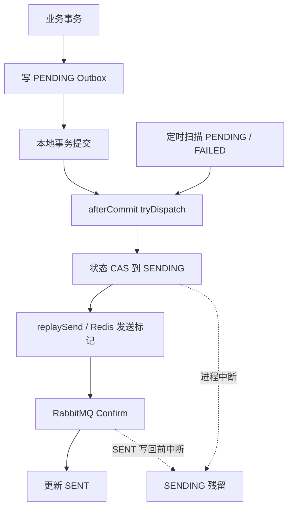
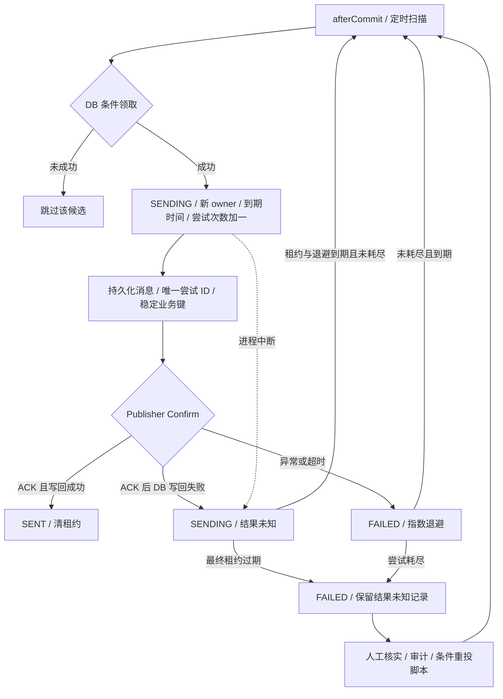

# T02 Outbox 消息可靠投递与故障恢复开发记录

本阶段复用现有本地消息表、事务提交后发送入口和 RabbitMQ Publisher Confirm，增加租约、有限退避重试、过期恢复及人工重投脚本。业务库迁移尚未执行，测试仅使用 Mock 或新建的独立容器。Python、Vue 和现有配置、密钥文件没有修改。

## 1. 原来存在什么问题

OutboxMessageServiceImpl.tryDispatch 将记录从 PENDING/FAILED 改为 SENDING 后才发送消息。如果进程在领取后、发送中，或 Broker 确认后但 SENT 保存前退出，消息会停留在 SENDING。原批量扫描只读取 PENDING/FAILED，这类消息没有自动恢复路径。

审查发送链时还发现 replaySend 依赖 Redis 发送幂等闸。闸未取得会直接返回，调用方无法区分实际 Confirm 成功和跳过发送。领取发送标记后发生崩溃，可能留下“消息没有发出但恢复重放被跳过”的窗口。

定时任务原来使用跨业务库共用的 Redis 锁。不同服务拥有各自的 Outbox 表，共享扫描锁并不能证明某条消息已被有效领取，还可能让一个服务的扫描挤占其他服务的扫描机会。

## 2. 为什么会出现这个问题

原状态机没有记录谁负责本次发送、责任期限到何时，以及旧发送者何时应失去写回资格。仅凭 status=SENDING 无法判断发送仍然活跃，还是进程已经退出。

原 updateStatus 只比较状态。当消息重新进入同一状态后，旧发送者可能误把新一轮发送的结果覆盖。因此恢复不仅需要扫描旧记录，还需要带领取标识的条件写回。

Publisher Confirm 证明 Broker 对本次发布的确认，Redis 标记表示曾取得发送资格，两者含义不同。Outbox 必须以实际 Confirm 结果推进 SENT。

## 3. 原来的代码执行流程



其中 R 存在直接返回的跳过分支，X 没有对应扫描恢复流程。

## 4. 修改后的代码执行流程

### 4.1 字段与状态约定

保留原状态值 PENDING=0、SENDING=1、SENT=2、FAILED=3，保留原 OutboxMessageService 接口签名。

| 字段 | 处理方式 | 用途 |
|---|---|---|
| lease_owner | 新增 varchar(96)，可空 | 实例标识与本次领取随机标识组合，每次领取生成新值 |
| lease_until | 新增 datetime(3)，可空 | 由数据库时钟计算租约截止时间 |
| next_attempt_time | 新增 datetime(3)，可空 | 下次允许尝试时间 |
| retry_count | 复用现有字段 | 每次成功领取加一，包含首次尝试与进程中断的尝试 |
| error_message | 复用 | 最近错误或最终结果未知说明 |

没有新增 version。唯一领取标识加状态及租约有效期条件，已经能够隔离前后两次领取的结果。retry_count 的统计口径由原失败累加改为已开始尝试数，避免每次都崩溃而永远不消耗重试预算。历史值保留，不批量清零。

### 4.2 原子领取与结果隔离

1. claimLease 使用一条数据库条件 UPDATE 领取。仅未耗尽预算、达到重试时间的 PENDING、FAILED 或过期 SENDING 可以成功。
2. 领取时生成唯一 owner，写入数据库时钟计算的 lease_until，并增加 retry_count。
3. 读取已领取内容，检查 owner 和有效期，进入发送。候选查询只是提示，领取成功以 UPDATE 影响行数为准。
4. sendOutboxWithConfirm 单次发送并等待 Confirm，绕过 Redis 发送闸。重试由数据库 Outbox 管理，不嵌套同步三次重试。
5. MessageId 和 x-idempotency-key 始终使用原业务幂等键；CorrelationData 与 x-publisher-attempt-id 使用本次领取标识。
6. completeLease 只允许 status=SENDING、owner 匹配且租约未过期的调用写结果。成功清租约并置 SENT；发送异常清租约、记 FAILED 和退避时间。
7. Confirm 已成功但 SENT 写回失败时，保留 SENDING，记录 OUTBOX_RESULT_UNKNOWN，等待过期恢复或预算耗尽后的人工核实。

Publisher Return 也按尝试标识关联，旧尝试的 Return/Confirm 不会误完成另一轮发送的 Future。其他既有发送接口保持原调用形式。

### 4.3 自动恢复



定时查询将预算、退避及过期条件放在 LIMIT 前，避免已耗尽记录长期占据批次，导致后续新消息得不到处理。到达最终尝试后仍残留的过期 SENDING，会转为保留原业务内容的 FAILED，明确要求人工核实。

指数退避使用数据库时钟。默认首次失败后等待 2 秒，后续为 4、8、16 秒，最大 300 秒。进程中断的领取也预先记录 lease_until 加退避间隔，恢复不会形成紧密循环。

### 4.4 调度与配置

移除 OutboxDispatchTask 的共享 Redis 扫描锁，使用每条消息的数据库租约协调各实例。扫描异常提升为可观测错误日志。

保留原有两个开关，只有满足条件的服务才自动扫描。本轮没有修改任何已有配置文件。部署时应对每个实际持有 Outbox 的服务核实这些开关及 Spring Scheduling 是否启用，不能只启动 admin 扫描就认为其他业务库也会恢复。

| 配置 | 默认值 | 含义 |
|---|---|---|
| mq.outbox.lease-seconds | 60 | 领取租约秒数，允许 1～3600 |
| mq.outbox.dispatch-max-retries | 10 | 沿用旧配置名，当前含义为最大尝试次数，含首次和中断尝试 |
| mq.outbox.backoff-base-seconds | 2 | 退避起始秒数 |
| mq.outbox.backoff-max-seconds | 300 | 退避上限秒数 |
| mq.outbox.dispatch-batch-size | 30 | 每批扫描条数，服务内部最多 1000 |
| mq.outbox.dispatch-interval-ms | 5000 | 扫描间隔 |
| mq.outbox.dispatch-enabled | 沿用原配置 | 必须显式 true 才创建任务 |
| app.common-scheduling.enabled | 沿用原配置 | 必须显式 true 才创建任务 |

应结合实际连接、Confirm 和数据库响应时延设置租约。即使发送超过租约，过期发送者也不能写回数据库结果，但 Broker 仍可能收到它的消息，因此消费端必须幂等。

可供日志告警系统订阅的事件为 OUTBOX_RETRIES_EXHAUSTED、OUTBOX_RESULT_UNKNOWN、OUTBOX_SCAN_FAILED。本轮实现的是结构化可检索的错误事件，没有配置或声称已接通外部通知平台。

### 4.5 数据库迁移与人工处理

新增 [26_outbox_lease.sql](../../sql/26_outbox_lease.sql)。对已有表增加三个字段及两个扫描索引，按 information_schema 判断字段及索引是否存在，支持重复执行。旧 SENDING 没有租约时，按 update_time/create_time 加租约时长判断是否可恢复。

迁移需要在实际拥有 local_message_outbox 的数据库分别执行，包括 order、admin、user、product、search、coupon。先完成原初始化脚本，再执行本迁移。没有 Outbox 的数据库会明确报错，避免在错误库中静默操作。

升级应停止或排空所有旧投递实例，完成各库迁移后再统一启用新版本。旧二进制里的 SQL 没有租约条件，不支持和新版本并行投递。MySQL DDL 隐式提交，按正常迁移窗口备份并执行。当前业务库尚未迁移。

新增 [27_outbox_manual_retry.sql](../../sql/27_outbox_manual_retry.sql)。默认目标 ID 为 NULL，直接执行不会重投消息。运维人员先选择业务库、核实 Broker 和业务结果、记录操作原因，再选择耗尽预算且没有租约的 FAILED 记录恢复为 PENDING。脚本保留幂等键、消息体、交换机、路由及最近错误，不碰 SENT 或有效租约。未耗尽的失败由自动退避负责。

人工核实可先查询当前库的 status=3 且 retry_count 达到配置上限的记录，再按 ID 使用脚本。脚本没有绕过数据库访问权限，操作人及原因需要进入运维审计记录。

### 4.6 修改范围

Java 主代码在 Simlect-common。

- entity/po/LocalMessageOutbox.java 增加租约字段映射。
- mappers/LocalMessageOutboxMapper.java 与对应 XML 增加领取、有效租约检查、受保护结果写回、就绪扫描及最终过期处理。
- service/impl/OutboxMessageServiceImpl.java 实现租约投递、异常结果处理及预算控制。
- task/OutboxDispatchTask.java 使用数据库行租约协调扫描。
- constants/ReliableMessageSender.java 增加 Outbox 专用单次 Confirm 发送。
- component/MqPublisherConfirmHelper.java 支持按尝试标识关联 Return，隔离旧回调。
- constants/TransactionalMqSender.java 更新投递说明，保留业务事务与 afterCommit 协议。

保留旧 Mapper 方法签名，但 updateStatus 不再允许绕过租约直接进入或完成 SENDING。当前 Outbox 服务已全部使用新方法，旧一般发送和补偿发送路径没有改成 Outbox。

## 5. 涉及哪些设计模式和技术

| 技术或模式 | 使用位置 |
|---|---|
| Transactional Outbox | 业务数据与 PENDING 同事务，提交后发送，定时补投 |
| 租约与领取标识隔离 | owner 与有效期条件防止过期发送者覆盖新发送者 |
| 数据库条件更新 CAS | 一条 UPDATE 判断状态、预算、到期时间并领取 |
| 状态机 | 保留四状态，区分发送中、成功、失败和结果未知的恢复语义 |
| 指数退避与有界重试 | 故障时降低重复压力，耗尽后保留失败记录 |
| Publisher Confirm / Return | 等待 Broker 确认，并拒绝不可路由消息的假成功 |
| 业务幂等键与尝试标识分离 | 同一业务事件稳定标识，各次网络尝试使用独立关联标识 |
| 至少一次投递 | 无法确定上次结果时允许重投，依赖消费端完成业务幂等 |

## 6. 如何保证数据一致性

数据库决定有效租约，实例时钟不参与领取及结果判定。候选查询可以同时命中同一记录，只有成功执行条件 UPDATE 的实例才能获得有效领取。

领取后网络发送不包在长数据库事务中。tryDispatch 与 dispatchPendingBatch 使用 NOT_SUPPORTED，使业务事务提交回调不会让租约更新滞留在原事务中。业务 Outbox 插入仍与业务事务一起提交。

发送与数据库 SENT 更新不是原子事务。消息到达 Broker 但本地状态未知时，系统保留记录并恢复重发，稳定业务键让下游识别重复。租约隔离的是数据库结果，不会撤回已进入网络的旧消息。

本阶段没有新增生产 Inbox。现有消费者正常重复投递时的去重行为已测试，但其“写 Redis 消费标记后、业务提交前崩溃”窗口仍需要 T03 完善，不能据此承诺所有故障下的业务恰好一次。发布端记录不静默删除，重试耗尽后可人工核实；人工重投前同样需要确认消费端幂等和业务结果。

## 7. 如何测试异常场景

### 7.1 单元及 Mapper 契约测试

新增 OutboxMessageServiceImplTest、OutboxMapperContractTest、OutboxPublisherTest、TransactionalMqSenderTest，扩展原有 Confirm 和调度任务测试。

| 场景 | 验证方式与断言 |
|---|---|
| 领取后、读取消息前退出 | 用 Error 切断控制流，确认 SENDING 保留，过期后可恢复 |
| 发送过程中退出 | 同上，下一次领取使用不同 owner |
| Confirm 后、SENT 写回前退出 | 恢复后再次发送同一业务键，不同尝试关联标识 |
| SENT 写回数据库异常 | 记录保持 SENDING，日志标明结果未知 |
| 两实例同时发送 | 可控内存模型模拟原子 UPDATE，只有一次有效领取 |
| 旧租约迟到成功/失败 | 新 owner 领取后，旧结果更新影响行数为零 |
| Broker 异常及超时 | 原 Confirm 超时测试保留，发送失败进入 FAILED 与退避 |
| 重试次数耗尽 | 最终过期租约保留 FAILED 及人工核实原因，不继续自动领取 |
| 退避上限与错误配置 | 退避受 cap 限制，非法配置启动失败 |
| 业务重复投递 | 稳定业务键与现有消费者正常去重闸配合，模拟业务处理计数为一 |
| 事务入口兼容 | 事务内先保存记录，提交后调度；无事务保持原直发路径 |
| SQL 条件与映射 | 解析实际 XML，验证 owner、有效期、预算过滤在 LIMIT 前及旧更新方法限制 |

可控内存模型验证服务控制流，不能代替真实数据库原子性测试。

### 7.2 真实隔离环境测试

本机已有 mysql:8.3 和 rabbitmq:3.13-management 镜像。OutboxLeaseIT 创建全新的 MySQL/RabbitMQ 容器，只使用容器返回的地址和独立 outbox_test 库，不读取应用的数据库或 Broker 配置。

实际执行 6 项测试并通过。

1. 重复执行真实迁移过程，验证旧空租约 SENDING 可恢复。
2. 四个独立 MySQL 调用竞争同一记录，仅一个领取成功；过期重新领取后，旧成功和失败写回均被拒绝。
3. 消息经真实 Broker Confirm 后，用异常中断 SENT 写回，再将隔离库租约调整到过期并恢复，真实队列收到两个稳定业务键相同、尝试标识不同的消息。
4. 真实不可路由消息收到 Return，记录 FAILED，立即再次触发不会绕过退避。
5. 最终过期记录保留失败状态，人工脚本能恢复选中的耗尽记录，不能覆盖有效租约。
6. 停止本测试创建的 RabbitMQ 容器，确认投递失败可见并保留错误。

这里的“进程中断”使用 Error 模拟控制流退出，租约到期使用测试库时间字段调整；没有进行操作系统级 kill JVM。Broker 停止是真实停止隔离测试容器。测试完成后已按两个精确容器 ID 确认临时容器清理。

### 7.3 命令与结果

在 Simlect-backend 目录执行。

```powershell
# 定向 Mock / SQL 契约首轮
mvn -o -pl Simlect-common test '-Dtest=OutboxMessageServiceImplTest,OutboxMapperContractTest,OutboxPublisherTest,MqPublisherConfirmHelperTest,OutboxDispatchTaskTest'

# 隔离集成测试，环境变量仅作用于测试命令进程
$env:SIMLECT_OUTBOX_IT='true'
$env:TESTCONTAINERS_RYUK_DISABLED='true'
$env:TESTCONTAINERS_CHECKS_DISABLE='true'
mvn -o -pl Simlect-common test '-Dtest=OutboxLeaseIT'

# 在新的命令进程中，执行全项目回归及打包
mvn -o package
```

首轮定向测试 34 项通过。独立容器集成测试 6 项通过、0 失败、0 跳过。首次编译新增集成测试时的泛型断言歧义已修复，最终集成测试实际执行成功。

为避免自动下载测试辅助镜像，本次关闭 Ryuk 和启动检查，依靠测试容器生命周期清理，并额外检查容器 ID。不能据此省略以后环境的清理责任。

全项目离线回归和打包最终 BUILD SUCCESS，26 个 Reactor 模块成功，耗时 05:26。按本次日志各模块汇总，1508 项中 1506 通过、2 跳过、0 失败；其中 common 为 253 项全部通过，订单模块为 430 通过、2 跳过，T01 相关回归保持通过。跳过的是未启用 SIMLECT_AFTER_SALE_DB_TEST 的既有 MySQL 售后测试，不是本次已实际执行的 6 项 Outbox 隔离集成测试。

定向 34 项与全量测试重叠，不能相加。OutboxLeaseIT 的 6 项通过来自单独显式启用的容器测试命令，全量 package 默认不执行 IT。

日志为 [定向单元测试](../../logs/t02-unit.log)、[隔离集成测试](../../logs/t02-isolated-integration.log)、[全量回归与打包](../../logs/t02-full-regression.log)。

## 8. 面试官可能如何提问

1. 为什么不能定时把所有 SENDING 直接重置为 PENDING？
2. 先查询再更新，多个实例会不会同时拿到消息？
3. 租约过期后旧线程继续运行怎么办？
4. 既然有 Confirm，为什么还会重复投递？
5. 为什么不直接使用 Redis 的发送幂等标记？
6. 重试次数为什么在领取时递增？
7. 有限重试后消息还没发出去，算不算丢失？
8. 业务键和 Confirm 关联 ID 为什么要分开？
9. 能不能承诺所有情况下业务只执行一次？
10. 你做了哪些真实测试，哪些仍是模拟？

## 9. 自己应该如何回答

### 问题 1 与 2，原子领取

“活跃的 SENDING 可能还在发送，直接重置会造成并发抢占。我增加数据库时钟计算的租约，用单条条件 UPDATE 判断状态、租约、退避和预算，并写入新的领取标识。查询只是候选，UPDATE 的影响行数才证明取得资格。”

### 问题 3，旧发送者隔离

“每次领取都有新的随机标识。结果更新必须同时匹配消息 ID、SENDING、owner 和未过期租约。旧线程不能覆盖新结果。不过数据库不能阻止旧网络请求已经到达 Broker，所以仍允许重复消息，并要求消费端幂等。”

### 问题 4 与 5，Confirm 和 Redis 标记

“Confirm 成功与数据库记录 SENT 是两次独立操作，中间崩溃会造成结果未知。恢复时需要再次实际发送并 Confirm，不能把 Redis 的已领取标记当成已投递。Outbox 有自己的专用发送入口，数据库控制重试；原普通发送入口仍保留。”

### 问题 6 与 7，重试与人工接管

“如果只在 catch 中加失败次数，进程每次崩溃都不会累加，可能永远循环。我在成功领取时增加尝试次数。失败使用有上限的指数退避；最终租约过期后保留失败和结果未知说明，发出错误事件，由运维核实后条件重投。记录和消息内容保留，不会静默删除；恢复也依赖可用扫描器和人工处理闭环。”

### 问题 8，标识分离

“消费者需要稳定业务键识别重复，Publisher Confirm 却要区分不同发送尝试。如果两者用同一个标识，旧的 Return 或 ACK 可能误关联新尝试。因此业务键固定，每次领取生成独立 Confirm 关联 ID，Return 也携带对应尝试标识。”

### 问题 9，一致性保证的边界

“发布端提供可恢复的至少一次投递，不能单独承诺业务恰好一次。我验证了现有消费者正常重复消息会被去重，但消费标记与业务事务之间的崩溃窗口仍需要 Inbox。那是 T03 的工作，本阶段没有把它包装成已经解决。”

### 问题 10，测试证据

“单元测试用可控时钟和原子模型模拟崩溃、迟到结果、重试及退避。另用全新的 MySQL 8.3 和 RabbitMQ 3.13 容器执行了 6 项集成测试，实际验证了 SQL 领取竞争、Confirm 后重投、Return 和 Broker 停止。进程退出是异常模拟，没有 kill JVM，也没有对已有业务环境注入故障。”

## 10. 后续边界

- 部署前需对各实际 Outbox 所属库执行迁移，统一更新旧投递实例，并确认每个写入服务的调度开关。当前业务库和运行中的服务未升级。
- 消费者事务级 Inbox、业务提交前崩溃后的重投一致性保留给 T03。
- 告警事件需要运维日志系统订阅，本轮没有发送外部通知。
- 现有普通 MQ 补偿路径继续使用原 replaySend，本阶段只将 Outbox 与 Redis 发送闸解耦。
