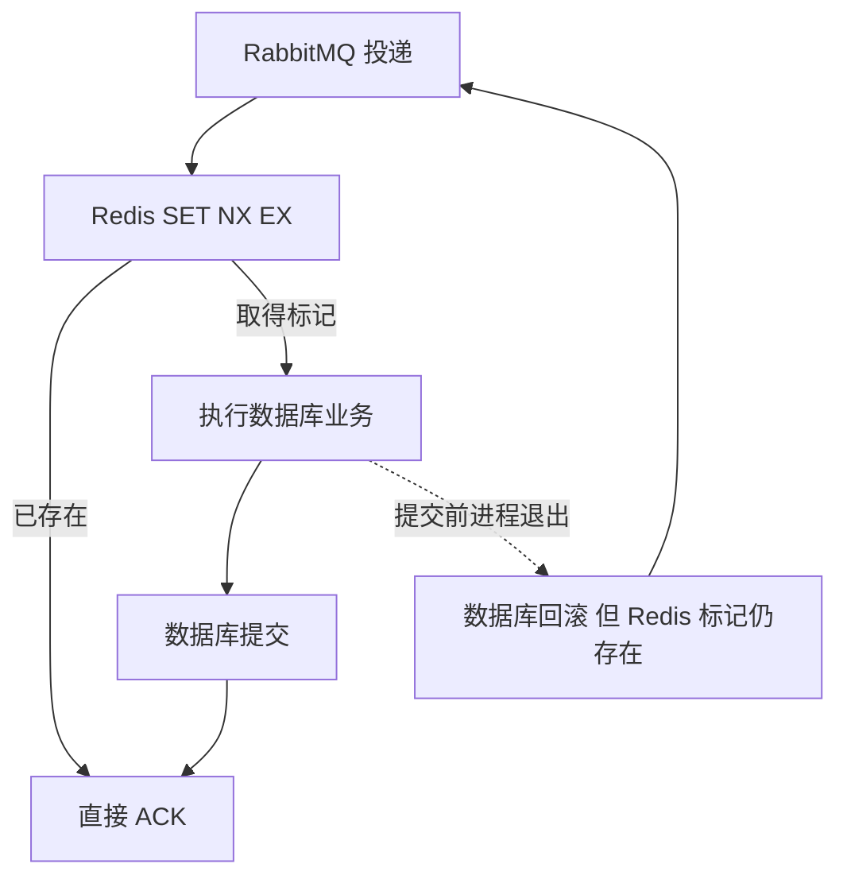
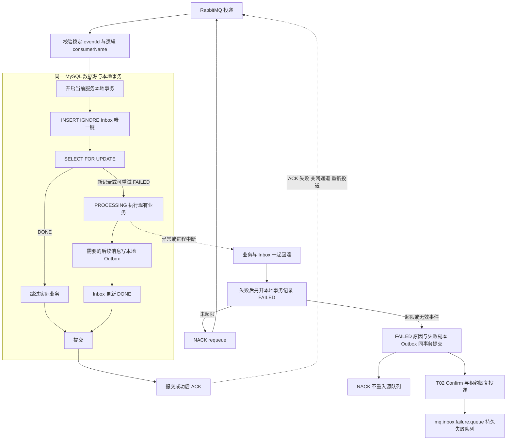

# T03 MQ 消费端 Inbox 幂等与事务一致性开发记录

本阶段将原 Redis 消费前置标记替换为本地数据库 Inbox。只修改 T03 消费链，复用 T02 Outbox；没有修改 Python、Vue、现有配置和密钥，没有执行业务数据库迁移，也没有调用真实支付渠道。

## 1. 原来存在什么问题

`MqConsumerIdempotencyHelper.tryBeginConsume` 在业务之前通过 Redis SET NX EX 设置标记。进程在数据库提交前退出时，数据库业务回滚，但 Redis 标记保留。重新投递遇到标记便直接 ACK，可能丢失订单关单、通知或物流更新。

另外，物流处理原先通过提交后回调直接发下一步消息，存在本地业务已提交、后续消息未发出的窗口。部分源队列没有配置终态 DLX，直接 NACK(false) 无法保证保留失败消息。

## 2. 为什么会出现这个问题

Redis 标记只能表示一次领取发生过，无法证明业务事务提交。Redis、MySQL、RabbitMQ ACK 是三个独立提交点，前置标记和业务没有原子性。ACK 也不能与 MySQL 本地事务共同原子提交，因此必须容忍提交后未 ACK 的重新投递。

原消费辅助类还将成功、处理中和重复消费压缩为 boolean，缺少持久化状态、失败次数与失败原因。

## 3. 原来的代码执行流程



## 4. 修改后的代码执行流程

### 本地事务与 ACK



- 唯一键为 `(consumer_name,event_id)`；相同事件可由不同逻辑消费者分别消费。
- `x-idempotency-key` 优先，其次 MessageId；缺失或超过 256 字符时不执行业务，生成隔离标识保存失败副本，不能把随机新 ID 当原事件重试。
- `executeBatch` 使用 `TransactionTemplate(REQUIRES_NEW)` 建立明确根事务。监听器没有外层事务；原业务默认 REQUIRED 加入同一数据源事务。不是通过同类方法上的注解自调用来获取事务。
- 新 PROCESSING 记录没有单独提交，正常进程中断会与业务一起回滚。重复消费在唯一键/行锁处等待；观察到 DONE 才跳过。异常的已提交 PROCESSING 只重入队列，不伪造完成，也不直接清除。
- `executeBatch` 返回表示本地事务已经提交。ACK 失败关闭通道促使重新投递，DONE 保留，不能将 ACK 错误记成业务失败或降级 DONE。
- 业务失败回滚后，`recordFailure` 在独立本地事务保存 FAILED 与计数。默认允许 3 次重试，第四次失败终止重试；无效事件立即隔离。数据库不可用时重入队列，不消耗一个虚构的完成标记。
- 超限时，FAILED 的 `dlq_enqueued=1` 表示失败副本已经写入本地 Outbox，并不代表 Broker 已收到。T02 Confirm 成功后才能认为失败副本发出。Outbox 写失败会回滚失败交接，源消息仍重入队列。
- 批量通知先按 eventId 去重和排序取锁，只插入本次新领取的通知；同一批失败中重复 ID 只计一次失败。所有通知行和各自 DONE 一起提交，提交后才进行既有弹窗/WS 推送。

### 实际业务调用链

| 服务/入口 | 事务内保留的业务调用 | 本轮调整 |
|---|---|---|
| order / handlePayTimeoutOrder | cancelUnpaidOrderForPayTimeout → cancelOrder，保留支付生命周期锁、订单状态校验、库存/优惠券补偿 | 本地订单修改和 DONE 同事务；关单未成功必须重试 |
| order / handleConfirmOrder | processOrderConfirm → confirmOrderReceipt → onOrderConfirmed | 提交后 ACK；这里是自动确认收货，支付回调 HTTP 流程没有改名或改写 |
| order / handleLogisticsOrder | processOrderLogistics → 状态机、物流主记录与轨迹 | 后续物流/自动收货消息改为当前事务写 Outbox；前置轨迹缺失报错重试 |
| coupon / SignStreakCouponListenerComponent.handle | CouponInternalService.grantSignStreakCoupon | 保留奖励唯一键、库存及发券校验，加入 Inbox 事务 |
| coupon / handleDeadOrder | 保留预占释放、Redis 库存补偿、远程关单 | 去除监听器外层事务，由 Inbox 建立本地根事务 |
| user / handleBrowseRecord | 原浏览记录服务 | 浏览数据库写入与 DONE 同事务 |
| user / handleNotify → flushBatch | 原 batchInsert | 保留 100 条/2 秒批量刷新，Inbox 批量去重与提交后推送 |
| search / handleRagData | 原商品/FAQ ES 写入 | 替换 Redis 完成依据；ES 仍为外部系统，保留既有文档 ID 幂等 |

遗留抢购通知入口只做兼容查询和丢弃、临时解封及旧死信处理器不使用原 tryBeginConsume，保留其原有行为。本轮迁移了所有原先使用 Redis 消费完成判断的生产调用点，不能据此宣称整个项目所有外部副作用都获得 exactly-once。

## 5. 涉及哪些设计模式和技术

- Transactional Inbox：唯一键定义逻辑消费身份，数据库完成记录代替缓存领取标记。
- 模板方法/回调：公共 helper 负责事务、去重和 ACK/NACK，具体监听器提供原业务回调。
- 悲观并发控制：MySQL InnoDB 唯一约束与 SELECT FOR UPDATE；批量按 ID 排序取锁，发生死锁/数据库异常时回滚重试。
- Transactional Outbox：本地业务和下一步消息意图共同提交；失败记录和失败副本也共同提交。
- 至少一次投递与业务幂等：容忍 ACK 丢失及 Outbox 重发，依靠稳定事件 ID 与业务状态机避免重复本地写入。
- MyBatis XML Mapper；未引入 MyBatis-Plus，也没有大规模改造现有服务。

## 6. 如何保证数据一致性

本地成功不变量：`业务数据库修改 + Inbox DONE + 本次新增 Outbox` 同一事务提交或回滚。失败审计只能在业务回滚之后另开事务；失败处理若发现并发消费者已经完成，返回 DONE，不能覆盖成 FAILED。

同一事件的两个实例通过唯一键/行锁互斥。PROCESSING 从未作为业务成功依据。Redis 不参与 Inbox 完成判断；Redis 辅助业务失败引发异常时，本地业务和 Inbox 回滚。

跨服务边界必须保留：关单调用支付、商品库存、优惠券等远程接口，确认收货会调用商品销量、用户成长值；本地事务无法回滚这些服务已提交的结果，依赖原状态幂等、稳定操作键和补偿。商品销量/成长值等远端接口是否具备完整事件级幂等仍需单独核查，不能把本轮说成跨服务强一致。

ES 更新也不在 MySQL 事务内；重复写依赖原稳定文档 ID，索引版本乱序问题没有在本阶段扩展解决。通知 WS/Redis 弹窗是提交后尽力发送，数据库通知不会因推送失败回滚，但推送本身没有新增可靠投递保障。

### 数据库迁移和部署

新增脚本 `sql/28_mq_consumer_inbox.sql`，创建 Inbox 表：eventId、consumerName、eventType、PROCESSING/DONE/FAILED、createdTime、completedTime，以及 failureCount、errorMessage、dlqEnqueued。脚本可重复执行，真实 MySQL 隔离测试已验证重复建表。

1. 停止并排空旧消费者，再分别在 order、coupon、user、search 对应本地数据库执行迁移。先具备现有 Outbox 表与 T02 租约迁移。
2. 部署新消费者和共享失败队列声明。不要将历史 Redis 标记导入为 DONE，不能新旧协议同时消费同一源队列。
3. 各服务应按 T02 约定启用本地 Outbox 定时恢复（`mq.outbox.dispatch-enabled`、`app.common-scheduling.enabled`）；本轮未更改现有开关。Broker 故障时失败副本留在 Outbox，恢复依赖该扫描。
4. DONE 记录不能按原 Redis TTL 随意删除，否则旧消息重放可能重新执行。归档策略必须覆盖业务允许的完整重放窗口。
5. 监控 FAILED、失败 Outbox、失败队列积压及 MQ_INBOX_UNAVAILABLE/MQ_INBOX_DEAD_LETTER 日志。异常的已提交 PROCESSING 要人工核对，不自动视为成功。
6. 失败队列保留原始 bodyBase64、eventId、consumerName 和原因，由人工核查。没有新增自动业务重放消费者或管理 UI。重放必须保留原事件身份，先核对跨服务结果；不得重置 DONE，也不得借用旧补偿链生成新 key 绕过 Inbox。终态 FAILED 的重开需要受控恢复操作与审计。

上述迁移只在临时测试容器中执行，尚未应用到用户现有业务库。

## 7. 如何测试异常场景

### 测试分层

| 层次 | 测试类 | 验证内容 |
|---|---|---|
| 公共事务模型 | InboxTransactionTest（13） | 事务内中断回滚、批量回滚、同消费者去重、跨消费者独立、FAILED 重试、PROCESSING 不完成、失败交接原子性 |
| Mapper 契约 | InboxMapperContractTest（4） | 真实 XML 的锁与状态更新条件 |
| ACK/NACK 单元 | MqListenerHelperTest（12） | 提交后 ACK、DB 不可用不丢弃、超限持久交接、ACK 错误关闭通道、批量重复失败只计一次 |
| 旧 API 防回归 | MqConsumerIdempotencyHelperTest（10）、OutboxPublisherTest（2） | key 解析；旧 boolean API 明确拒绝继续把 Redis 标记视为 DONE；稳定消息标识保留 |
| 订单/优惠券监听器 | 原监听器测试（19+6+4） | 关单、物流、收货、券释放和发券原分支保留；通过 Inbox 回调执行 |
| 批量通知接线 | RabbitMQNotifyInboxTest（3） | 缓冲期间不 ACK、新领取索引过滤、写入失败不推送、推送等待提交 |
| 隔离集成 | InboxConsistencyIT（10） | 真实 MySQL 事务、唯一键和真实 RabbitMQ 重投/失败队列 |
| T02 兼容 | OutboxLeaseIT（6） | 租约、Confirm、并发与恢复行为回归 |

### 用户要求的八项故障映射

1. 消费前中断：实际领取 Broker 消息后关闭 Channel，重新投递成功，没有提前生成 DONE。
2. 数据库事务中断：业务 UPDATE 后抛出 Error，真实 MySQL 回滚业务计数与 Inbox；再关闭 Channel，重投可完成。
3. 提交后 ACK 前中断：注入 basicAck IOException 并实际关闭 Channel；Broker 重投时查询 DONE，业务计数仍为 1。
4. 同一消息重复消费：真实 Broker 发布两条相同 MessageId，业务只执行一次。
5. 并发消费者：两个线程和 Channel 同时处理同 ID，由真实 MySQL 唯一键/行锁保护，计数为 1。
6. Redis 不可用：Inbox 不依赖 Redis；另注入 RedisConnectionFailureException 验证业务回滚和重投。没有停止真实 Redis 实例。
7. Inbox 已存在：覆盖 DONE、FAILED 和异常已提交 PROCESSING，PROCESSING 重入队列不 ACK。
8. 超过重试限制：连续四次业务异常，真实 MySQL 保留 FAILED/原因，Outbox 投递成功，真实失败队列收到副本，原业务计数为 0。

中断测试通过 Error、ACK 异常和真实通道关闭模拟故障窗口；没有声称完成操作系统 kill -9、断电或生产集群故障注入。集成业务使用独立计数表验证原子性，不等于所有微服务真实端到端联调。

### 实际执行结果

执行目录：`Simlect-backend`，均为 Maven 离线模式。

```powershell
# 全项目回归与打包
mvn -o package

# 最终定向回归（含全量打包后新增的 3 项批量通知测试）
mvn -o -pl Simlect-common,Simlect-user/app,Simlect-order/app,Simlect-coupon/app -am test '-Dtest=InboxTransactionTest,InboxMapperContractTest,MqListenerHelperTest,MqConsumerIdempotencyHelperTest,OutboxPublisherTest,RabbitMQNotifyInboxTest,RabbitMQPayOrderDeadListenerComponentTest,RabbitMQOrderDeadListListenerComponentTest,SignStreakCouponListenerComponentTest' '-Dsurefire.failIfNoSpecifiedTests=false'

# 独立临时 MySQL + RabbitMQ 集成测试
$env:SIMLECT_INBOX_IT='true'
$env:SIMLECT_OUTBOX_IT='true'
$env:TESTCONTAINERS_RYUK_DISABLED='true'
$env:TESTCONTAINERS_CHECKS_DISABLE='true'
mvn -o -pl Simlect-common test '-Dtest=InboxConsistencyIT,OutboxLeaseIT'
```

| 运行 | 总数 | 通过 | 失败/错误 | 跳过 | 结果/证据 |
|---|---:|---:|---:|---:|---|
| 全项目 package | 1527 | 1525 | 0/0 | 2 | BUILD SUCCESS；logs/t03-full-regression.log |
| 最终定向 | 73 | 73 | 0/0 | 0 | BUILD SUCCESS；logs/t03-final-targeted.log |
| 隔离集成 | 16 | 16 | 0/0 | 0 | Inbox 10 + Outbox 6；logs/t03-isolated-integration.log |

三轮结果不相加，定向回归和全量有重叠。全量之后只进行了订单监听器缩进、无用 import 清理和 3 项通知测试新增，最终定向已重新编译验证相关模块。全量跳过的是既有 `AfterSaleMapperMySqlTest`、`AfterSaleWorkflowMySqlTest`，未配置其业务库环境，本轮未冒充执行。默认 Surefire 不选择 *IT，所以独立集成单列实际命令与结果。

早期运行中发现测试类 Container 导入歧义，以及优惠券测试 @Mock 误落到 boolean 字段；均已修正，最终上述三轮无失败。没有删除旧业务测试规避失败。

隔离测试使用本机已有 mysql:8.3、rabbitmq:3.13-management 镜像，新建专用数据库和计数表，连接地址只取临时容器映射端口；未读取业务数据库连接配置。共创建四个临时容器，JUnit 生命周期结束后已自动清理，并通过按完整容器 ID 筛选 docker ps -a 的空结果验证。环境变量只影响单次测试进程，未写入项目配置。


## 8. 面试官可能如何提问

1. Redis SET NX 做消费幂等为什么会丢消息？
2. Inbox 的 PROCESSING 要不要也加租约？
3. 为什么先提交数据库再 ACK，而不是反过来？
4. MySQL 提交和 ACK 没有分布式事务，如何避免重复执行？
5. Inbox 是否解决了调用库存/优惠券等微服务的原子性？
6. 超限后直接 NACK(false) 有什么问题？
7. 批量通知如何保证一个重复消息不导致重复通知？
8. 线上应该如何回放失败消息？

## 9. 自己应该如何回答

1. 旧 Redis key 在业务前写入，业务尚未提交就崩溃时 key 仍在。重投看到 key 会误 ACK。新完成依据是和业务一起提交的 Inbox DONE。
2. 本实现 PROCESSING 不单独提交，进程中断由数据库事务回滚释放行锁，不需要像 Outbox 的跨网络租约一样恢复常规 PROCESSING。若发现异常已提交 PROCESSING，要核实数据，不能自动 ACK。
3. 先 ACK 后提交会丢消息。先提交再 ACK 最多产生重新投递，重新投递用 DONE 去重，因此选择后者。
4. 稳定 eventId 加 consumerName 唯一键、同事务业务写入与 DONE、并发锁定，组成数据库侧幂等；不承诺 RabbitMQ 从不重复投递。
5. 不能。本地事务覆盖本服务数据源。远程调用必须保留自身幂等和补偿，必要时后续专门设计事件驱动履约。本阶段没有把跨服务调用伪装成强一致。
6. 某些队列没有终态死信路由，NACK(false) 会直接丢弃。因此先在事务内保存失败原因和 Outbox 副本，再终止源队列重试，最终通过 Confirm 投递到独立持久失败队列。
7. 批量先按事件 ID 去重，锁定已有记录，只有新领取索引进入 batchInsert；通知行和对应 DONE 一起提交，重复消息只 ACK，提交前不推送。
8. 先查 Inbox、原业务和远程副作用，再决定是否修复 FAILED。保留原事件身份和审计，不能随便生成新 ID 绕过 DONE；已完成事件不要重置。失败副本持久保留，后台恢复 UI 属于后续明确任务。

## 10. 修改文件清单与边界

生产 Java：

- `Simlect-backend/Simlect-common/src/main/java/com/simlect/component/MqConsumerIdempotencyHelper.java`
- `Simlect-backend/Simlect-common/src/main/java/com/simlect/component/MqListenerHelper.java`
- `Simlect-backend/Simlect-common/src/main/java/com/simlect/mappers/MqInboxMapper.java`（新增）
- `Simlect-backend/Simlect-common/src/main/java/com/simlect/constants/RabbitMQConfig.java`
- `Simlect-backend/Simlect-order/app/src/main/java/com/simlect/component/RabbitMQPayOrderDeadListenerComponent.java`
- `Simlect-backend/Simlect-coupon/app/src/main/java/com/simlect/component/SignStreakCouponListenerComponent.java`
- `Simlect-backend/Simlect-coupon/app/src/main/java/com/simlect/component/RabbitMQOrderDeadListListenerComponent.java`
- `Simlect-backend/Simlect-user/app/src/main/java/com/simlect/component/RabbitMQBrowseListenerComponent.java`
- `Simlect-backend/Simlect-user/app/src/main/java/com/simlect/component/RabbitMQNotifyListenerComponent.java`
- `Simlect-backend/Simlect-search/src/main/java/com/simlect/component/RabbitMQRagListenerComponent.java`

资源：新增 `Simlect-backend/Simlect-common/src/main/resources/com/simlect/mappers/MqInboxMapper.xml`；新增迁移 `sql/28_mq_consumer_inbox.sql`。测试源码见第 7 节对应类（common、order、coupon、user）。开发记录索引 `docs/improvement/README.md` 同步更新。

业务代码已完成 T03 实现。现有业务库迁移、服务部署与跨服务真实故障联调尚未执行。当前工作目录未发现可用 Git 仓库，无法给出可靠 git diff/提交状态，未创建提交。下一阶段可以在用户指定后开始，本轮没有修改 T04。
