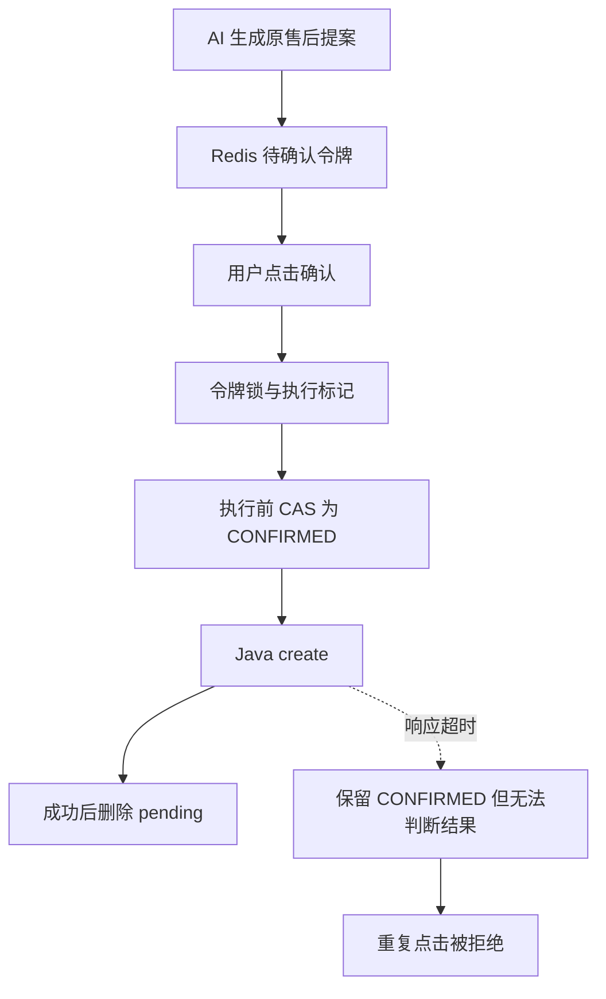
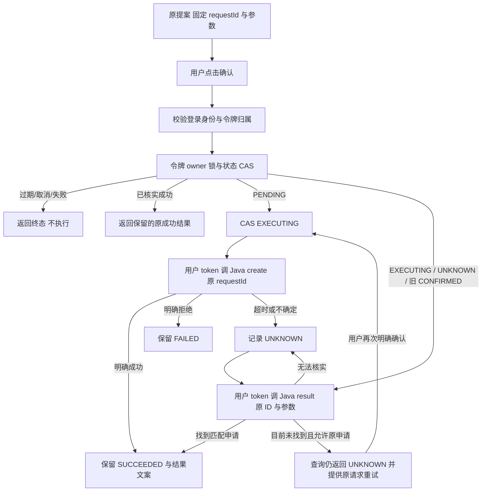

# T04 AI Agent 用户确认结果恢复开发记录

本阶段只完善现有确认与执行机制，复用 T01 售后申请、Java 订单锁、申请 requestId 和原 Redis pending 结构。没有新增框架、数据库表或 SQL 迁移，没有重新开发 LangGraph 工作流、售后系统或 T01～T03。只运行相关定向测试，没有调用真实支付、生产环境或用户业务数据库。

## 1. 原来存在什么问题

`PendingActionService.confirm` 在真正调用 Java 前就将 status 从 0 CAS 为 1（CONFIRMED）。网络超时后无法分辨申请已经创建还是尚未执行；重试又被“已处理”挡住。成功后删除 pending，导致重复点击无法返回原结果。删除失败还会将已成功动作返回为 success=false。

前端只识别待确认/已确认/取消/过期，网络错误显示“确认失败”。Java 原 create 已经具有 requestId 幂等和订单/订单项归属校验，不应再创建第二套申请机制。

## 2. 为什么会出现这个问题

用户同意、正在发送请求和业务已提交是不同事实。执行前落“已确认”只证明用户确认过，不能证明 Java 提交。Redis CAS、HTTP 响应和 Java 本地事务无法共同原子提交。删除确认记录虽能阻止再次执行，却也删除了恢复所需的原请求参数和结果。

## 3. 原来的代码执行流程



## 4. 修改后的代码执行流程

继续使用原 status 数字字段，保持已有 0～3 的接口含义兼容：

| 数值 | 状态 | 含义 |
|---:|---|---|
| 0 | PENDING | 等待用户确认 |
| 1 | SUCCEEDED | 申请提交经 Java 响应或查询核实成功；保留 CONFIRMED 常量别名 |
| 2 | CANCELLED | 用户在执行前取消 |
| 3 | EXPIRED | 等待确认超过原有效期 |
| 4 | EXECUTING | 已经确认，正在调用 Java |
| 5 | FAILED | 明确的参数/业务拒绝，不自动重置为待确认 |
| 6 | UNKNOWN | 响应超时、网络异常或结果尚未核实 |



### Python 实际调用链

- 原 `after_sale_service.propose` 继续在服务端生成售后 requestId；`create_pending` 保留该 ID。其他写提案缺少 ID 时在创建时分配一次，保存到原记录及 paramsJson。
- `POST /api/agent/confirmAction` → `PendingActionService.confirm` → `ActionExecuteService.execute` → `POST /api/order/afterSale/create`。
- 网络异常先记录 UNKNOWN，再调用 `ActionExecuteService.recover` → `POST /api/order/afterSale/result`。找到原申请就更新为 SUCCEEDED。
- 新增 `POST /api/agent/getActionResult`：同样需要登录与令牌归属，只查询恢复，不调用执行回调。PENDING 查询不会隐式确认。
- 当 Java 查询暂未找到、且原订单项仍允许申请时，查询返回 retryAllowed。只有用户再次点击确认才允许以原 requestId 和原参数重试。不会生成新 ID，也不在超时异常处理中自动重发。
- 所有已核实的终态保留，重复确认返回原结果。若解锁删除失败但成功结果已保存，可直接读取已核实的缓存，不必等锁过期。
- Redis 状态与 resultMessage 在同一次 Lua CAS 更新；缓存更新失败不能把已经核实的 Java 成功改成业务失败。下次可从遗留 EXECUTING/UNKNOWN 再向 Java 核实。
- 旧 CONFIRMED 没有结果文案时视为结果未核实，不冒充 SUCCEEDED。

### Java 最小结果查询

原 `/mine` 返回本人所有申请，缺少对某个原提案的匹配和重试资格判断。因此新增最小 `/order/afterSale/result`，使用原 `AfterSaleDTO.Create`，不新增 Mapper、表或字段。

`AfterSaleController.result` → 登录 token 提取 userId → `AfterSaleService.result` → 原订单归属检查 → 按 create 相同顺序锁订单/订单项 → `applications.byId(requestId)`。

查询使用本地 READ_COMMITTED 事务，避免等待创建事务后仍读取旧快照。匹配申请必须校验 userId、orderItemId、type、trim 后 reason。申请进入 APPROVED 等后续审核状态，依然代表“申请提交动作成功”，不再要求一定为 PENDING_REVIEW，也不表示退款成功。

查不到返回 NOT_FOUND、原 requestId 和基于原 decision 的 retryAllowed，不创建任何业务记录。查不到只是当前快照，不能证明一个延迟的原网络请求永远不会到达。安全性来自重试仍携带同一个 requestId，进入原 create 的锁、参数匹配及幂等检查。

### 前端确认卡

PC 确认卡继续使用原组件和 API 模块，展示待确认、正在提交、申请成功、申请失败、正在核实结果，以及取消/过期状态。挂载时从服务端同步状态；未知结果只提供核实按钮，Java 明确允许时再显示“使用原请求重试”。取消接口返回 success=false 不再误画成取消成功。

状态不确定时最多追加 5 次、间隔 2.5 秒的查询，之后由用户手动核实，避免无限轮询。组件卸载清理定时器。浏览器 HTTP 失败只标 UNKNOWN，不显示已失败，也不产生新申请。

## 5. 涉及哪些设计模式和技术

- 保留原两阶段用户确认：模型生成提案，用户确认后才调用 Java 写接口。
- 显式动作状态机：区分意图、执行中、已核实结果与不确定结果。
- 稳定幂等键：原 requestId 绑定不可变业务参数；Redis 令牌锁只负责协调，Java 才是业务事实来源。
- 查询恢复与受控重试：先读实际结果，符合条件并经用户再次确认后使用原键重试。
- Redis Lua CAS：同一 JSON 中状态和结果文案一起更新，避免两个字段分步保存。
- MyBatis XML、现有悲观锁与 Spring 本地事务；没有引入新框架。

## 6. 如何保证数据一致性

Java 原申请与审计日志在 create 的本地事务中写入，requestId 原幂等记录、订单锁与订单项锁继续生效。请求 ID 相同但参数不同会拒绝；更换 ID 也不能绕过已有处理中申请拦截。

Python 不向 Java 提交模型传入的 userId、金额或状态，只白名单传 requestId、orderItemId、type、reason，身份来自登录 token。查询也走用户鉴权接口，不能使用内部 token 冒充用户。

Redis 记录保留 7 天，确认有效期仍为原 30 分钟，使用 expiresAt 单独校验。原期限后不能确认新的 PENDING，但已经执行的动作仍可核实结果。成功后不再依赖删除 pending；清理失败、响应丢失均不等于业务失败。

确认收货、评价、追评也保留并透传稳定 requestId 供追踪，但其 Java 接口没有新增事件执行账本。对这些动作的 UNKNOWN 不开放自动或受控重放，仍需查询业务进度，不能把透传标识说成已实现同售后一样的结果恢复保证。

## 7. 如何测试异常场景与实际结果

| 要求 | 定向覆盖 |
|---|---|
| 正常确认 | Java 执行成功，缓存 SUCCEEDED，重复返回相同结果 |
| 重复点击 | 顺序重复不执行；并发确认第二个返回 EXECUTING，执行回调只有一次 |
| Java 成功但 Python 超时 | HTTP MockTransport 模拟落申请后 ReadTimeout，随后查询原 ID 返回已存在且已审核申请，成功恢复，无第二次 create |
| Redis 删除失败 | 注入执行标记删除和 owner 解锁失败；成功结果保留，重复返回成功 |
| 结果缓存写失败 | Java 成功返回后注入 CAS 故障，保留执行中记录，下一次根据原 ID 查询恢复 |
| 令牌过期 | 超期 PENDING 转 EXPIRED，不调用 Java；已执行的过期确认窗口仍可恢复 |
| 其他用户使用令牌 | confirm、cancel、只读查询先检查 userId，甚至锁忙时也不泄露结果 |
| 业务与参数安全 | Java 更换 ID 不绕过处理中申请；相同 ID 改参数拒绝；恢复查询采用登录身份 |
| 恢复结果不可用 | 保持 UNKNOWN；JSON 损坏、错误申请 ID 不能被当成成功或明确业务失败 |
| 前端状态 | 编译实际 SFC 并进行七种状态的 SSR 断言；定向类型检查 |

### 实际命令

Java 工作目录 `Simlect-backend`：

```powershell
mvn -o -pl Simlect-order/app -am test '-Dtest=AfterSaleServiceTest,AfterSaleControllerTest' '-Dsurefire.failIfNoSpecifiedTests=false'
```

Python 工作目录 `Simlect-backend/Simlect-agent`：

```powershell
$env:SIMLECT_INTERNAL_TOKEN='t04-isolated-test-token-not-a-production-secret'
$env:JAVA_WEB_URL='http://java-mock.invalid'
.venv/Scripts/python.exe -m pytest tests/integration/test_pending_confirm.py tests/test_action_result_recovery.py tests/test_action_result_routes.py tests/test_refund_application_safety.py tests/test_auth.py -q -p no:cacheprovider -o asyncio_default_fixture_loop_scope=function
```

前端工作目录项目根目录：

```powershell
node Simlect-front/Simlect-web/scripts/test-agent-confirm-card.cjs
Simlect-front/Simlect-web/node_modules/.bin/vue-tsc.cmd --noEmit -p logs/t04-vue-tsconfig.json
```

定向临时 TS 配置 extends 原 tsconfig.app.json，仅以 AgentConfirmCard.vue 为入口，并提供原 vite/client 类型；依赖按正常 imports 解析。没有更改用户现有配置文件。

| 执行 | 通过 | 失败/错误 | 跳过 | 证据 |
|---|---:|---:|---:|---|
| Python 定向 | 43 | 0/0 | 0 | logs/t04-python-final.log |
| Java 定向 | 33（Service 28、Controller 5） | 0/0 | 0 | logs/t04-java-targeted.log，BUILD SUCCESS |
| 确认卡状态 SSR | 7 | 0/0 | 0 | logs/t04-card-render.log |
| 确认卡定向 vue-tsc | 命令 exit 0 | 0 | 不适用 | logs/t04-vue-targeted.log 无错误 |

原确认测试的 6 个场景保留，按新状态和结果保留契约更新断言；T01 测试继续断言只有一次认证 create、用户不能伪造身份。没有删除测试或降低为“只要不报错”。本轮新增 Java 8 个测试，以及 Python 恢复/路由测试。

首次 Python 执行曾因工作目录、测试环境令牌配置导致收集失败；沙箱中的两个 Python 测试进程停滞，已按本轮 PID/命令行核对后停止，并在受审批环境重跑通过。前端首次定向配置缺少 Vite 类型，补充到临时测试配置后通过。自动审批曾拒绝批量测试编辑，随后用明确增量补丁保留原测试完成，无未解决审批阻塞。

以上 Python 使用 Redis fake 与 HTTP MockTransport，Java 使用 Mockito/Standalone MockMvc；没有启动真实 Java/Python/Redis/MySQL 端到端联调，也没有宣称注入真实 JVM 退出或 Redis 宕机。SSR 检查验证状态渲染，不等于浏览器点击和完整视觉联调。

## 8. 面试官可能如何提问

1. 之前执行前先标“已确认”，为什么仍然有问题？
2. 为什么网络超时不能直接展示失败？
3. 查询没记录，为什么还不能断言原操作永远未执行？
4. Redis 解锁或结果保存失败如何处理？
5. 用户更换 requestId 是否可以绕过幂等？
6. 申请已被审核拒绝，为什么动作状态还可以是 SUCCEEDED？
7. 为什么没有为所有写接口新增执行账本？

## 9. 自己应该如何回答

1. 用户授权不等于 Java 事务提交。原状态压缩了这两件事。现在用 EXECUTING 和 UNKNOWN 保留这个事实差异。
2. 请求可能已到 Java 并提交，只有响应丢失。重发新 ID 会重复申请，所以用原 ID 查询结果，不能用 HTTP 超时推断业务失败。
3. 查询与一个延迟请求仍可能并发。NOT_FOUND 是当前快照，真正安全靠同 requestId、相同参数、Java 原锁与唯一性校验；查询不会直接触发重发。
4. 已核实成功不因缓存故障降级成失败。保留结果并做 owner 校验清理；若缓存更新失败，下次仍从原执行中记录查询 Java。彻底丢失缓存时转已有售后进度入口，不随意生成新申请。
5. Java 除了 requestId 幂等还检查订单项是否已有处理中申请。相同 ID 改内容也会拒绝，防止键复用成另一笔业务。
6. SUCCEEDED 描述“提交申请动作完成”，不是“审核通过/退款成功”。界面返回当前申请业务状态，明确区分这两层。
7. 本次优先解决已有售后闭环，不做大规模架构扩展。其他动作只透传稳定 ID、禁重复执行，不确定时不开放重放，并明确剩余边界。

## 10. 修改文件与剩余问题

生产 Java：

- `Simlect-backend/Simlect-order/app/src/main/java/com/simlect/biz/AfterSaleService.java`：result。
- `Simlect-backend/Simlect-order/app/src/main/java/com/simlect/controller/AfterSaleController.java`：用户鉴权 result 接口。

生产 Python：

- `Simlect-backend/Simlect-agent/app/services/pending_action_service.py`：状态、期限、保留结果、查询恢复与受控原键重试。
- `Simlect-backend/Simlect-agent/app/services/action_execute_service.py`：原请求校验、执行/查询、异常分类。
- `Simlect-backend/Simlect-agent/app/services/redis_service.py`：原记录可指定保留期、Lua 原子更新状态与结果。
- `Simlect-backend/Simlect-agent/app/api/routes/agent.py`：确认返回状态，新增只读恢复入口。

前端：

- `Simlect-front/Simlect-web/src/components/agent/AgentConfirmCard.vue`：状态展示、核实、原请求重试、有限查询。
- `Simlect-front/Simlect-web/src/api/modules.ts`：恢复 API 与返回值类型。
- `Simlect-front/Simlect-web/scripts/test-agent-confirm-card.cjs`：七种状态的实际 SFC SSR 定向检查。

测试：Java 原 AfterSaleServiceTest、AfterSaleControllerTest 增量；Python 原 integration/test_pending_confirm.py、test_refund_application_safety.py 更新契约，新增 test_action_result_recovery.py、test_action_result_routes.py。开发记录与索引同步。

剩余边界：Redis 整个记录被驱逐、丢失或超过 7 天后无法仅凭令牌重建原参数，应使用已有售后进度查询；没有增加永久动作账本。收货/评价/追评 UNKNOWN 没有新增自动核实能力。真实前后端联调、生产鉴权过滤器与数据库锁的故障注入本轮未执行，部署需要同时发布新增 Java 查询接口及 Python/前端。

T04 代码与上述定向验证已完成，可以在用户指定后进入下一任务。本轮未开始 T05、T07、T09 或其他阶段。
