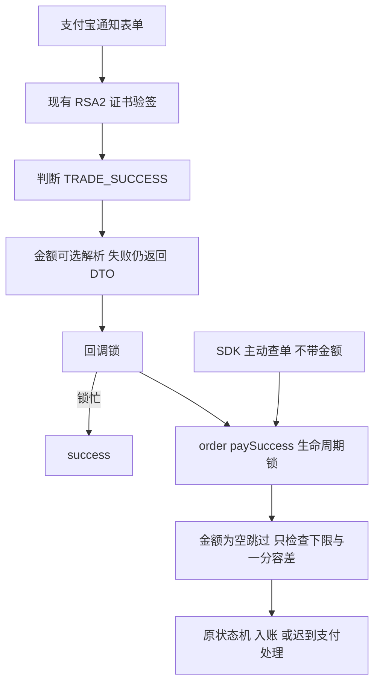
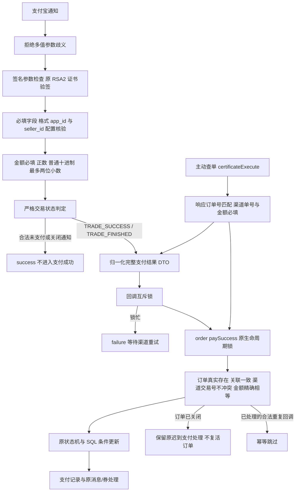

# T07 支付宝支付回调严格校验开发记录

本阶段只完善支付回调、主动查单的归一化结果与订单侧支付成功校验，保留 T01 退款入口治理和原迟到支付处理。不修改数据库结构、Mapper SQL、支付状态机、生产配置或密钥；Python、Vue 无修改。没有调用真实支付宝、真实退款或生产环境。

## 1. 原来存在什么问题

1. `PayChannel4AliPay.payNotify` 已使用支付宝证书验签，但 `total_amount` 缺失直接留空；解析失败只记录日志，仍返回 DTO。
2. `OrderInfoServiceImpl.assertCallbackAmountMatches` 金额为空直接跳过，只拒绝“少付超过一分钱”，允许少付一分和任意多付。
3. 回调没有核验配置中的 app_id、预期收款 seller_id。AppConfig 已有 alipay.appid，但未发现 sellerId 配置读取字段。
4. `queryOrder` 与回调共同使用 `PayOrderNotifyDTO`，主动查单却只带本地支付单号、渠道单号，不带金额，也没有校验响应中的 out_trade_no。
5. 回调锁忙时 Controller 返回 success；这只能证明另一个处理者持有锁，无法证明其一定提交成功。
6. 缺少金额/身份等严格测试，不能因 T01 已修退款就认定回调已经安全。

## 2. 为什么会出现这个问题

代码将验签成功等同于可入账，忽略了“真实的渠道消息”还必须对应当前应用、收款方、本地订单及金额。为兼容不完整主动查单 DTO，又在共享订单入口允许金额缺失，导致外部回调也获得同样的跳过条件。

原金额判断使用容差与单向下限，与支付单实际应收金额的精确核对不一致。回调互斥锁只协调执行，不能作为业务完成记录。

## 3. 原来的代码执行流程



## 4. 修改后的代码执行流程



### 外部回调校验

- out_trade_no 必填，限制为项目支持的字母/数字/下划线/短横线，最长 64 字符。
- trade_no 必填，只接受数字且最长 64 字符。
- app_id、seller_id 必填且为数字文本，与配置精确相等；配置缺失也拒绝，不能拿回调的 seller_id 自己作为预期商户。
- sign 必填，sign_type 必须为 RSA2；继续调用原 `AlipaySignature.rsaCertCheckV2`，保留现有证书路径、UTF-8 和 RSA2，不改为跳过验签。
- total_amount 必填，长度上限 32，普通非负十进制格式且数值必须大于零，最多两位小数；拒绝空白、科学计数法、符号、千分隔符、NaN、零、负数和三位以上小数，不对回调金额四舍五入。
- trade_status 必填，精确匹配支持的状态。支付成功接受 TRADE_SUCCESS / TRADE_FINISHED；合法 WAIT_BUYER_PAY / TRADE_CLOSED 不触发支付成功。未知、错误大小写或缺失状态拒绝。
- Controller 不再从同名多值参数中随意取第一个；格式存在歧义就返回 failure，避免验签值与业务值不一致。

### 精确金额与关联检查

`paySuccess` → 原 `runWithPayOrderLifecycleLock` → `paySuccessInLock` → 原查询按 payOrderId 加载订单 → `assertCallbackAmountMatches`。

每条订单必须属于该 payOrderId，金额非空、非负、精度有效。已有 channelOrderId 不能被另一个渠道交易号替换。回调金额必须为正、非空且最多两位小数，用 BigDecimal.compareTo 精确相等，取消一分容差和“多付即可”规则。

应收计算复用 `OrderPayAmountUtil.normalizeChannelPayAmount(订单金额合计)`，与 getPayUrl 实际向渠道发起的金额及原最低支付规则一致，不另造收费规则。普通非零订单即严格核对合计；没有为了兼容旧空金额跳过校验。

校验在已付幂等分支、普通/秒杀分支和退款冲突处理之前进行；`handlePaySuccessConflict` 重新加载后再次校验，异常重读结果也不能未经检查执行原迟到支付处理。

### 外部表单与内部 DTO 的边界

没有新建一套来源标记或允许 null 的“内部特权”。外部原始回调仍是签名 Map，必须通过商户/格式/状态检查后，才生成内部 `PayOrderNotifyDTO`。该 DTO 明确标注为已归一化支付成功结果，并增加三参数构造支持携带金额。

主动查单是另一条可信输入：原 SDK certificateExecute 保留，不强行要求查询响应包含回调表单的 app_id、seller_id、sign_type。它必须验证响应 out_trade_no 等于请求支付单号、trade_no 有效，并解析有效 total_amount，才返回同样完整的内部 DTO。

两种来源到 order 后金额都不可为空，不能通过构造“查询 DTO”绕过订单侧校验。原 PayQueryDTO 仍负责查询请求参数，轮询任务和 Feign API 不变。SDK 响应验签沿用原实现；本轮测试只 Mock 该调用，不声称验证了真实证书链。

## 5. 涉及哪些设计模式和技术

- 支付边界分层校验：渠道签名与商户身份在 pay 服务检查，本地业务事实在 order 服务检查。
- BigDecimal 精确货币比较：区分渠道下单归一化和回调入参校验；回调不做容差或自动舍入。
- 复用原归一化 DTO：回调与查单各自验证，之后共同进入严格订单入口，不增加绕过开关。
- 原分布式生命周期锁、状态机、条件 SQL、支付记录幂等与 Outbox 发送保持原结构。
- 只有已完成业务才正常返回成功；锁忙返回 failure，使渠道能够重试。

## 6. 如何保证数据一致性

原 paySuccess 本地事务保留，原支付/关单生命周期锁仍使用同一 payOrderId。原状态机仅允许合法旧状态变更，SQL 的旧状态条件没有修改。合法重复回调在相同金额与交易号校验后幂等跳过，不重复标记成功、发货消息或回补库存。

并发支付先完成时，超时关单不能改掉已支付订单，也不能回补库存。关单先完成时，支付回调不能复活或发货，仍按原迟到支付处理。原迟到支付退款、补偿与跨服务事务边界保持现状，没有在本轮重做 T01 或宣称跨服务 exactly-once。

### 必须配置的商户身份

`alipay.appid` 继续读取现有配置。AppConfig 新增 `alipay.sellerId` / `ALIPAY_SELLER_ID` 读取口，默认空值；需要由环境提供该支付宝应用实际收款方的商户 PID。本轮没有推测商户信息，没有填入测试值作为生产商户，也没有改写现有 properties/yaml/env 或密钥。

未配置 sellerId 时，外部支付宝通知按失败处理。这是有意的拒绝策略。原受开关控制的本地模拟付款仍通过本地入口运行，相关 17 项测试通过，不依赖虚构商户来绕过回调。

## 7. 如何测试异常场景与实际结果

| 要求 | 测试覆盖 |
|---|---|
| 正常支付回调 | Mock 证书验签成功后解析完整字段，保留精确金额；订单按原状态机成功处理 |
| 缺少 total_amount | 外部解析、Controller 归一化 DTO 门禁、order 入口均有拒绝覆盖 |
| 金额格式错误 | 空串、null、空白、指数、符号、NaN、千分位、零、负数、超小数精度 |
| 金额不匹配 | 少付一分、多付一分、大额多付全部拒绝，不修改订单、支付、库存或消息 |
| app_id 错误 | 格式不正确、与配置不匹配、配置缺失均拒绝 |
| seller_id 错误 | 同上，未以回调值或硬编码商户放宽 |
| 重复支付回调 | 连续两次真实 service 调用，订单/标记成功/消息只发生一次；已付状态也不能跳过金额或交易号检查 |
| 支付与关单并发 | 两个线程调用实际业务入口，使用模型锁和条件更新，分别强制支付先赢、关单先赢并断言最终状态与库存/退款/发货副作用 |
| 内部查询边界 | 查单金额缺失/畸形、返回另一支付单、缺少渠道单号拒绝；不要求不存在的回调表单字段 |
| 回调锁忙 | 先返回 failure、不调用业务；锁可取得后重试正常处理 |
| 参数污染 | 多个 total_amount 值在验签和业务前拒绝 |

### 实际测试命令

工作目录 `Simlect-backend`：

```powershell
mvn -o -pl Simlect-pay/app,Simlect-order/app -am test '-Dtest=PayChannel4AliPayTest,PayChannel4AliPaySecurityTest,PayNotifyControllerTest,OrderInfoServiceImplTest,OrderStateMachineTest,PayOrderTaskTest,LocalDemoPaymentServiceTest,RedisComponentTest,PayTradeRecordServiceImplTest' '-Dsurefire.failIfNoSpecifiedTests=false'
```

| 测试类 | 通过 | 失败/错误 | 跳过 |
|---|---:|---:|---:|
| RedisComponentTest | 11 | 0/0 | 0 |
| OrderInfoServiceImplTest | 138 | 0/0 | 0 |
| LocalDemoPaymentServiceTest | 17 | 0/0 | 0 |
| OrderStateMachineTest | 8 | 0/0 | 0 |
| PayOrderTaskTest | 10 | 0/0 | 0 |
| PayChannel4AliPaySecurityTest（新增） | 48 | 0/0 | 0 |
| PayChannel4AliPayTest | 21 | 0/0 | 0 |
| PayTradeRecordServiceImplTest | 10 | 0/0 | 0 |
| PayNotifyControllerTest | 12 | 0/0 | 0 |
| 合计 | 275 | 0/0 | 0 |

日志 `logs/t07-final-targeted.log`，最终 BUILD SUCCESS。本轮只运行定向测试，没有重新执行全项目回归或全量打包。

第一次回归有一个旧空金额用例失败。保留其场景，并将“订单金额为空不退款且不抛错”收紧为“明确拒绝、不能进入退款”，没有删除原有测试。原合法交易夹具补齐金额，多子单夹具显式提供正确合计，未通过放宽断言解决问题。

所有支付宝 SDK、验签、证书路径、远程服务均为 Mock。并发测试使用实际线程和业务方法，但 Redis 锁/数据库 CAS 是模型，未连接真实 Redis/MySQL，也不是沙箱支付宝或真实证书端到端联调。不能将本轮结果描述为已验证生产级支付故障注入。

## 8. 面试官可能如何提问

1. 验签成功为什么还不能直接修改订单？
2. 少付一分、多付一分为什么都要拒绝？
3. 为什么不能为了主动查单兼容，把回调金额设为可空？
4. 支付和超时关单同时发生怎么处理？
5. 为什么锁忙时不直接返回 success？
6. sellerId 没配置怎么办？
7. 本轮证明了哪些并发保障，哪些还没有验证？

## 9. 自己应该如何回答

1. 验签证明来源和内容完整，业务上还要核对应用、收款商户、订单号、金额和交易状态。它不能代替订单归属关联与应付金额判断。
2. 需要验证这笔支付与本地订单的应收金额完全对应。用 BigDecimal.compareTo 判断数值相等，100.0 与 100.00 可以相等，但 99.99 或 100.01 不应偷偷接受。
3. 外部签名表单和 SDK 查询响应字段不同，应各自验证后补齐内部支付结果。下游统一要求金额，不用 source 标记或空值作为豁免。
4. 复用同一个生命周期锁与旧状态 SQL 条件更新。支付赢就不关单回补；关单赢则不复活订单、不发货，沿用迟到支付处理。本轮只加强进入这些分支前的真实性校验。
5. 持锁者可能崩溃或事务失败。锁忙只代表处理中，因此返回 failure 等渠道重试；真正已完成的重复通知由订单幂等分支成功处理。
6. 不猜、不填一个商户号糊弄校验。读取部署环境提供的实际 PID，缺失时拒绝外部回调，并明确提示部署配置。
7. 测试验证了业务入口串行协调、条件更新、重复请求和副作用分支；真实 Redis、MySQL 事务隔离、证书验签与支付宝通知重试仍需独立联调。

## 10. 修改文件清单与剩余问题

生产 Java：

- `Simlect-backend/Simlect-common/src/main/java/com/simlect/entity/config/AppConfig.java`：新增实际 sellerId 配置读取。
- `Simlect-backend/Simlect-pay/api/src/main/java/com/simlect/api/dto/PayOrderNotifyDTO.java`：明确归一化结果职责，增加带金额构造。
- `Simlect-backend/Simlect-pay/app/src/main/java/com/simlect/biz/impl/PayChannel4AliPay.java`：严格回调字段/身份/金额，查单补齐金额与订单关联。
- `Simlect-backend/Simlect-pay/app/src/main/java/com/simlect/controller/PayNotifyController.java`：多值参数、无效 DTO 拒绝；锁忙返回 failure。
- `Simlect-backend/Simlect-order/app/src/main/java/com/simlect/biz/impl/OrderInfoServiceImpl.java`：assertCallbackAmountMatches、paySuccess 关联门禁、handlePaySuccessConflict 重读校验。

测试 Java：更新原 PayChannel4AliPayTest、PayNotifyControllerTest、OrderInfoServiceImplTest；新增 PayChannel4AliPaySecurityTest。OrderStateMachine 与 Mapper XML 保留，原测试直接执行。Python、Vue、数据库结构均无修改。

剩余：部署需提供真实 sellerId，并同时发布更新后的 pay/order，避免旧查单仍返回空金额。真实证书、支付宝沙箱/生产通知、跨服务数据库事务和故障注入未执行；原迟到支付退款及跨服务补偿边界仍保留，不宣称本轮修复了全部支付/退款一致性问题。

代码与定向验证已完成，可在用户指定后进入下一任务；本轮没有开始 T09 或其他阶段。

### 参考依据

支付宝关于异步通知业务校验的官方说明要求在验签后继续检查订单、金额、收款方与应用身份：[支付宝官方支付通知说明](https://developer.alibaba.com/docs/doc.htm?articleId=106448&docType=1&treeId=204)。本报告的实际实现与测试结果来自当前工作区源码和本轮日志，不能用官方文档替代运行验证。
