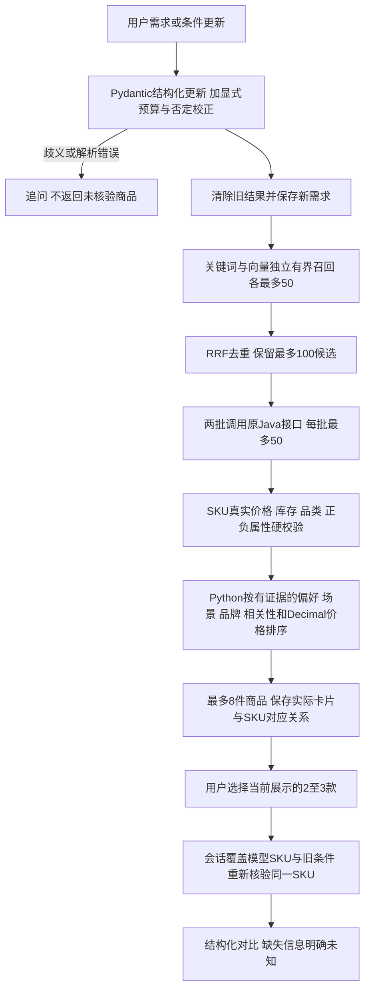

# T09 AI 智能导购优化开发记录

本轮复用原 LangGraph、Pydantic、MCP 和 Java SKU 筛选。没有新增 Agent、框架或数据库结构，没有改写本地配置、密钥或真实业务数据。只运行本次相关定向测试。

## 1. 原来存在什么问题

- 召回每路 40 个结果，RRF 又在 Java 核验前截断为 40，后排符合预算的商品可能永远没有被核验。
- 向量异常可能使并行关键词结果一起失败；Embedding 调用在异常捕获之外，关键词熔断时也跳过已有 Java 降级。
- 属性仅按原始名称和值精确比较，缺少品牌排除、明确否定和常用单位别名。
- 解析失败会返回普通搜索卡片，虽然有文字警告，但没有执行原预算与属性约束。
- 对比仅持有商品 ID，重新从所有 SKU 选择，可能换成用户没有看到的 SKU；条件修改和对比同句时还可能优先对比旧商品。

## 2. 为什么会出现这个问题

候选相关性排序与业务可售性混在一起，先截断导致合法候选消失。会话里缺少当前展示 SKU 的引用边界，商品 ID 不足以确定用户看到的配置。模型解析、召回和最终业务事实的失败边界也未充分隔离。

## 3. 原来的代码执行流程

用户 → ShoppingPatch → 合并条件 → 关键词/向量各40 → RRF截40 → Java筛选 → 偏好/浮点价格排序 → 卡片。对比按旧商品ID重选SKU；解析失败则转普通搜索。

## 4. 修改后的代码执行流程



需求字段保留原结构，新增 preferred_brands、excluded_brands，属性比较支持 eq/ne/gte/lte。新条件合并保留未修改字段，同名属性替换，clear 和 reset 继续有效。显式人民币数字上下限、万/千单位和常见品牌/颜色否定由局部规则校正，不建立第二个 Agent。数值属性的“至少8GB”不会被误当作预算8元。

Java 使用原 DTO 和 Service，增加可选 operator，旧两参数 Attribute 构造保留。保守支持 RAM/运行内存、ROM/存储容量、颜色/色彩、品牌、ANC 等别名；8GB/8G 可比较，范围比较只接受已知且相同的单位，不猜测跨单位换算。未知属性不能证明正约束，也不能证明排除条件；互斥属性存在多值歧义时拒绝。

品牌排除转为 Java 的品牌 ne 硬约束。没有品牌业务属性时不从商品名猜品牌。价格继续以 Java SKU BigDecimal 为准，库存必须为正，SKU价格异常或候选范围以外的商品不返回。Python只对已核验结果排序，额外丢弃非法/越界响应，不能用软偏好覆盖预算。

对比卡包含名称、SKU、实际价格、库存、核心配置、需求匹配、优势、不足、适用场景。优势来自已录入参数或可售事实；无数据的不足写未知，不编造产品缺陷。路由从当前登录用户会话取可见商品、SKU和需求，覆盖模型传入的旧SKU。原SKU无货或超预算时不偷偷换另一SKU。

召回分支各有7秒上限，推荐25秒、对比15秒、完整导购轮次45秒；没有无限重试。ES故障或熔断复用原Java关键词降级。解析失败不再触发不受约束的普通搜索。条件变化优先重新推荐，需再次选择新展示结果对比。

## 5. 涉及哪些设计模式和技术

沿用 Pydantic 结构化输出、显式需求状态合并、RRF 候选融合、分层业务校验、超时隔离与既有熔断降级。Java是业务事实来源，Python负责召回与软排序；推荐与对比文案由校验数据生成，不让模型补写商品事实。

## 6. 如何保证数据一致性

不缓存商品可售资格，对比也重新调用 Java 获取同一 SKU 的价格和可售库存。条件修改前清空可比较结果，失败和空结果也覆盖旧引用。价格/库存只保证查询时快照，下单仍需现有交易业务重新校验和锁库存；没有宣称读查询能保证未来库存。

品牌和属性同义词表是保守白名单，未覆盖的表达应追问或显示无匹配，不做猜测。数据库、库存接口和原50候选上限均保留，通过两个有界批次核验完整候选池。

## 7. 如何测试异常场景

固定语料 `Simlect-backend/Simlect-agent/tests/data/t09_shopping_cases.json` 共40条，覆盖预算上下限/修改/清除/冲突、品牌排除、否定、属性、场景、重置和追问。另有15个推荐/对比/库存/检索故障评测场景，及轮次、MCP、ES、Embedding、超时安全测试。

这些是固定结构化输出与合成商品夹具测试，不是在线LLM语义准确率或真实商品推荐质量。LLM被Stub，Java HTTP与检索被Mock；Java另通过实际AiProductFilterService和Mock业务快照验证筛选逻辑。没有删测试或调整语料来规避失败。

### 实际命令与结果

Python工作目录 `Simlect-backend/Simlect-agent`：

```powershell
$env:SIMLECT_INTERNAL_TOKEN='t09-isolated-test-token'
.venv/Scripts/python.exe -m pytest tests/test_shopping_evaluation.py tests/test_shopping_turn_safety.py tests/test_guardrails.py -q -p no:cacheprovider -o asyncio_default_fixture_loop_scope=function
```

最终 **76 passed，0失败，0跳过**，日志 `logs/t09-python-final.log`。

Java工作目录 `Simlect-backend`：

```powershell
mvn -o -pl Simlect-product/app -am test '-Dtest=AiProductFilterServiceTest' '-Dsurefire.failIfNoSpecifiedTests=false'
```

最终 **20通过，0失败，0错误，0跳过，BUILD SUCCESS**，日志 `logs/t09-java-final.log`。未运行全项目测试，也没有连接真实支付、生产或业务数据库。

### 指标口径与结果

下表来自本轮固定55个评测场景；额外安全回归不混入该分母。合成数据明确以 fixture 标识，不冒充真实商品。没有符合条件的商品或工具故障时，安全空结果不算推荐成功。

| 指标 | 结果 | 分子/分母 |
|---|---:|---|
| 预算硬约束满足率 | 100.00% | 12/12个返回SKU |
| 全部推荐请求返回率 | 63.64% | 7/11 |
| 有可售候选时推荐成功率 | 100.00% | 7/7 |
| 对比已知数据完整率 | 85.19% | 46/54字段 |
| 对比结构完整率 | 100.00% | 6/6行 |
| 核验工具调用成功率 | 93.33% | 14/15，含一次注入失败 |
| 平均响应时间 | 0.827 ms | 55个本地夹具场景 |


已知数据完整率按9项对比字段统计，未知不足/场景不计为已知数据；结构完整率另计。工具调用指评测中的 Java 核验接口尝试，不是生产 MCP 可用性。平均耗时仅为55个本地夹具场景，包含解析、推荐、对比、空结果和注入故障，不含真实模型推理与网络延迟。

### 优化前后对比

| 方面 | 修改前源码行为 | 修改后与验证 |
|---|---|---|
| 候选截断 | RRF先截40再核验 | 最多100个先核验；第99个候选是唯一预算内商品的测试可推荐 |
| 单路召回异常 | gather异常使另一支结果丢失 | 单支失败/超时仍返回另一支的Java核验商品 |
| 解析失败 | 普通搜索返回未核验卡片 | 追问或错误，不返回商品；安全测试断言没有调用搜索 |
| 多轮结果 | ID不足以绑定SKU | 当前可见商品+SKU；条件变更、空结果与失败清旧引用 |
| 品牌/否定 | 缺少显式支持 | 品牌ne和正负属性在Java核验，未知数据拒绝 |
| 属性同义词 | 原始字符串相等 | 保守别名、相同单位范围检查，否定值不被当支持 |
| 排序/对比 | float排序、可能重选SKU | Decimal和有证据的软因素；原SKU重新核验，九项结构化对比 |

没有运行优化前的同口径完整评测，故不虚构“从某百分比提升到某百分比”。前列来自修改前源码，后列来自实际测试。

## 8. 面试官可能如何提问

1. 为什么RRF分数高不等于可推荐？
2. 否定条件缺少属性时能不能放行？
3. 如何避免多轮对话拿错商品？
4. 推荐理由怎么防止幻觉？
5. 指标很高是否说明模型或RAG已上线可用？

## 9. 自己应该如何回答

1. RRF只表示召回相关性。先截断会丢掉低排名但合法候选，因此先对有界候选池做Java硬筛，再排序截断。
2. 不能。没有品牌数据就无法证明不是某品牌；缺失数据按不满足硬约束处理，不拿产品名或模型猜测补事实。
3. 保存当前实际展示顺序与SKU，修改条件先清空；对比从本人会话取这些引用，再查当前同SKU，不使用模型提供的旧SKU。
4. 价格库存配置来自Java，文案按证据生成；偏好匹配必须有属性依据，未知不足和场景明确写未知。
5. 不能。本次是可复现的离线契约/故障夹具；模型准确率、真实检索相关性和端到端响应时间必须在部署服务、真实商品和评测环境中另测。

## 10. 文件清单、运行状态与剩余事项

Python生产文件：

- `Simlect-backend/Simlect-agent/app/models/shopping.py`
- `Simlect-backend/Simlect-agent/app/services/shopping_parser.py`
- `Simlect-backend/Simlect-agent/app/services/shopping_service.py`
- `Simlect-backend/Simlect-agent/app/services/shopping_turn.py`
- `Simlect-backend/Simlect-agent/app/rag/retriever.py`
- `Simlect-backend/Simlect-agent/app/rag/rrf.py`
- `Simlect-backend/Simlect-agent/app/services/mcp_tool_router.py`
- `Simlect-backend/Simlect-agent/app/mcp_server/server.py`

Java生产文件：`Simlect-product/app/src/main/java/com/simlect/biz/AiProductFilterService.java`、`Simlect-product/app/src/main/java/com/simlect/entity/dto/AiProductFilterDTO.java`（均位于Simlect-backend）。

测试：新增 `tests/test_shopping_evaluation.py`、`tests/test_shopping_turn_safety.py`、40条JSON语料；扩展原 `AiProductFilterServiceTest`。输出 `evals/t09-shopping-metrics.json`；本记录与开发记录索引更新。Vue、数据库结构和密钥配置无修改。

本轮初始只读探测：向量开关为true，Embedding Key未配置，localhost 7050/7060/9200均未监听。不能仅凭源码或开关声称向量检索已运行验证。本轮未启动用户服务或调用真实模型。

剩余：真实LLM输出质量、真实ES向量索引和Embedding维度一致性、商品数据属性覆盖率、MCP端到端联调与真实响应耗时尚未验证；未覆盖同义词继续保守处理。上线需同步发布Java DTO/筛选、Agent与MCP服务。无永久库存保证，成交前继续依赖Java交易校验。

T09代码与本轮定向验证已完成，没有启动T05/T06/T08/T10轻量检查或其他任务。
