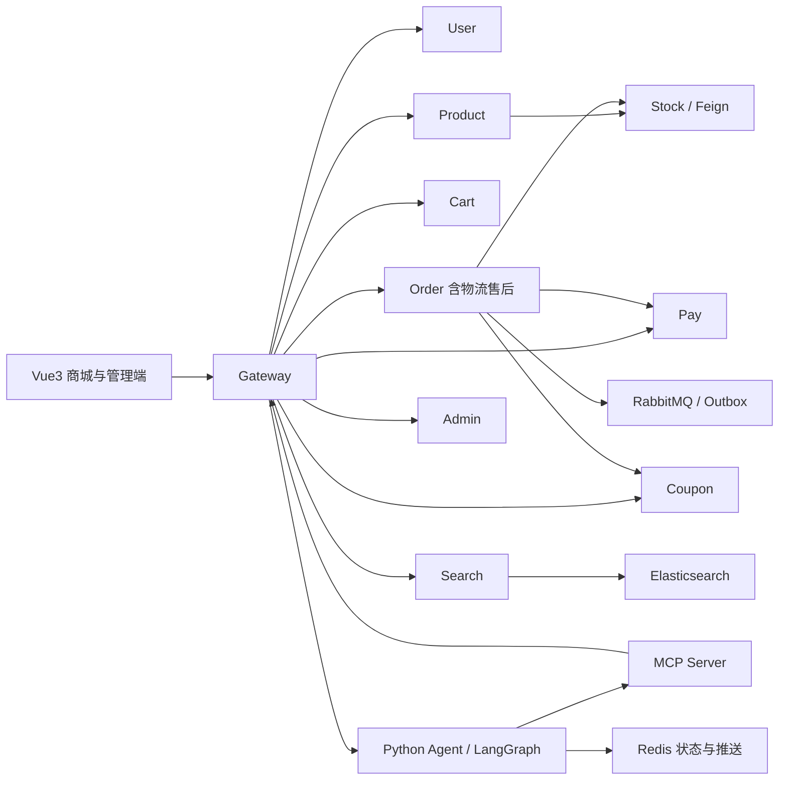

# 项目完整架构分析（截至2026-11-02）

> 2026-11-02后续更新：售后已新增管理员审核、退货物流/人工验货、受控退款执行及实时进度。原文中“尚未实现审核履约”等是此前阶段记录，最新源码与验收见 [15-售后审核履约设计与验收](15-售后审核履约设计与验收.md)。

> 本文记录改造前审查事实。后续已补搜索入口和导购2.0源码，变更与测试见 `04-个人二次开发说明.md` 和 `08-AI导购2.0实现与验收.md`；下文的“待新增/断点”描述不得当作改造后状态。

初次审查：2026-11-01；实施与验收更新：2026-11-02。实际根目录为 `E:/Simlect-AI-Mall-main/Simlect-AI-Mall-main`。本文路径均相对此根目录。当前目录未包含 `.git`，无法提供原始提交差异或创建分支。保留会话之前已完成的低内存启动、Responses 接入、本地邮箱与关闭向量检索修改。后续已经完成导购与搜索二开，以下历史断点结合当前状态说明阅读。

## 当前实际运行架构与验收状态

Common是共享库，不是独立微服务；各Java领域读写各自MySQL库，Nacos提供发现。图省略了多数缓存及API连线，不代表所有Feign都绕行Gateway。Seata与Sentinel控制台为本地未启用的可选运行组件。

- 普通搜索当前链路：Vue `/api/search/products` → Gateway → SearchController.searchProducts → EsSearchComponent.searchProducts → ES → 分页返回；旧 `/api/product/search` 在网关兼容转发。
- 严格导购当前链路：需求Patch/Pydantic → MCP RECOMMEND_PRODUCTS → 原检索候选 → Java AI Filter → Stock批量RPC → 偏好排序与卡片。无结果不会补热销；本地向量关闭。
- 商品对比：最近实际展示序号 → MCP COMPARE_PRODUCTS → Java重新核验 → 有证据结论/缺参数提示。
- 已实际联调商品搜索与详情，已通过20条只读MCP/Java演示目录评测；30条真实模型解析的字段匹配结果、业务单测和局限见09。
- 源码目录级扫描及核心流程审阅已完成，不声称所有文件逐行审计或所有部署/安全/并发路径已经测试。

## 阅读范围和证据边界

`00-源码扫描索引.md` 提供排除依赖和产物的文件目录。已定向阅读 Agent 商品查询、图拓扑/状态、内部客户端、Product 内部快照、Stock Mapper、搜索入口、订单主要调用点、支付/超时/MCP/前端确认相关符号。目录扫描不等于全部文件逐行审计；支付渠道、退款并发及所有权限分支仍需按功能继续精读和运行验证。README 中的测试数量和性能描述不作为本次执行结果。

## 服务职责

Java 根目录为 `Simlect-backend/`；除 Gateway、Search、Admin、Common 外，业务实现通常位于模块 `app/`，跨域契约位于 `api/`。

| 模块 | 职责及源码入口 | 关联关系 |
|---|---|---|
| Gateway | `Simlect-gateway/src/main/resources/application.yml`；`src/main/java/com/simlect/cloud/gateway/filter/` 中 AuthGlobalFilter、InternalTokenGlobalFilter、OriginCheckGlobalFilter | 用户鉴权、内部令牌、Origin、路由到 Java；Agent 是显式 HTTP/WS 路由 |
| User | `Simlect-user/app/src/main/java/com/simlect/controller/AccountController.java`：register/login/getEmailCode | MySQL 账号、Redis 验证码和会话；PasswordService 校验 BCrypt，兼容旧 MD5 后登录升级 |
| Product | `Simlect-product/app/src/main/java/com/simlect/biz/ProductInternalService.java`：snapshotBatch/defaultSku/getSearchIndex/getRagIndex | 商品、分类、属性、SKU 价格权威来源；不拥有库存表 |
| Stock | `Simlect-stock/app/src/main/java/com/simlect/biz/SkuStockService.java`；`resources/com/simlect/mappers/SkuStockMapper.xml` | SKU 库存、行锁、条件更新、操作幂等记录 |
| Cart | `Simlect-cart/app/src/main/java/com/simlect/biz/CartInternalService.java` | 购物车领域；下单通过契约协作，详细购物车写入流程待下一轮精读 |
| Order | `Simlect-order/app/src/main/java/com/simlect/biz/impl/OrderInfoServiceImpl.java` | postOrder、cancelOrder、paySuccess、refund；组合商品、库存、优惠券、支付契约；物流实现在订单域 |
| Pay | `Simlect-pay/app/src/main/java/com/simlect/biz/PayInternalService.java`；`biz/impl/PayChannel4AliPay.java`；`controller/PayNotifyController.java` | 交易记录、渠道调用、回调；本地启动成功不证明真实支付凭据可用 |
| Coupon | `Simlect-coupon/app/src/main/java/com/simlect/biz/CouponInternalService.java` | 优惠券领域；普通优惠券与抢购分支需要分别验证 |
| Search | `Simlect-search/src/main/java/com/simlect/component/EsSearchComponent.java` | ES 商品索引与 searchProducts；SearchController 管理搜索词和推荐；商品检索 HTTP 入口存在断点，见下文 |
| Admin | `Simlect-admin/src/main/resources/application.yml` | 管理端服务；Gateway 把部分 admin-api 按业务路由到各领域，并非所有后台请求都落到 Admin |
| Common | `Simlect-common/src/main/java/com/simlect/` | ResponseVO、异常、鉴权辅助、Redis、Feign 内部令牌、MQ/Outbox。它是依赖库，不是独立运行服务 |

## 中间件实际用途

- MySQL：`sql/01_user.sql` 至 `10_admin.sql` 为领域库结构。商品 SKU 在 `simlect_product.product_sku`，库存在 `simlect_stock.sku_stock`，禁止把旧单体跨库 JOIN 当作现有微服务实现。
- Redis：账号 token、验证码、限流、待确认提案、会话工作状态、图 checkpoint。推荐不能将 Redis 或 ES 价格当作最终成交权威。
- RabbitMQ：订单延迟/死信处理、商品/知识库同步等。Outbox 的 `Simlect-common/.../service/impl/OutboxMessageServiceImpl.java` 与 `task/OutboxDispatchTask.java` 已存在，不能再宣传为本次新增。
- Elasticsearch：`simlect-index` 商品关键词召回；向量库检索由 Agent `app/rag/retriever.py` 调用。本地 `VECTOR_SEARCH_ENABLED=false` 时向量路径短路，但关键词路径保留。
- Nacos：Java 服务注册发现；Feign 的 `@FeignClient(name="simlect-stock")` 通过发现调用服务，不应照抄契约注释，把所有 Java Feign 都画成经过 Gateway。
- Sentinel：网关/Feign 限流熔断相关配置已存在；本地未启动控制台，不能以控制台离线推断业务必然不可用。
- Seata：订单 postOrder 有 `@GlobalTransactional`；当前启动器 `SEATA_ENABLED=false`，演示环境不能声称已验证跨服务原子事务。

## 五条调用链

### 1. 普通商品搜索：改造前断点与当前修复

`Simlect-front/Simlect-web/src/api/modules.ts` 的 `productApi.search` → POST `/api/product/search` → Gateway product 路由 → `Simlect-product/app/src/main/java/com/simlect/controller/ProductController.java#search`。

此方法当前直接抛出“请使用搜索服务接口 /api/search 完成商品搜索”。Search 模块 `controller/SearchController.java` 目前只有关键词和推荐接口，没有接通 `component/EsSearchComponent.java#searchProducts` 的商品搜索入口。这是改造前断点；当前已新增SearchController.searchProducts、调整前端并在网关兼容旧入口。实际Search、Gateway、前端代理搜索均返回5款演示在售商品，详见04。

### 2. AI 对话与工具

前端 `src/composables/useAgentSession.ts`、`src/stores/agentMessage.ts` → `src/api/modules.ts` Agent API → Gateway agent-http/agent-ws → `Simlect-backend/Simlect-agent/app/api/routes/agent.py` → `app/services/agent_service.py` → `app/graph/runner.py#run_agent_graph` → `builder.py#build_agent_graph`。

图：entry → build_context → agent_loop ⇄ tools → finalize → post_turn → cleanup。节点真实实现为 `app/graph/nodes.py` 中 entry_guard/build_context_node/agent_loop_node/tools_node/finalize_node/post_turn_node/cleanup_node；状态类型 `app/graph/state.py#AgentGraphState`，含 react_round 与 pending_tool_calls。

`app/services/agent_runtime.py#bind_agent_llm` 绑定工具 → `mcp_tool_router.py` → `mcp_streamable_client.py#call_tool` → Streamable HTTP `:7060/mcp` → `app/mcp_server/server.py` 注册工具 → `app/services/mcp_tools_service.py` → `java_internal_client.py` → Gateway `/internal/**` → Java 内部 Controller/Service。返回 ToolMessage 或业务卡片，经 WS 更新前端。

MCP list_tools/call_tool 已有 asyncio.timeout，默认 30 秒。不要重复增加第二套无边界客户端。Agent 商品召回由 `product_service.py#search_products` 调 `rag/retriever.py` 的关键词和向量搜索，`rag/rrf.py#rrf_merge` 合并 ID，然后 `_load_products_by_ids` 调 snapshot_batch 读取 Java 快照。

### 3. 下单、扣库存、支付

`Simlect-order/app/src/main/java/com/simlect/controller/OrderController.java#postOrder` → `biz/impl/OrderInfoServiceImpl.java#postOrder`：ProductFeignSupport.snapshotBatch 取得产品/属性/SKU 快照 → 计算真实 SKU 相关业务数据，StockFeignSupport.getAvailable 检查 → lockAndVerify → changeStockBatchIdempotent → 订单持久化与支付记录/支付 URL。具体 SQL/事务先后顺序须结合整个方法的事务分支继续精读，不能仅按这一摘要实现新下单逻辑。

Stock 通过 `Simlect-stock/api/src/main/java/com/simlect/api/StockFeignClient.java` 契约访问 `/internal/stock`，映射到 `app/.../controller/internal/StockInternalController.java` 与 `biz/SkuStockService.java`。Mapper 的 `selectByKeyForUpdate` 使用 FOR UPDATE；`changeStock` 带 `stock + changeAmount >= 0` 条件；`stock_change_operation` 持久化 operationId。

支付使用 PayFeignSupport.getPayUrl/createPending；通知入口 `Simlect-pay/.../controller/PayNotifyController.java`。订单 `OrderInfoServiceImpl#paySuccess` 更新业务结果。退款方法 `#refund` 调 PayFeignSupport.refund，并存在库存恢复及事务同步分支，需以专项测试验证重复通知和远程成功本地失败场景。

### 4. 超时关单与库存恢复

`OrderInfoServiceImpl#postOrder` 含 PAY_TIMEOUT_DELAY_KEY 发布路径 → RabbitMQ 延迟/死信 → `Simlect-order/app/src/main/java/com/simlect/component/RabbitMQPayOrderDeadListenerComponent.java#handlePayTimeoutOrder` → `OrderInfoServiceImpl#cancelUnpaidOrderForPayTimeout` → 关单及库存恢复逻辑。`cancelOrder` 及相关关闭分支会调 PayFeignSupport.markClosed 与 StockFeignSupport.changeStockBatchIdempotent。幂等恢复已有基础，后续应针对竞态补证据，不是重新实现一套恢复逻辑。

### 5. AI 售后确认

模型调用 `app/mcp_server/server.py` 中 PROPOSE_REFUND 等工具 → `mcp_tools_service.py` → `pending_action_service.py#create` 保存提案 → `Simlect-front/Simlect-web/src/components/agent/AgentConfirmCard.vue` 展示确认 → Agent confirmAction → `PendingActionService#confirm` → `action_execute_service.py#ActionExecuteService.execute` → `JavaBridge.refund_order/confirm_order/post_comment/post_recomment` 携用户 token 请求 Java `/api/order/**` → Java 继续执行业务所有权与状态检查。

这里服务间内部令牌和用户 token 用途不同。提案成功不等于退款成功；模型不得跳过确认直接执行写操作。

## 已有能力和本次缺口

| 能力 | 源码现状 | 决策 |
|---|---|---|
| 关键词+向量+RRF | ProductService 已实现；本地向量关闭 | 复用候选召回 |
| 商品批量快照 | ProductInternalService.snapshotBatch 三类批量查询 | 复用，SKU 价格继续由 Java 读取 |
| 预算/硬软约束 | 原product_search_query主要规则清洗 | 已增加shopping模型、结构化解析、校验与降级 |
| 无结果推荐 | product_service 热销兜底已有 | 约束搜索不得把越预算/无库存热销包装为满足条件结果 |
| 库存批量读取 | 原契约以单项读与批量写为主 | 已新增readBatch只读接口和有界SQL |
| 推荐 MCP | SEARCH_PRODUCTS 已有 | 优先增强并复用；新工具只在语义契约不同且有必要时添加 |
| 会话与指代 | session_memory_service、图状态、卡片上下文已有 | 增加需求状态字段并核对既有 lastSearchResults 写入位置 |
| 2～3 商品精确对比 | 原有咨询与卡片上下文 | 已新增最近列表序号对比、Java重新核验与证据结论 |
| RAG 与 DB 兼容模式 | java_internal_client.py 允许 INTERNAL_READ_BACKEND=db | 新导购必须强制 HTTP 权威校验；不能让 AI 走兼容库查询 |

## 第一轮可定位的问题

1. 普通搜索 HTTP 断链，见上文前端、ProductController 与 SearchController。
2. ProductInternalService.increaseSales 先读 totalSale 再 updateByProductId，源码存在并发覆盖窗口；是否需要修复取决于当前销量调用并发和事务锁语义，需专项验证，不直接宣称已造成丢失。
3. ProductService._load_products_by_ids 在批量失败时逐个请求；增加请求预算、候选上限和降级耗时测试，避免工具默认 30 秒内形成串行超时。
4. ProductService 搜索无结果会转热销，结构化硬约束路径应独立返回不满足，而不改变现有普通浏览体验。
5. product_search_query 的手机扩展词包含“手机壳”；手机需求可能召回配件，需以实际商品夹具验证相关性。
6. 不声称新功能已通过集成评测；当前没有本次 30 条基准执行结果。
