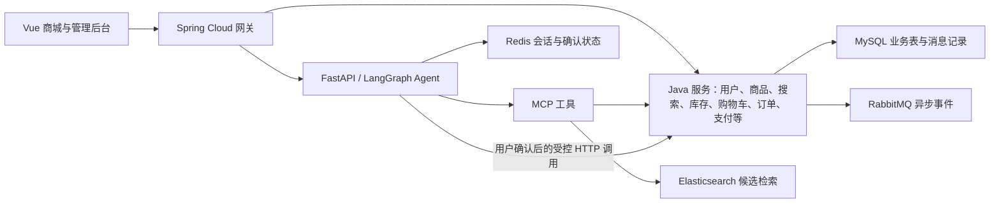
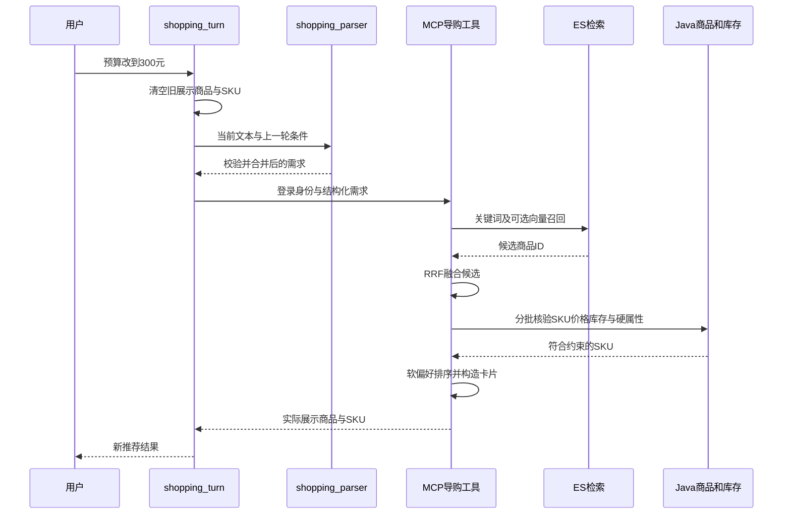
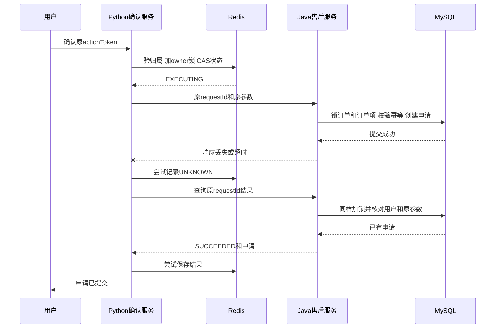
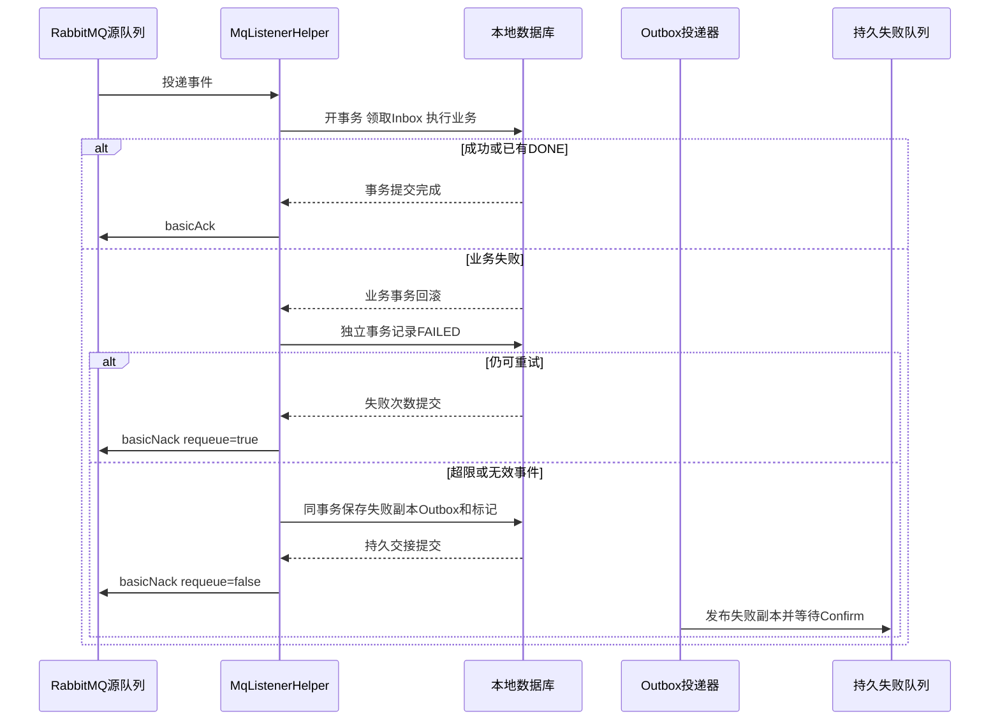

# 基于 AI Agent 的微服务电商平台｜源码与面试实战

2026-11-25 学习入口：[项目原理讲解与追问指南](25-项目原理讲解与追问指南.md)。新教材按当前源码深入讲解交易、导购、售后恢复与测试边界；本篇保留作为简历逐条复习材料。

这份笔记按最终简历的五条项目经历展开。先跑通脑中的调用链，再挑一条故障路径练到能画图、能指出方法、能解释数据最后落在哪里。

2026-11-16 对照当前源码修订。先读 [技术栈原理与源码详解](23-项目技术栈原理与源码详解.md)，再使用本篇复习简历。第 7 节补充时序图和连续追问。源码片段的完整位置及变量解释见基础篇。

## 0. 项目简介：先建立全局图

读代码时把三类职责分开：LangGraph 管一轮会话怎么走，MCP 管可调用的业务工具，Java 管订单、价格、库存和售后状态等业务事实。项目以 Spring Cloud 划分服务，Java 通过 OpenFeign 调用其他服务，数据库访问主要看 MyBatis Mapper 和 XML。下单入口有 Seata 全局事务注解，本地演示启动方式关闭 Seata，演示无法证明跨库全局事务已经联调。

**60 秒介绍练习**

> 这是一个 Spring Cloud 微服务电商项目。我主要做了两类完善。AI 侧，导购把自然语言转成结构化购物条件，检索商品候选，再让 Java 按 SKU 的价格、库存和属性核验。售后侧，AI 先出提案，用户确认后才创建申请，超时就拿原 requestId 查 Java。交易侧，我完善了已发货订单的退款门禁和支付宝回调校验，还处理了 Outbox 投递崩溃恢复、Inbox 提交后 ACK。项目演示用的是本地模拟支付和退款。

开头用“基于已有商城做二次开发”讲清原有基础和自己负责的改动。核心点讲完后，让面试官选一条深入。

## 1. 智能导购：从一句话到可核验的商品卡

**原问题。** 召回排序靠前的商品未必在预算内。提前截断候选会丢掉预算内的结果。多轮修改之后，直接沿用上一轮列表会让“第一款”指向旧 SKU。

**真实调用链。** 在 `Simlect-backend/Simlect-agent/app` 从 `api/routes/agent.py::send_message` 开始，读 `graph/builder.py` 和 `graph/nodes.py`，再看导购分支 `services/shopping_turn.py::_shopping_turn`。

1. `shopping_parser.py::parse_shopping` 解析用户条件，`explicit_update` 识别明确的预算等修改，`models/shopping.py::merge_requirement` 把结构化 patch 合并到上一轮需求。预算和必须满足的属性走硬约束，品牌偏好等软条件用于排序。缺品类或有歧义时先问清。
2. `shopping_turn.py` 在新推荐之前清空旧的 `shoppingResults` 和 `shoppingShownSkus`。解析失败或检索不可用时，也就不会拿旧卡片来回答新条件。
3. `RECOMMEND_PRODUCTS` 走 MCP 工具，进入 `shopping_service.py::recommend`。关键词和可选向量分支各有超时，`rrf_merge` 按各路排名累加倒数贡献，融合后把有界候选分批交给 Java。RRF 融合的是排名，预算判断在下一步。
4. `verified_rows` 调 `/internal/product/ai/filter`。Java 的 `AiProductFilterService.filter` 批查库存，以商品 ID 和 SKU 哈希关联 SKU 库存，核对品类、价格和硬属性，过滤库存为零的 SKU。Java 用 `BigDecimal`，Python 用 `Decimal` 防止浮点误差。关键属性缺失时不能当作符合条件。
5. `rank_rows` 对已核验商品做排序，卡片用核验返回的 SKU、价格、库存和属性构造。比较“第一款和第二款”时按实际展示顺序取商品 ID 和 SKU 哈希，`compare` 重新核验，只保留相同 SKU。原 SKU 失效就提示用户，缺失数据标未知。

**手演。** 假设首轮要求“500 元以内的蓝牙耳机，排除某品牌”，第二轮说“预算改到 300，其他不变”。画出旧条件、patch、合并后的条件、旧结果清空、重查与新 SKU 列表。第三轮对比前两款时，假设一款库存变为零，解释为什么结果只剩一款且需要提示。

**面试问答。**

- 为什么不直接用 Elasticsearch 的商品价格？索引负责找候选，商品最便宜的 SKU 可能无货或不满足属性。推荐展示的是 Java 核验过的 SKU 价，下单时仍须重新核价、校验库存。
- 向量分支超时怎么办？单分支失败后可继续使用关键词候选；Java 核验失败则不给未经验证的商品。演示用关键词，源码有向量及 RRF 分支，真实向量效果尚无联调证据。
- 怎么证明多轮安全？查 `test_shopping_turn_safety.py` 和 `test_shopping_evaluation.py`，区分固定场景和模拟故障与线上推荐效果。

## 2. 智能售后：提案、确认、写入、查结果

**原问题。** 用户双击会重复提交。Java 已提交但 Python 没收到响应时，显示“失败”会诱导用户再次创建申请。Redis 锁或临时键清理失败也可能让界面和真实状态不一致。

**咨询链。** `graph/nodes.py` 进入 `after_sale_turn.py::after_sale_turn`，通过 MCP 查订单、政策、资格和售后进度。Java 的 `AfterSaleService.check` 校验归属和申请条件，`AfterSalePolicyRules.evaluate` 处理规则。缺正式政策或可信签收时间时转人工核实。可以受理申请与已经具备退款资格是两件事。

**执行链。**

1. `pending_action_service.py::create_pending` 保存用户、动作类型、原始参数、确认 token、稳定 requestId 和过期时间。确认时长与结果保留时长分别管理。
2. `api/routes/agent.py::confirm_action` 从登录上下文取用户，`load_owned` 核对 token 所属用户。随后获取 Redis 动作锁，CAS 将 `PENDING` 改为 `EXECUTING`。并发点击遇到锁返回“正在提交”，已经保存的结果可直接回显。
3. `action_execute_service.py::execute` 用用户鉴权和原 requestId 调 Java。兼容的退款提案走售后申请，实际退款由后台履约入口处理。
4. `AfterSaleController.create → AfterSaleService.create` 在本地事务内按订单、订单项加锁并复核归属。相同 requestId 且用户、订单项、类型、原因都一致时返回原申请；参数冲突则拒绝。新申请还要通过资格和重复申请检查，申请和日志同事务写入，状态为 `PENDING_REVIEW`。
5. 明确业务拒绝记 `FAILED`。超时等不确定异常记 `UNKNOWN`，由 `recover` 调 `AfterSaleController.result → AfterSaleService.result` 查原请求。查到已提交就恢复 `SUCCEEDED`。`NOT_FOUND` 只是当前快照，只有允许重试且用户再次明确确认，才可用同一个 ID 和原参数重试；查询结果的入口只读。缓存写回或清锁失败不抹掉已经核实的 Java 结果。
6. 人工审核由 `AfterSaleWorkflowService.review` 处理。退货退款进入 `WAIT_RETURN → WAIT_INSPECTION → READY_REFUND`，验货拒绝不能退款。管理员触发模拟退款后再查售后进度。申请提交成功时退款仍未完成。

**手演。** Java 已写入申请 A，HTTP 响应丢失，Redis 状态写回又失败。画两行状态：Java 已有 A，Redis 可能还在 `EXECUTING`。用户查询或再次确认时按原 ID 恢复 A，说明缓存状态为什么落后、订单行锁与幂等校验怎样挡住重复写入。

**面试问答。**

- Redis 已经加锁，为什么 Java 还需要幂等？锁有超时，进程可能崩溃，网络请求可能迟到，Java 也有自己的入口。最终的重复保护在业务数据库和事务边界。
- 用户改个 requestId 呢？requestId 固定在提案里，确认端读原始参数。Java 还对同订单项的处理中申请做业务门禁，所以不同 ID 也不能绕过。
- 怎么测最难的路径？看 `test_action_result_recovery.py`，定位“Java 提交后响应超时”“缓存写回失败”“跨用户”“并发点击”和“超期确认”用例；Java 看 `AfterSaleServiceTest`。

## 3. 交易安全：退款门禁和支付回调分别讲

### 3.1 退款入口治理

**原问题。** 旧接口和新售后并存，已发货订单可能从旧入口直接进入退款，绕过审核与验货。

**调用链。** 旧 `OrderController.refundOrder → OrderInfoServiceImpl.refund → refundInLock → doRefund` 保留入口，但退款执行前复核归属、订单与订单项状态、处理中申请及物流。快捷退款由 `AfterSaleWorkflowService.allowsQuickRefund` 同时判断订单和未发货物流状态，物流未知也不能通过。已发货退货退款走后台 `AfterSaleWorkflowService.refund`，由已审核且达到可退款阶段的申请调用 `refundAfterSale`。

**一致性。** 支付生命周期锁协调同一支付单上的操作，MySQL 行锁保护本地订单、订单项或申请的并发读改，状态门禁控制合法迁移。三个约束解决不同层的问题。库存回补跟履约分支及可重新入库条件有关，退款成功不等于任何场景都可以回补。

**追问。** 已审核但没验货能退吗？退货退款还处于等待退货或等待验货，只有验货通过进入可退款阶段。看 `AfterSaleWorkflowServiceTest`，重点解释为什么拒绝时支付、订单项和库存都不能发生修改。

### 3.2 支付回调

**读码顺序。** `OrderInfoServiceImpl.postOrder` 先帮助理解下单、库存、支付单和延迟关单消息的关系。然后读 `PayNotifyController.alipayNotify → PayChannel4AliPay.payNotify → OrderInfoServiceImpl.paySuccess → paySuccessInLock`。

1. Controller 拒绝同名多值参数，渠道层用支付宝证书验签。核对 `out_trade_no`、`trade_no`、`trade_status`、`app_id`、`seller_id`、`total_amount`，商户值来自配置。金额必须为正，最多两位小数。
2. 支付成功事件经 Feign 给订单服务。订单侧按支付单号关联订单，`assertCallbackAmountMatches` 用 `BigDecimal` 比较实际金额与本地应付。验签只能说明报文可信，本地仍要确认这笔钱属于本订单、金额也正确。
3. 回调入口锁减少重复并发，订单侧支付生命周期锁、状态机和 SQL 条件更新约束支付成功与关单竞争；`handlePaySuccessConflict` 重新读取并处理冲突状态。拿不到回调锁时返回失败让渠道重试，因为持锁请求未必提交成功。

**追问。** 为什么用 `compareTo`？`100.0` 与 `100.00` 数值相同、scale 不同，业务比较的是金额数值。格式和精度在渠道入口另外校验。异常测试看 `PayChannel4AliPaySecurityTest`，对比缺金额、错误商户、错误金额和重复回调分别在哪一层处理。真实支付宝资金通道没有接入本地演示。

## 4. 消息可靠性：生产者 Outbox 与消费者 Inbox

| 机制 | 处理的问题 | 先看哪个入口 |
| --- | --- | --- |
| Outbox | 业务提交了，但发消息前后可能宕机 | `TransactionalMqSender.sendAfterCommit`、`OutboxMessageServiceImpl.tryDispatch` |
| Inbox | Broker 重投，业务可能已经提交，也可能已经回滚 | `MqListenerHelper.consumeInbox`、`MqConsumerIdempotencyHelper.executeBatch` |

**Outbox。** 有本地事务的调用先将业务和待发记录一起落库，提交后尝试发出，调度任务兜底。无事务时发送器有直发分支。两实例扫描可看见同一条记录，但只有 `LocalMessageOutboxMapper.xml::claimLease` 条件更新成功的实例拿到有效租约。过期的 `SENDING` 可以重新领取；当前有效租约持有者才能写结果。Publisher Confirm 说明 Broker 接收情况，消费者是否执行业务要另查。发送失败按退避重试，耗尽后保留记录和告警供人工核实。

**Inbox。** 旧的 Redis 预占位存在“写标记后、业务提交前宕机”的丢处理窗口。现在用消费者名与事件 ID 唯一约束，插入或锁定 Inbox 记录。业务库修改和 `DONE` 在同一个本地事务内提交。业务失败回滚后，独立事务记录失败次数和原因。可重试时执行 `NACK(requeue=true)`。失败超限或事件无效时，先将失败记录及失败副本 Outbox 同事务提交，再对原消息执行 `NACK(requeue=false)`，随后由 Outbox 投递到持久失败队列。正常提交或查到 `DONE` 才 ACK。跨微服务操作仍各自保留事务边界。

失败处理过程中若发现其他消费者已经提交 `DONE`，会返回 DONE 并 ACK。失败记录或副本 Outbox 写入失败时，原消息重入队列。默认允许 3 次重试，普通业务第四次失败进入终态。数据库里的 `dlq_enqueued=1` 表示失败副本已交给本地 Outbox，Broker 是否接收还要看投递结果。

| 故障时点 | 恢复方式 |
| --- | --- |
| 已领取 Outbox，还没发就宕机 | 租约到期后调度重新领取 |
| Broker 已确认，数据库未写成 SENT | 租约恢复后可能重发，保持原事件 ID |
| 消费业务执行到一半，数据库未提交 | 业务和 Inbox 一起回滚，重新投递可再执行 |
| 消费事务已提交，ACK 未到达 Broker | 重投读到 DONE，跳过业务并 ACK |

**追问。** 能做到 Exactly Once 吗？传输层允许重投。对接入 Inbox 的消费路径，在事件标识稳定且业务与 Inbox 共用本地事务的前提下，可以避免重复执行本地业务。不同消费者可以各处理同一个事件。看 `OutboxMessageServiceImplTest`、`OutboxMapperContractTest`、`InboxTransactionTest`，区分测试模拟的故障与实际 Broker 宕机验证。

## 5. 测试验证：说明证据来自哪一层

| 证据层级 | 可以怎么说 |
| --- | --- |
| 历史自动化回归记录 | Java 1616 项，1614 通过、2 跳过；Python 251 通过；PC 前端 `vue-tsc -b` 通过。此次学习整理未重新执行 |
| 本地手动演示 | 用户反馈已验证下单与模拟支付、AI 推荐及对比、售后申请至模拟退款。若被问到具体步骤，只讲自己实际点过并看过状态的部分 |
| 功能边界 | 关键词召回已用于演示，真实向量召回、Seata 跨库事务、真实支付退款、可信签收事件和换货履约不作为已联调的项目成果 |

复盘每条演示时记下一个可核对的结果：支付前后同一订单的状态，修改预算前后真实展示的 SKU，售后申请编号及审核、验货、模拟退款的状态。健康检查通过和页面可打开属于服务就绪证据。

## 6. 三次首轮复习安排

下面的时间适用于已有基础后的首轮复习。初学时每轮拆成多个学习时段，先读基础篇，再定位源码和测试。掌握以能独立解释故障恢复、读懂 SQL 条件并回答追问为准。

1. **第一轮，导购与介绍（50 分钟）。** 画架构并录一遍 60 秒介绍。沿 `shopping_turn → parse_shopping → recommend → filter → compare` 看实际代码。合上文档解释“关键词能搜到，但 Java 为什么没有返回”。
2. **第二轮，售后与交易（70 分钟）。** 画两条状态链：Python 动作状态和 Java 售后履约状态。口述超时恢复、旧退款门禁、支付验签和金额校验，再看一条对应测试。
3. **第三轮，可靠消息与模拟面试（60 分钟）。** 白纸画业务提交、Broker Confirm、业务消费提交、ACK 四个时点。任选一个时点假设进程挂掉，解释重试由谁做、用哪个 ID、怎么证明不会重复改库。

每轮用四句话检查自己：原来哪里会出错、我改了哪个入口、系统如何从失败中恢复、我用什么证据确认。讲错时回到对应方法重走，不背类名列表。

延伸阅读：[分阶段开发记录](../improvement/README.md)、[最终验收](../SIMLECT_FINAL_ACCEPTANCE.md)、[运行与测试证据](../SIMLECT_FUNCTION_VERIFICATION_RESULTS.md)。

## 7. 时序图与连续追问

### 7.1 导购的结果为什么可信

**第一问：为什么已经结构化解析，还需要 Java 核验？**

> Pydantic 能约束预算类型、范围和属性结构。模型可能理解错用户意思，也不掌握实时库存。我把解析结果作为查询条件传给 Java，Java 从实际 SKU 和库存数据筛选，卡片引用核验后的价格与属性。下单还会再校验，因为推荐到下单之间库存可能变化。

**第二问：为什么先融合再筛选，不能只取前几款？**

> 召回排名表达相关性。排名靠前的商品可能超预算，如果只保留几款再筛选，会把后面的合规商品提前丢掉。现在把有上限的融合候选分批给 Java 筛选，通过后再排序展示。候选仍有限，所以不能承诺找到全库所有符合条件的商品。

**第三问：多轮里的“第二款”怎么确定？**

> 系统保存当前卡片的商品顺序和 SKU 哈希。对比从当前展示结果取 ID，工具路由还会从服务端会话重新取 SKU 和条件。Java 再查价格库存，原 SKU 无货就提示。条件变更之前先清掉旧列表，所以新一轮失败也不会沿用旧编号。

### 7.2 Java 成功、Python 超时后怎样恢复

**第一问：超时是不是说明失败？**

> 超时只说明调用方没有及时拿到响应。我将动作标为 UNKNOWN，再拿原 requestId 查 Java。查到原申请就恢复成功。查询也不可用时继续显示正在核实。这里成功的含义是申请提交成功，人工审核和退款是后续阶段。

**第二问：查询说没有，为什么还不能换 ID 重试？**

> 原请求可能还在网络里，也可能刚准备获取数据库锁。查不到只是一个时点的结果。允许重试时继续使用原 ID 和参数，这样迟到的旧请求和新请求最终进入同一个 Java 幂等检查。结果查询本身不会写申请，重新执行还需要用户明确确认。

**第三问：Redis 状态没保存成功呢？**

> Java 数据库里的申请提供恢复依据。下次读到 EXECUTING 或 UNKNOWN 时仍可查询原请求，锁过期也不抹掉 Java 的幂等保护。如果确认记录已彻底丢失，就要通过用户售后进度核实，不能假设 Redis 永远能恢复所有历史动作。

### 7.3 消费成功与失败超限的两个分支

图中最后两条消息强调持久交接后的职责。Outbox 的 afterCommit 尝试可能在 NACK 之前就发生，也可能由定时任务稍后完成，两者没有必须先 NACK 再发布的时序要求。

**第一问：为什么不能业务开始前写 Redis 消费成功标记？**

> 进程可能在标记成功后、数据库提交前挂掉。重投时只看 Redis 会误认为处理完成并 ACK。Inbox 把完成标记和业务放在同一个本地事务，提交前一起回滚，提交后重投能查到 DONE。

**第二问：ACK 失败后会不会回滚业务？**

> executeBatch 返回时事务已经提交，ACK 属于后续 Broker 交互。代码记录 ACK 错误并关闭通道，让未确认消息有机会重投。重投读到 DONE 后跳过本地业务，重新 ACK。

**第三问：失败超限为什么要 Outbox 再 NACK(false)？**

> NACK(false) 对没有 DLX 路由的源队列可能意味着丢弃。项目先保存失败原因、原事件信息和失败副本 Outbox，再终止源队列重试。之后通过 Confirm 投递到独立失败队列。失败副本尚未发出时，数据库记录仍然保留；若持久交接失败，则继续 requeue。

**第四问：跨服务调用也能被 Inbox 一起回滚吗？**

> 本地事务覆盖同一个事务管理器下的数据库修改。远程服务若已经提交，调用方回滚不能撤销它。远程操作仍需要自己的幂等键、业务状态校验和补偿。我会分别说明本地事务一致性与跨服务最终一致性的范围。

### 7.4 支付回调与退款门禁的追问

**第一问：支付宝验签成功为什么还要验商户和金额？**

> 签名验证报文的真实性和完整性。业务还要确认报文里的 app_id 和 seller_id 对应本项目商户，out_trade_no 能关联本地支付单，total_amount 与应付一致，trade_status 表示已支付。任何一层不匹配，都不能推进支付成功状态。

**第二问：支付成功和超时关单同时发生怎么办？**

> 代码按支付单协调生命周期操作，再由订单状态机和条件更新限制状态迁移。支付侧重新读取冲突状态并走 handlePaySuccessConflict。回答时我会分别画出支付先获得执行机会、关单先获得执行机会的路径，再指出查询和补偿位置。外部支付渠道与本地库存在独立提交点，需要处理迟到通知。

**第三问：修旧退款接口会不会挡住管理员退款？**

> 旧入口的快捷退款受订单、物流和处理中申请约束。管理员从售后履约入口执行，先检查审核和验货阶段，再进入对应退款执行分支。两类调用在进入实际退款前都有门禁。验货通过与是否可以回补库存也是分别判断的。

### 7.5 学习完成标准

| 主题 | 合上文档后的练习 | 回到源码检查 |
| --- | --- | --- |
| 导购 | 解释预算修改、原SKU无库存、检索失败三种结果 | shopping_turn、verified_rows、compare |
| 售后 | 同时画Redis动作状态和Java申请状态 | confirm、recover、create、result |
| 交易 | 指出每个回调字段在哪一层被验证 | payNotify、assertCallbackAmountMatches |
| 消息 | 画提交前崩溃、提交后ACK丢失、超限隔离 | executeBatch、recordFailure、settleFailure |
| 基础 | 解释锁、幂等、事务、状态机各自保护什么 | 基础篇第4—8节 |

本次为源码与文档核对，未重新执行测试。历史测试数字沿用第 5 节的证据范围。
