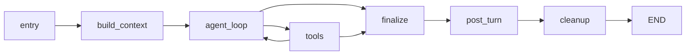

# AI 微服务电商平台技术栈原理与源码详解

2026-11-25 学习入口：[项目原理讲解与追问指南](25-项目原理讲解与追问指南.md)。可先按新教材追踪真实业务与故障，再回本篇查技术概念；最新验证范围见 24 号报告。

2026-11-16。配套 [简历源码与面试实战](22-最终简历逐条源码与面试实战.md)。这份资料从概念讲到项目代码，后一份按业务链做复习和追问。

阅读每节时，先用自己的话说明用途，再打开源码看输入、条件、输出。代码框标明真实摘录或教学展开，省略部分不作为可运行程序。本文只整理当前项目，历史测试与本地模拟演示的范围沿用验收记录。

## 1. 先认识一次业务请求

用户点击按钮后，前端发送 HTTP 请求。Controller 接收请求并做登录和参数检查，Service 执行业务规则，Mapper 访问数据库。Service 需要其他服务的数据时，通过 Feign 发起远程 HTTP 请求；需要异步通知时，通过消息机制交给消费者。

| 对象 | 含义 | 在项目中关注什么 |
| --- | --- | --- |
| 商品/SPU | 一类商品的展示与描述 | 商品名、品类、属性 |
| SKU | 可购买的具体规格组合 | SKU哈希、价格、可售库存 |
| 订单 | 一次业务交易的记录 | 用户归属、订单状态、金额 |
| 支付单 | 对接支付过程的标识 | 回调关联、渠道交易号、金额 |
| 订单项 | 订单内具体购买项 | 售后归属、退款状态 |
| 售后申请 | 一次申请及履约过程 | requestId、审核、退货、验货、退款阶段 |

回答“库存属于哪个对象”时，要讲到具体 SKU。回答“申请成功了吗”时，要讲清是申请写入、审核通过还是退款完成。这样才能理解后面的约束。

## 2. Spring Boot、IoC 和 AOP

**是什么。** Spring 管理对象及对象间依赖，称为 IoC 容器。依赖注入让 Service 获得 Mapper 等对象。Spring Boot 通过自动配置和依赖组合简化应用启动。AOP 可以在方法调用前后统一执行事务等逻辑。

**项目为什么用。** 用户、订单、商品等模块各自运行一个服务，Controller、Service、Mapper 都需要被创建和连接。每个业务方法都手写连接、提交和回滚容易漏掉异常路径。

**代码入口。** 看 `Simlect-backend/Simlect-order/app/src/main/java/com/simlect/biz/AfterSaleService.java`。类上有 `@Service`，构造函数注入依赖，`create` 上有 `@Transactional(rollbackFor=Exception.class)`。沿 Controller 调用它，观察抛异常时如何回滚。

**底层要点。** 声明式事务通常通过代理拦截方法调用。代理外部进入 Service 时开启事务，正常返回后提交，符合回滚规则的异常触发回滚。同类内部直接调用可能绕过代理；吞掉异常正常返回也会影响回滚。项目 Inbox 使用 TransactionTemplate 显式划定事务范围。相关代理边界见 [Spring事务说明](https://docs.spring.io/spring-framework/reference/data-access/transaction/declarative/annotations.html)。

**面试口述。**

> Spring 管理 Service 和 Mapper 的依赖，事务代理为售后创建方法建立本地事务。这个事务让申请和日志一起成功或失败。我还要核对调用是否经过代理、使用哪个事务管理器，以及业务有没有把异常吞掉。

**自测。** 如果插入申请成功、插入日志失败，哪里抛异常？Controller 返回时数据库应该是什么状态？如果在 create 里面捕获所有异常后返回成功，会有什么变化？

## 3. Spring Cloud 与 OpenFeign

**是什么。** Spring Cloud 提供微服务相关基础设施的集成。OpenFeign 用接口声明远程 HTTP 调用，运行时代理负责参数序列化、发送请求和解析响应。

**项目为什么用。** 支付服务处理渠道通知，订单服务掌握订单状态。通过显式 API 传递结果，让订单服务自行执行规则。

源码 `Simlect-backend/Simlect-order/api/src/main/java/com/simlect/api/OrderFeignClient.java` 的真实注解摘录：

```java
@FeignClient(name = "simlect-order", contextId = "orderFeignClient", path = "/internal/order",
        fallbackFactory = OrderFeignFallbackFactory.class)
```

`name` 指向服务名，`contextId` 区分客户端配置上下文，`path` 是接口公共路径，fallbackFactory 提供失败降级实现。具体请求是否经过网关，要看实际服务发现、URL和路由配置，不能从这条注解推断。

**为什么用 Support 层。** 项目存在 `OrderFeignSupport` 等封装，用于集中处理跨服务返回值与异常。学习时继续追到该层，避免只读接口签名。

**追问与回答。**

> Feign 调用超时，只能证明调用方没拿到结果，远端可能已经提交。读操作可以按策略重查，写操作应保留稳定标识、查询结果并控制重试。Python 调 Java 同样有这个问题，所以售后增加了原 requestId 结果恢复。

## 4. MyBatis、SQL 和 MySQL事务

**是什么。** MyBatis 把 Java Mapper 方法与 SQL 绑定，并将结果映射为对象。项目主要使用 XML Mapper，也存在售后 Mapper 上的 SQL 注解。数据库事务把多条修改组合成一次提交。

**实际入口。** `Simlect-backend/Simlect-common/src/main/resources/com/simlect/mappers/MqInboxMapper.xml` 及相应 Java Mapper。真实摘录：

```xml
<select id="lock" resultType="java.util.HashMap">
    SELECT status, failure_count AS failureCount, dlq_enqueued AS dlqEnqueued
    FROM mq_consumer_inbox WHERE consumer_name=#{consumer} AND event_id=#{eventId} FOR UPDATE
</select>
```

`id="lock"` 对应 Mapper 方法。`#{consumer}` 和 `#{eventId}` 是绑定参数，不能把用户输入拼成 SQL。`AS failureCount` 把数据库列名转换为返回 Map 的键。`FOR UPDATE` 在事务内锁住匹配记录，其他竞争事务必须等待或超时。

**行锁为什么有用。** 两个消费者读到同一个 FAILED 后，如果各自执行一次业务就会重复修改。唯一约束先定义“同一消费者的同一事件”，锁定读再让判断和状态更新按顺序执行。具体锁范围依赖索引、SQL和隔离级别，不能一概认为任何查询都只锁一行。

**事务中的三件事。**

- 原子性让业务修改和 DONE 一起提交或回滚。
- 隔离性约束并发观察与修改，锁定读解决这里的竞争。
- 持久性确保成功提交的数据在数据库提供的持久化保证下保留，应用还需要考虑部署和存储故障。

**追问。** 唯一约束已经有了，为什么还加锁？唯一约束防止同身份创建两条记录，行锁保护已有记录的“读取状态、执行业务、标完成”。两者作用阶段不同。

## 5. Redis owner锁、TTL与Lua

**是什么。** 多进程用共享 Redis 键协调同一资源。NX 表示键不存在才设置，EX 按秒设置过期时间，PX 按毫秒。一次原子 SET 同时完成占位和过期配置。

项目确认锁在 `Simlect-backend/Simlect-agent/app/services/redis_service.py::try_lock_pending_action`，真实摘录：

```python
key = f"{REDIS_AGENT_PENDING_ACTION}lock:{token}"
owner = uuid.uuid4().hex
ok = await self.client.set(key, owner, nx=True, ex=max(1, int(ttl_seconds)))
return owner if ok else None
```

- `token` 定位同一确认动作，`owner` 区分每次拿锁的执行者。
- `ok` 为真才持锁。失败时另一请求可能仍在处理。
- 默认确认锁时长为 120 秒，这一段使用 EX，没有自动续期逻辑。

解锁 Lua 的真实摘录：

```lua
if redis.call("get", KEYS[1]) == ARGV[1] then
    return redis.call("del", KEYS[1])
end
return 0
```

`KEYS[1]` 是锁键，`ARGV[1]` 是调用方的 owner。比较与删除作为一段 Lua 执行，避免“检查完归属后，锁过期被别人取得，原持有者又把新锁删掉”。基本机制可参考 [Redis锁说明](https://redis.io/docs/latest/develop/clients/patterns/distributed-locks/)。

**手演。** A 得到锁，执行暂停超过 TTL。B 得到新锁。A 恢复后解锁，发现 owner 已不同，删除被拒绝。但 A 可能仍在执行先前业务，所以 owner 解锁并不能独自消除业务重复。

**面试回答。**

> TTL 让崩溃后的锁能释放，owner 和 Lua 防止误删后来者的锁。任务超过 TTL 时可能出现两个执行者，所以我还依赖稳定 requestId、Java 本地锁和业务状态校验。Java 的 Redisson 看门狗锁与这段 Python 固定 TTL 锁要分别说明。

## 6. 锁、幂等、状态机和事务怎样配合

| 机制 | 回答的问题 | 项目例子 |
| --- | --- | --- |
| 锁 | 此刻谁可以操作同一资源 | 动作锁、订单行锁 |
| 幂等 | 同一意图再次执行会产生什么结果 | 相同 requestId 返回原售后申请 |
| 状态机 | 当前阶段允许做什么 | 等待验货不能退款 |
| 事务 | 一组本地修改是否一起提交 | 业务修改与 Inbox DONE |

稳定 requestId 代表一次业务提案，重试沿用原值。不同订单、不同业务意图不能随便复用同一个 ID。相同 ID 携带不同用户、订单项或原因也要拒绝，避免把别人的成功结果当作本次成功。

**代码阅读。** `AfterSaleService.create` 先核对归属，再按订单、订单项加锁，查询原 requestId。已有记录要比较原参数；没有记录再做资格检查并插入。申请层还限制同订单项的处理中申请，防止换 ID 重复申请。

**口述练习。**

> 锁降低同时执行的竞争，幂等处理重复到达，状态机限制非法顺序，事务让本地修改共同提交。这四种约束一起覆盖并发、重试和中途失败。业务跨服务时仍要分别处理远程结果。

## 7. RabbitMQ、Confirm与ACK/NACK

**是什么。** 生产者向 Exchange 发布消息，Exchange 根据绑定将消息路由到 Queue，消费者从 Queue 获取消息。Channel 是连接上的逻辑通道。

**项目为什么用。** 延迟关单、物流事件等异步业务允许生产者先完成当前事务，后续由消费者处理。学习入口包括 `RabbitMQPayOrderDeadListenerComponent` 和公共 `MqListenerHelper`。

| 信号 | 发送方向 | 说明 |
| --- | --- | --- |
| Publisher Confirm | Broker → 生产者 | 发布端确认 |
| basicAck | 消费者 → Broker | 当前投递可以完成确认 |
| basicNack，requeue=true | 消费者 → Broker | 拒绝并要求重新入队 |
| basicNack，requeue=false | 消费者 → Broker | 拒绝并停止重入源队列，后续取决于死信配置 |

Confirm 与消费者 ACK 独立。不可路由消息还需要关注 Return/mandatory 处理。消费侧 deliveryTag 属于当前 Channel，重投后可能变化，所以业务幂等要用稳定 eventId。项目 ACK/NACK 的第二个参数 false 表示只处理当前投递。协议细节见 [RabbitMQ确认机制](https://www.rabbitmq.com/docs/confirms)。

项目真实终态分支，来自 `MqListenerHelper.settleFailure`：

```java
if (outcome==MqConsumerIdempotencyHelper.Outcome.DONE) ack(delivery);
else nack(delivery,outcome!=MqConsumerIdempotencyHelper.Outcome.DEAD_LETTERED);
```

`DONE` 走 ACK。`DEAD_LETTERED` 使表达式为 false，因此 NACK 不重入。`null` 表示仍可重试，使表达式为 true。不要把 DEAD_LETTERED 误读为成功消费，也不要从名字推断失败副本已经到达 Broker。

## 8. Outbox租约与Inbox事务

### 8.1 为什么引入两张记录表

业务数据库提交和消息发布有两个提交点。先改库后发消息，进程可能在中间崩溃。Outbox 将“需要发送的消息”与业务一起记录，后续能重发。

消费数据库提交和 ACK 也有两个提交点。先提交后 ACK 可能收到重复投递。Inbox 用同事务完成记录识别已经处理的事件。

### 8.2 逐项读懂Outbox领取SQL

打开 `Simlect-backend/Simlect-common/src/main/resources/com/simlect/mappers/LocalMessageOutboxMapper.xml`。以下是保持逻辑的教学展开，省略了时间字段更新；完整重试策略以 XML 为准：

```sql
UPDATE local_message_outbox
SET status = 1, lease_owner = #{owner},
    lease_until = timestampadd(SECOND, #{leaseSeconds}, now(3)),
    retry_count = ifnull(retry_count, 0) + 1
WHERE id = #{id}
  AND ifnull(retry_count, 0) < #{maxAttempts}
  AND (next_attempt_time IS NULL OR next_attempt_time <= now(3))
  AND (
    status IN (0, 3)
    OR (status = 1 AND (
      lease_until <= now(3)
      OR (lease_until IS NULL AND
          coalesce(update_time, create_time) <= timestampadd(SECOND, -#{leaseSeconds}, now(3)))
    ))
  );
```

| 条件/字段 | 含义 |
| --- | --- |
| id | 本次领取哪条记录 |
| status 0/1/2/3 | PENDING / SENDING / SENT / FAILED |
| retry_count < maxAttempts | 领取次数有限，崩溃领取也计数 |
| next_attempt_time | 退避尚未结束时不得领取 |
| status IN (0,3) | 待发和失败记录可按策略领取 |
| SENDING 且过期 | 恢复失去持有者的工作 |
| lease_until为空的兼容条件 | 兼容旧记录，按更新时间或创建时间判断过期 |
| lease_owner | 当前这一次领取的身份 |
| lease_until | 当前领取有效截止时间 |

完整 SQL 在领取时还设置下一次允许尝试的时间，包含租约时长及退避。因此租约刚过期，也可能仍需等到 next_attempt_time。计算使用数据库 now(3)。

Java 的领取判断真实摘录：

```java
if (!Integer.valueOf(1).equals(localMessageOutboxMapper.claimLease(id, owner, leaseSeconds,
        attemptLimit, backoffBaseSeconds, backoffMaxSeconds))) return false;
```

影响 1 行才说明成功领取。两个实例查询到同一记录后，都要经过这条条件 UPDATE。后到者看到当前有效租约不满足 ready 条件，影响 0 行。SELECT 用来发现候选，UPDATE 决定领取权。

结果写回的真实 SQL 条件：

```sql
WHERE id = #{id} AND status = 1 AND lease_owner = #{owner} AND lease_until > now(3)
```

旧持有者即使后来收到 Confirm，也不能覆盖新租约的状态。租约失效时仍在网络中的旧发送可能到达 Broker，所以重复投递仍须由消费端处理。有限重试耗尽后转人工核查，不能承诺永远自动恢复。

### 8.3 Inbox的事务边界

`MqConsumerIdempotencyHelper.transaction` 真实摘录：

```java
var template = new TransactionTemplate(transactionManager);
template.setPropagationBehavior(TransactionDefinition.PROPAGATION_REQUIRES_NEW);
return template;
```

executeBatch 用它创建本地事务，按稳定排序锁定事件，过滤已有 DONE，只把新领取事件的索引交给 business 回调，再写 DONE。方法返回时事务已提交。业务回调必须使用同一个本地事务，独立事务或远程服务副作用不自动包含在其中。

失败后再调用 recordFailure，它另开事务，避免失败日志跟着业务回滚。默认失败次数小于等于 3 时继续重试，第四次普通业务失败交接失败副本。无效事件可直接隔离。若失败交接的数据库操作出错，NACK requeue=true。

**为什么Inbox不照搬Outbox租约。** 正常 PROCESSING 与业务在同一事务里，进程中断后数据库回滚，锁被释放。Outbox 必须在数据库领取提交后去做 Broker IO，跨越两个提交点，所以需要租约恢复。如果发现异常已提交的 Inbox PROCESSING，需要核查，当前实现不会把它直接认作完成。

## 9. FastAPI、async/await与Pydantic

**是什么。** FastAPI 接收 Python HTTP 请求。async/await 使协程在等待网络等操作时让出执行机会。Pydantic 根据模型约束验证数据，并产生结构化对象。

**项目入口。** `Simlect-backend/Simlect-agent/app/main.py` 启动应用，`api/routes/agent.py` 定义消息、确认和结果查询入口。导购模型在 `models/shopping.py`。

真实字段摘录：

```python
min_price: Decimal | None = Field(None, ge=0, max_digits=10, decimal_places=2)
max_price: Decimal | None = Field(None, ge=0, max_digits=10, decimal_places=2)
```

`None` 表示未给定，`ge=0` 限制非负，`max_digits` 和 `decimal_places` 限制金额精度。模型还校验下限不高于上限，以及品牌不能同时被偏好和排除。它约束结构与部分语义，商品真实性交给 Java。

**多轮为什么用patch。** 用户只说“预算改为300”，本轮只修改预算。merge_requirement 根据 `model_fields_set` 区分显式提供字段，clear 指定清除项，reset 清空旧条件，再验证合并结果。普通 None 不等同于清除。属性按规范化名称合并，偏好和排除列表按现有逻辑去重累积。

**追问。** async 就线程安全吗？协程在 await 点可交错，多个进程也有各自内存。共享 Redis 会话仍要协调，异步语法不会自动让“读旧值、修改、保存”成为原子操作。

## 10. LangGraph的State、Node、Edge

**是什么。** State 保存流程数据，Node 处理当前步骤并返回状态更新，Edge 决定下一步，条件边根据状态选路。Checkpoint 保存图执行快照。基础定义见 [LangGraph Graph API](https://docs.langchain.com/oss/python/langgraph/graph-api)。

项目在 `app/graph/state.py` 定义 AgentGraphState，`builder.py` 连线，`nodes.py` 实现节点。

| 状态字段 | 项目含义 |
| --- | --- |
| user_id | 当前执行用户 |
| intent | 当前意图 |
| llm_messages | 提供给模型的上下文消息 |
| pending_tool_calls | 等待执行的工具请求 |
| route | 下一跳选择 |
| cancelled | 是否取消 |
| tools_called | 已调用工具的累计记录 |

真实连线摘录：

```python
graph.add_edge("build_context", "agent_loop")
graph.add_conditional_edges(
    "agent_loop",
    _after_agent_loop,
    {"tools": "tools", "finalize": "finalize", "cleanup": "cleanup"},
)
```

先组上下文，再进入主循环。主循环返回路由，条件边选择工具、回复收束或清理。工具结果有时可直接展示卡片，有时回到模型组织语言。



取消及异常还有通往 cleanup 的分支，完整连接见 builder。导购和售后分支在 nodes 中调用各自 turn 服务，共享图框架。

**状态合并。** tools_called 使用 `Annotated[list[str], operator.add]`，返回的新列表会追加。普通字段默认更新覆盖。重复返回旧累计列表会造成重复累加，读节点时要注意返回的是增量还是完整状态。

**三种持久状态。** 图 checkpoint 是执行快照，session_memory 保存跨轮购物条件等上下文，pending_action 保存确认动作状态。当前图 thread_id 用用户和消息 ID 组合。三者用途不同，checkpoint 不会替 Java 写入做业务幂等，也不能单凭保存快照声称任意远程写操作都能安全自动重放。

**口述。**

> LangGraph 把上下文构建、模型决策、工具调用和结果收束连接成状态图。条件边读取 route 决定下一步。我能定位节点和状态字段，给工具调用设置边界，并在导购分支直接展示经过业务核验的卡片。

## 11. MCP工具与身份边界

**是什么。** MCP 为客户端和工具服务提供统一交互协议，工具具有名称、参数结构和返回结果。协议之外仍需要应用鉴权和业务授权。

项目路径为 `services/mcp_tool_router.py::invoke → mcp_streamable_client.call_tool → mcp_server/server.py`，工具服务调用 Java 或检索服务。

路由器真实摘录：

```python
raw = dict(args or {})
raw["userId"] = user_id
if not tool_guard.validate_tool_args(tool_name, raw, user_id):
    ...
```

省略号表示校验失败返回分支。user_id 由调用链的登录上下文提供，覆盖模型参数。Java 仍要核对订单归属。对比工具还会从服务端会话取当前展示 SKU 和条件，防止模型伪造引用对象。

**写操作边界。** 查询可以返回业务数据；售后相关工具先形成提案卡，用户确认入口随后调用 Java 创建申请。工具名里出现 CREATE 也需要追实现确认它到底创建提案还是落业务表。

**追问。** Prompt Injection 怎么防？把用户或检索文本当作数据处理，工具白名单、参数校验、可信身份覆盖、用户确认和 Java 归属校验分别限制执行。提示词只是其中一层，不能替代接口权限控制。

## 12. Elasticsearch、RAG与RRF

**Elasticsearch是什么。** 搜索引擎以索引保存可检索文档。关键词检索利用文本索引找匹配；向量检索将文本转换为数值向量，按距离或相似度找邻近内容。向量维度、模型和字段映射必须匹配。

**RAG是什么。** 检索资料，把相关内容放入模型上下文，再依据资料生成回答。检索可采用关键词或向量。项目 FAQ 有 `search_faq → build_context_node → knowledge_text` 注入链路。售后政策在 `after_sale_policy.py` 按关键词检索 JSON 原文并返回版本和来源。商品推荐融合候选后还有 Java 核验阶段。

**运行边界。** 既有本地演示记录显示向量开关关闭、Embedding Key 未配置。真实向量召回和效果尚未验证。商品关键词路径与政策词法检索可用于说明已运行能力。

**RRF为什么用。** 两路检索分数尺度不同，直接相加可能偏向某一路。项目按排名累加，来自 `app/rag/rrf.py` 的真实核心行：

```python
scores[pid] = scores.get(pid, 0.0) + 1.0 / (RRF_K + i + 1)
```

RRF_K 为 60，i 从 0 开始。同一路先对商品 ID 去重，多路命中再叠加。两路都排第 1 的商品贡献约为 2/61；只在一路第 1 的约为 1/61。融合排名用于候选优先级，预算和库存仍须核验。

**失败处理。** 向量开关关闭或向量检索失败返回空候选；关键词可继续使用，关键词失败还存在 Java 商品查询回退。两路可用与最终商品符合硬约束是不同指标。缺少属性时显示未知或判为不满足，不能靠生成内容补齐。

**追问。** 有了向量检索就一定推荐更准吗？需要真实语料和评测确认。语义相似不能证明价格合规或有货。当前能说明代码和降级设计，效果结论应依据实际验证。

## 13. Seata与跨服务一致性

**是什么。** Seata 提供分布式事务协调能力，常见 AT 模式涉及分支事务、回滚日志和全局协调。实际行为取决于所选模式及运行配置。

**项目入口。** `OrderInfoServiceImpl.postOrder` 上有 `@GlobalTransactional(name = "simlect-post-order", rollbackFor = Exception.class)`。完整调用涉及订单、库存、购物车和支付等服务。

**如何阅读。** 跟踪 XID 是否传播、参与服务是否接入、数据源是否代理、协调器是否工作，再看失败时各分支状态。单独看到注解只能证明接入意图。本地演示启动器关闭 Seata，当前学习资料不把跨库全局事务列为已联调结论。

**口述。**

> 本地 Inbox 事务保护本服务数据。跨服务调用有各自提交边界，项目下单有 Seata 接入，但本地演示使用关闭 Seata 的配置。我能解释接入位置，同时区分这部分和已经验证的本地事务幂等链路。

## 14. 从第一次复习到真正掌握

| 阶段 | 要完成的动作 | 自检标准 |
| --- | --- | --- |
| 认识概念 | 阅读第1—7节，写清每个名词的作用 | 不看文档解释锁、事务、幂等、ACK |
| 看懂源码 | 阅读第8—13节，打开对应方法 | 逐条解释领取SQL、Lua和状态字段 |
| 跟业务链 | 回到22号文档画三张时序图 | 指出每个网络超时发生在哪里 |
| 看异常测试 | 阅读恢复、Inbox、Outbox、支付校验测试 | 说清输入、模拟故障、预期副作用与断言 |
| 连续追问 | 录音讲项目并追问自己三层 | 从“用了什么”讲到“为什么这样写” |

每次安排 45—60 分钟学习一个主题，遇到数据库事务等基础生疏点单独补课。已有基础后可以用22号文档做三轮快速复习，初次学习按掌握程度分多天完成。

推荐练习顺序为导购 → 售后确认 → 支付退款 → 消息可靠性。每次拿一个失败场景练，写出用户看到什么、Redis状态是什么、数据库提交了什么、下次请求怎么恢复。

本次只核对源码并补全文档，未运行服务或重新执行测试。具体历史测试、模拟演示和延期事项见 [最终验收](../SIMLECT_FINAL_ACCEPTANCE.md) 与 [T03开发记录](../improvement/T03-inbox-idempotency.md)。
