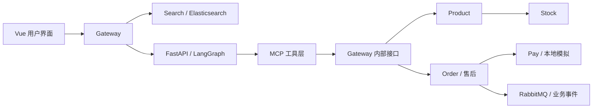

# 第一讲：把整个项目讲成一条业务链

核对日期：2026-11-25。本文依据当前工作区源码。它是学习材料，不是一次新的在线验收报告。推荐先不启动项目，打开文中链接，边读边画调用图。

## 1. 先回答：这个项目到底解决什么问题？

这是一个把传统电商交易与自然语言交互结合的平台。用户既可以搜索、看商品、加购物车和下单，也可以把预算和偏好告诉 AI，让它检索候选商品、调用 Java 核验，再展示推荐或对比结果。售后侧由 AI 理解问题和收集条件，涉及提交申请时先展示确认卡，再由 Java 校验并执行业务。

讲项目时要有两条主线：**电商业务提供真实事实与执行能力，Agent 提供理解、编排和解释能力**。如果只讲“用了 LangGraph、MCP、Redis”，面试官无法判断这些技术为什么存在。

这里的“真实事实”是数据库中当前记录的价格、商品状态、库存和订单归属；它不等于生产商家数据、真实物流商认证或真实资金交易。本地存在公开商品样本，价格和库存等测试字段需要按样本导入说明理解；付款和退款采用本地模拟模式。

## 2. 用三个边界理解架构

### 2.1 进程边界：一个目录不一定是一个服务

后端父工程见 [pom.xml](../../../Simlect-backend/pom.xml)。Java 17、Spring Boot 3.5.4、Spring Cloud 2025.0.0 是当前代码声明的版本。不要为了面试重新升级依赖。

| 模块 | 在业务中的职责 | 阅读入口 |
| --- | --- | --- |
| Gateway | 浏览器统一入口、路径路由、登录态及内部令牌过滤 | [路由配置](../../../Simlect-backend/Simlect-gateway/src/main/resources/application.yml) |
| User | 账号、用户资料、地址、用户侧信息 | [AccountController](../../../Simlect-backend/Simlect-user/app/src/main/java/com/simlect/controller/AccountController.java) |
| Product | 商品、分类、SKU、AI 精确筛选 | [Product 模块](../../../Simlect-backend/Simlect-product) |
| Stock | 库存读取与交易库存操作 | [Stock 模块](../../../Simlect-backend/Simlect-stock) |
| Cart | 购物车 | [Cart 模块](../../../Simlect-backend/Simlect-cart) |
| Order | 下单、订单明细、物流、售后申请与履约 | [Order 模块](../../../Simlect-backend/Simlect-order) |
| Pay | 支付单、退款相关协作及本地模拟资金流程 | [Pay 模块](../../../Simlect-backend/Simlect-pay) |
| Coupon | 优惠券业务 | [Coupon 模块](../../../Simlect-backend/Simlect-coupon) |
| Search | Elasticsearch 商品检索 | [SearchController](../../../Simlect-backend/Simlect-search/src/main/java/com/simlect/controller/SearchController.java) |
| Admin | 管理端相关业务；部分管理接口实际路由到领域服务 | [Admin 模块](../../../Simlect-backend/Simlect-admin) |
| Common | 共享 DTO、异常、鉴权约定、工具与基础配置，是依赖库 | [Common 模块](../../../Simlect-backend/Simlect-common) |

许多领域模块包含 `api` 和 `app`。`api` 提供契约、DTO、Feign 接口等编译依赖，`app` 才包含可运行应用。不能把两个目录算成两个微服务。Common 也不需要单独启动。项目实际库存模块名是 Stock，售后和物流放在 Order 中，没有因为新增售后而拆一个微服务。

Python 的 FastAPI Agent 与 MCP Server 在本地启动计划中分别运行。两种职责可以独立部署，但导购和售后没有各建一整套 Java 服务，也不是两个独立自主规划的多 Agent 集群。

### 2.2 数据边界：谁有资格决定什么？

Product 负责商品与 SKU 事实，Stock 负责库存，Order 负责订单归属和业务状态，Pay 负责资金业务协作。Elasticsearch 是检索索引，Redis 可承担会话、缓存和协调；它们不能让模型绕过交易校验。

必须区分 SPU 与 SKU。可以把“某款耳机”理解为商品，把“黑色、标准版”理解为可销售 SKU。一个商品存在多个规格时，最低展示价不代表用户选中的规格价格。推荐阶段要验证具体 SKU，下单时还要重新验证，不能复制聊天里刚展示的价格完成交易。

### 2.3 信任边界：模型输出是输入，不是权限

大模型输出“商品 ID、退款原因、用户 ID”也仍是待验证输入。Pydantic 只能帮助检查结构与字段约束；它不知道这件商品是否存在，更不能证明订单属于当前用户。

正确关系是：登录会话确定用户身份 → 工具层限定允许调用的能力和参数 → Java 查事实并检查归属、状态与幂等 → 把结果交给 Agent 解释。内部服务令牌证明调用方持有服务凭证，不证明某个订单归任意 `userId` 所有。

## 3. 在脑中运行一次普通请求

先打开前端 [http.ts](../../../Simlect-front/Simlect-web/src/api/http.ts) 与 [modules.ts](../../../Simlect-front/Simlect-web/src/api/modules.ts)。前者封装 Axios，后者定义业务 API。

```text
点击页面按钮
  → modules.ts 组织业务参数
  → http.ts 以 /api 为基础路径发送请求、携带 Cookie
  → 开发环境 Vite 代理
  → Gateway 匹配路由并执行过滤器
  → 领域 Controller 接收参数
  → Service 执行业务判断
  → Mapper / Feign / MQ 等完成具体读写或协作
  → ResponseVO → 前端业务码判断 → 更新页面
```

这个顺序帮助你定位故障。页面“网络异常”不一定是数据库故障，可能 Vite 无法连接 Gateway；页面拿到 HTTP 200 也不一定业务成功，项目还有 ResponseVO 的 `code`、`info`、`data`。

Gateway 的路由配置是判断“究竟转发到谁”的证据。例如普通商品搜索会到 Search；`/api/agent/**` 到 Python Agent；一些 `/admin-api/**` 会直接到 Product 或 Order。不要根据页面名字猜所有管理端请求都经过 Admin 服务。

Java 服务之间的 OpenFeign 调用又是另一条路径：Feign 按服务契约调用目标服务，服务发现和负载均衡解决目标实例选择。它们不必全部绕回浏览器 Gateway。相反，Python 的 [JavaInternalClient](../../../Simlect-backend/Simlect-agent/app/services/java_internal_client.py) 明确通过配置的 Gateway 地址访问 `/internal/**`。

## 4. 登录态、内部鉴权和业务授权分别做什么？

### 4.1 这是 Redis 会话 Token，不是 JWT

用户登录入口是 `AccountController.login`，会调用 `RedisComponent.saveTokenUserInfo` 保存会话。Gateway 的 [AuthGlobalFilter](../../../Simlect-backend/Simlect-gateway/src/main/java/com/simlect/cloud/gateway/filter/AuthGlobalFilter.java) 从请求解析 Token，再读取 Redis 中的 `mall:token:web:{token}`；管理端使用另一个前缀。

源码中的关键操作摘录如下，两行在原方法中并非相邻：

```java
reactiveStringRedisTemplate.opsForValue().get(REDIS_KEY_TOKEN_WEB + token)
builder.header("X-User-Id", userId);
```

`token` 是会话凭证，`userId` 来自会话内容。这样可让多实例共享登录状态，也便于服务端使会话失效。代价是请求依赖 Redis 的可用性和读开销。JWT 的签名验证、无状态撤销等问题是对比方案，不能冒称当前已经使用。

Gateway 返回登录超时时使用业务码 901；前端响应拦截器会处理重新确认会话或重新登录。面试时不要只说“后端返回 401”，要按具体入口区分。

### 4.2 Python 也读取登录会话

[token_service.py](../../../Simlect-backend/Simlect-agent/app/auth/token_service.py) 中 `require_login → get_user_by_token` 读取 Redis，会拒绝没有有效用户 ID 的请求。因此聊天传入的文字“我是用户 B”不能改变身份。工具路由还应使用认证上下文覆盖模型传入的用户字段，Java 最后验证业务资源归属。

### 4.3 内部接口不等于公开 API

[InternalTokenGlobalFilter](../../../Simlect-backend/Simlect-gateway/src/main/java/com/simlect/cloud/gateway/filter/InternalTokenGlobalFilter.java) 对 `/internal/**` 检查内部令牌，和用户会话鉴权分开。即使内部令牌正确，Order 仍需要判断 `order.userId` 与当前业务用户是否一致。

应当能解释防护的局限：共享令牌不是完整的服务网格身份体系；单机调试时开放领域端口也不等于生产网络已隔离。完整安全论证还要检查服务侧校验、网络暴露、凭证管理和日志。不要用“上了 Gateway 所以没有越权”结束回答。

还要看清当前内部只读接口的信任来源：[OrderAgentInternalController](../../../Simlect-backend/Simlect-order/app/src/main/java/com/simlect/controller/internal/OrderAgentInternalController.java) 等接口会接收请求体中的 `userId`，依赖已认证的 Agent 正确传递用户身份。正常聊天路径由登录校验与 Router 覆盖字段保护；如果内部共享令牌泄露且端点可达，攻击者仍可能伪造其他 `userId`。订单归属比较无法单独证明参数代表真实调用者。因此必须保护服务凭证和网络边界；更强的签名身份传递可以作为后续方案，不能说当前已实现。

## 5. Spring 与 MyBatis 到底替你做了什么？

Controller 接 HTTP，Service 组织业务，Mapper 执行 SQL，这是一种职责划分。Spring 的 IoC 容器创建和注入这些对象；构造器注入让依赖显式出现。AOP 代理可以在方法调用前后开启事务、处理拦截逻辑，但它不是替每个普通方法调用自动增加分布式事务。

项目用的是 **MyBatis**，有自己的 [BaseMapper](../../../Simlect-backend/Simlect-common/src/main/java/com/simlect/mappers/BaseMapper.java)，不要被名字误导成 MyBatis-Plus。真实接口摘录：

```java
List<T> selectList(@Param("query") P p);
Integer selectCount(@Param("query") P p);
```

`T` 表示返回的实体类型，`P` 是查询条件类型，`@Param("query")` 为 XML SQL 中的参数提供名称。Mapper 接口由框架代理实现，执行的仍是映射 SQL。阅读时必须从方法继续找到 XML，而不是看到 `selectList` 就推断自动使用某个索引。

面试解释事务时要问四件事：调用是否经过代理？用的哪个数据源/事务管理器？数据库读写处于哪一段？远程库存或支付调用失败后由谁补偿？一个 Java 方法标了 `@Transactional`，不会自动把另一个进程里的数据库纳入同一个本地事务。交易细节见 [第二讲](02-Java交易库存与消息可靠性.md)。

## 6. 普通搜索与 AI 推荐为什么不能混为一谈？

普通搜索入口 [SearchController.searchProducts](../../../Simlect-backend/Simlect-search/src/main/java/com/simlect/controller/SearchController.java) 校验关键词、价格区间、分页和排序，再交给 ES 检索组件。ES 擅长倒排索引、相关性排序和过滤，但索引同步可能落后于业务数据。

AI 推荐多了这些步骤：自然语言解析 → 复用上轮条件 → 召回候选 → Java 精确筛选 SKU 和库存 → 基于已核验事实组织说明。即使检索阶段召回了下架或过期价格的文档，也不能直接当成推荐成功。



图中是主要业务关系，省略注册中心和各数据源，不表示所有箭头都具有同一种事务或传输方式。当前向量开关关闭，不能说已经验证关键词与向量混合召回的线上效果。架构里有路径，和当前实际运行验证是两个结论。

## 7. 聊天为什么不是一次 HTTP 请求直接等答案？

[AgentOrchestrator.send_message](../../../Simlect-backend/Simlect-agent/app/services/agent_service.py) 保存消息并检查任务上限，然后启动后台协程。真实摘录：

```python
asyncio.create_task(self._run_agent(agent_msg))
return agent_msg
```

`agent_msg` 包含消息关联信息。HTTP 提交成功说明请求被接收，不等于模型已经回答成功。结果还要通过推送和历史消息等机制呈现；后台异常要补充错误状态，任务计数要在 `finally` 中释放。

[builder.py](../../../Simlect-backend/Simlect-agent/app/graph/builder.py) 定义统一状态图，[nodes.py](../../../Simlect-backend/Simlect-agent/app/graph/nodes.py) 是节点实现，[runner.py](../../../Simlect-backend/Simlect-agent/app/graph/runner.py) 负责运行与受条件约束的恢复。这里需要区分：当前消息执行状态、跨轮购物条件、历史消息、待确认动作，不是同一个“大字典”无差别保存。

后台任务计数是进程内保护，多 worker 并不会自然共享这个计数，也不是持久消息队列。`create_task` 不会自动提供“进程崩溃后保证执行”。现有检查点有明确恢复条件，也不能把任意有副作用节点无脑重跑。

## 8. 中间件不要背功能，要对应项目行为

| 组件 | 应如何结合本项目解释 | 不应推出的结论 |
| --- | --- | --- |
| MySQL | 商品、订单、售后及日志等持久事实，配合本地事务和约束 | 所有跨服务操作天然原子 |
| Redis | 登录会话、业务缓存、Agent 状态、待确认动作和锁等 | Redis 锁等于永久防重，缓存永不过期 |
| Elasticsearch | 普通商品搜索、AI 候选召回及可选向量路径 | 搜索命中就是当前可买 |
| RabbitMQ | 订单事件、超时处理及后续异步协作 | 发送成功等于业务完成，消息不会重复 |
| Nacos | Java 服务注册发现及相关配置 | 注册了就代表业务依赖健康 |
| Sentinel | 代码与配置提供限流/保护能力，需要核对启用与规则 | 控制台没启动仍已验证所有熔断效果 |
| Seata | 代码保留相关配置/能力，本地显式关闭 | 当前演示依赖 Seata 保证所有一致性 |

公共配置可从 [simlect-common.yml](../../../Simlect-backend/Simlect-common/src/main/resources/simlect-common.yml) 看起。配置项存在不等于规则已生效，更不等于已经压测验证。

## 9. 一套可反复使用的源码阅读方法

不要从所有实体类第一页开始背。每次只追一个用户动作，在纸上记这七栏：

| 栏目 | 问自己什么 |
| --- | --- |
| 输入 | 谁传来的？是否可信？为空、超长、非法状态怎么处理？ |
| 身份 | 当前用户从哪里获取？用户 ID 能否被参数覆盖？ |
| 事实 | 价格、库存、订单状态由哪个服务/表决定？ |
| 顺序 | 先查、先写还是先远程调用？为什么？ |
| 边界 | 哪些操作在同一本地事务里？哪些不在？ |
| 故障 | 超时、重复、宕机、消息乱序分别有什么后果？ |
| 证据 | 哪个测试验证该行为？哪些边界只是设计未实测？ |

用 `rg -n '方法名' 目录` 找声明和调用，用 `rg --files` 找 Mapper XML。跳过 target、node_modules、.venv，避免把编译副本当成最新源码。文档行号会漂移，本文链接到文件，并给类/方法定位。

第一遍只跑通主链；第二遍读异常分支；第三遍看测试如何构造输入和断言。测试是行为证据，但 mock 掉的边界不属于本次真实调用范围。

## 10. 面试连续追问训练

**问 1：用一句话介绍项目。** 它把商品、交易、售后微服务与统一 Agent 平台连接起来，由 AI 理解需求并调用受控工具，Java 对价格、库存、权限和状态作最终判断。

**追问：为什么不全写在 Python？** 技术上可以实现，但本项目已经有 Java 交易领域及校验能力；复用领域接口能避免两份规则。拆分的代价是网络与一致性问题，需要超时、鉴权和故障恢复。

**追问：模型输出符合 JSON Schema 就能下单吗？** 不能。结构合法只解决格式，商品存在性、预算、可售库存和资源归属需要 Java 查询并检查；写操作还要确认与幂等。

**问 2：为什么需要 Gateway 和 Nacos，两者不重复吗？** Gateway 处理入口路由和过滤，Nacos 帮服务发现实例；Feign 使用契约发起服务间调用。它们处理的问题不同。

**追问：Gateway 挂了怎么办？** 当前单机演示入口会不可用；生产可以多实例和外部负载均衡。只能把后者作为方案，不能说本机已经高可用。

**问 3：为什么 Redis Token 能支持多实例？** 因为登录态不放在单个应用进程内，而由实例共享 Redis；但 Redis 的可用性、TTL 和权限隔离仍要考虑。

**追问：知道内部令牌能不能查所有人的订单？** 它不应当授予任意用户权限，但当前部分内部只读接口信任服务传入的 userId；如果令牌泄露且接口可达，存在身份冒用风险。正常路径由 Agent 的登录和工具身份覆盖保证来源，不能把这种信任关系说成泄露后仍能独立验证终端用户。写申请另走用户会话校验，具体入口必须分别分析。

**问 4：数据库与 ES 价格不一致以谁为准？** 检索只做召回。推荐用 Java 核验后的 SKU 事实，下单再校验；不能把历史对话视为锁价承诺。

**追问：核验过的库存还能被别人买走吗？** 能，核验是快照，不是预留。最后要由库存扣减流程处理竞争。

**问 5：为什么你的项目用了微服务？** 它使领域职责、契约与独立演进更清楚，也是学习跨服务协作的载体；但两周个人项目用模块化单体也合理。当前微服务有启动资源和运维成本，已经用按场景启动缓解本机压力，不以服务数量证明质量。

**追问：如果让你重新做会怎么选？** 先按团队、业务规模和交付期限判断，可能先模块化单体；保留商品、库存、订单清晰边界，达到独立扩缩容需求后再拆。这个回答比“微服务一定更先进”更可信。

## 11. 本讲练习与过关标准

闭卷画出“普通搜索”和“AI 推荐”两张图，每条箭头标注调用方、接收方和返回事实；再说出“HTTP 已接收、工具已执行、业务已成功”为什么是三个不同状态。

每项 0～2 分：能解释领域边界；能定位真实入口；能区分身份与授权；能说明检索与业务事实；能讲一种故障和实际限制。8 分以上再进入第二讲。只背出组件名但无法指出输入和输出，每项最多 1 分。
