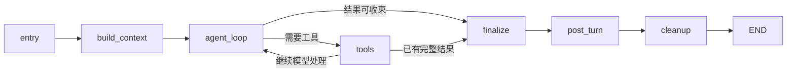

# 03｜导购 Agent 与 MCP：从一句购物需求读懂真实执行链

本章按 2026-11-25 的本地源码讲解，适合已经会写 Controller、Service、Mapper，但第一次接触 Agent 的同学。阅读目标不是背框架名，而是回答：条件怎样进入程序、谁有权决定商品事实、上下文怎样延续、失败为什么不会返回旧商品。本文不修改代码、不重新执行测试，不把离线夹具结果写成线上效果。

先记住业务分工：模型把自然语言变成需求；检索提供候选；Java 根据商品、SKU、库存执行硬约束；Python 整理有证据的排序和卡片。模型输出了合法 JSON，不代表商品存在，也不代表订单可以成交。

本项目所谓导购 Agent、售后 Agent，是统一平台中的两条业务流程。当前只有一套主要 LangGraph 图，不是两个独立模型互相开会，也不要求每个步骤都调用模型。

## 阅读导航与事实边界

| 主题 | 本章要解决的问题 |
| --- | --- |
| 一、流程编排 | LangGraph 和普通函数分别负责什么？ |
| 二、需求契约 | Pydantic 为什么挡不住所有幻觉？ |
| 三、多轮状态 | 从 300 改成 500，哪些条件保留，哪些结果清除？ |
| 四、候选检索 | 关键词、向量、RRF 分别做什么？ |
| 五、事实核验 | Java 为什么还要查真实 SKU 和库存？ |
| 六、商品对比 | “第一款”怎样绑定当前展示的商品及规格？ |
| 七、工具协议 | MCP、HTTP、v2 错误与 legacy 的关系是什么？ |
| 八、完整推演 | 遇到改预算、库存变化和故障时如何逐步定位？ |

本机启动配置中的 `VECTOR_SEARCH_ENABLED=false`。因此，当前演示不能描述为“已经验证关键词与向量混合召回效果”。相关代码存在，向量效果、召回质量和模型在线准确率仍需独立验证。本章的 A/B/C 商品和价格仅为教学假设，不是对当前数据库的查询结果。

## 一、先理解流程编排：一张图承载两条业务流程

**技术是什么。** LangGraph 将处理步骤组织为节点与边。节点读状态、执行逻辑并返回更新；边决定接下来调用哪一步。它解决的是流程和状态组织问题，不替代业务服务，也不保证模型答案正确。

**本项目为什么需要。** 一轮对话会经历入口检查、上下文构建、工具调用、结果收束、记忆更新和清理。用户可能中途取消；工具可能超时；模型可能要求继续调用工具。把这些分支集中在图里，比散落在一个巨大接口函数中更容易看清出口。

真实入口见 [builder.py](../../../Simlect-backend/Simlect-agent/app/graph/builder.py) 的 `build_agent_graph()`；节点实现在 [nodes.py](../../../Simlect-backend/Simlect-agent/app/graph/nodes.py)。图的拓扑如下，图中词语与节点注册名对应：



`agent_loop_node()` 首轮先调用 `after_sale_turn(state)`；未命中，再调用 `shopping_turn(state)`。任一业务分支返回结果，就进入 `finalize`；都未处理时，才继续通用的模型与工具循环。所以节点叫 agent_loop，不代表这轮一定发生了自由 ReAct 推理。

`react_round` 表示工具推理轮次，`route` 表示下一跳，`cancelled` 控制取消；通用循环达到 `graph_max_react_rounds` 会收束。导购还有自己的总超时。轮次限制防止无限反复，时间限制防止一次调用过久，两者不能互相代替。

**异常与替代方案。** Redis checkpoint 初始化失败存在内存 checkpointer 退路，但不能据此声称全部 Redis、会话和业务依赖故障后仍可运行。简单系统完全可以用几个普通异步函数实现当前固定流程；采用图的价值在于统一状态、分支和清理，不应为了“多 Agent”标签拆更多进程。

**面试表达。** “我复用同一个 LangGraph 运行框架，把导购与售后作为有界业务分支；高风险流程的工具顺序由程序控制，保留通用模型工具循环处理其他问题。”

## 二、需求契约：结构化输出、硬约束和软偏好

“预算 300 以内，游戏蓝牙耳机，最好低延迟，不要二手”至少包含品类、预算、场景、偏好与限制。直接把整句话当搜索关键词，会把预算和否定词当普通文本，也无法稳定支持下一轮修改。

[shopping.py](../../../Simlect-backend/Simlect-agent/app/models/shopping.py) 定义三个关键模型：`HardAttribute` 是带操作符的属性条件；`ShoppingRequirement` 是完整条件；`ShoppingPatch` 是本轮修改。预算使用 Decimal，避免二进制浮点表示造成金额边界误差；`extra='forbid'` 拒绝模型塞入未定义字段。`gte/lte` 表示数值上下限，`eq/ne` 表示相等和排除。

真实模型定义摘录：

```python
class HardAttribute(BaseModel):
    model_config = ConfigDict(extra="forbid", str_strip_whitespace=True)
    name: str = Field(min_length=1, max_length=30)
    value: str = Field(min_length=1, max_length=100)
    operator: Literal["eq", "ne", "gte", "lte"] = "eq"
```

这段保证操作符属于指定集合、字段长度有界，但无法证明“低延迟”已存在于某款商品。Pydantic 校验输入结构和约定，真实属性还要由 Java 核验。

解析在 [shopping_parser.py](../../../Simlect-backend/Simlect-agent/app/services/shopping_parser.py) 的 `parse_shopping()`：先处理明确字面更新；在 20 秒边界内调用配置的模型，要求 `ShoppingPatch` 结构；合并模型与明确规则；重新校验；需要澄清则不搜索；否则生成完整条件。以下是原函数内的真实摘录：

```python
literal = explicit_update(text[:2000])
async with asyncio.timeout(20):
    parser = create_memory_llm().with_structured_output(ShoppingPatch, method="json_schema")
    patch = ShoppingPatch.model_validate(await parser.ainvoke([SystemMessage(content=PROMPT), HumanMessage(content=json.dumps(
        {"previous":previous, "user_text":text[:2000]}, ensure_ascii=False))]))
```

`with_structured_output` 约束模型返回形式，随后 `model_validate` 在应用端再检查。若供应商不支持相应模式、模型输出坏结构或网络失败，程序仍可能失败；框架方法存在不等于外部模型一定遵守。

硬约束决定能不能入选：最高 300、成色全新、排除某品牌。软偏好决定合格商品如何排序：最好舒适、偏好某品牌。游戏是场景，不能自动变成“延迟必须低于某毫秒”；用户说“最好低延迟”，也不能擅自升级为硬限制。Prompt 明确区分这些语义，`explicit_update()` 对“预算改为500”“不要二手”等无歧义表达作确定性纠正。

范围冲突、品牌同时被偏好和排除、模糊预算会进入澄清。注意当前严格导购解析失败时不会无条件退回热销推荐；这是防止用户仍以为预算等条件已生效。旧搜索工具仍存在，但不是严格流程中可以任意放松条件的兜底。

**替代与答法。** 全部用正则较容易解释，却难覆盖复杂表达；全部信模型又容易丢失否定、数字和旧条件。当前结合结构化解析、少量明确规则和业务复核。我会说“模型降低自然语言处理成本，程序保住条件边界”，而不是“模型理解能力保证准确”。

## 三、多轮状态：需求 Patch 不等于聊天摘要

源代码中至少要分清三类状态，不能都叫“上下文”：

| 状态 | 真实位置 | 用途 |
| --- | --- | --- |
| 本轮图状态 | [graph/state.py](../../../Simlect-backend/Simlect-agent/app/graph/state.py) 的 AgentGraphState | 当前消息、路由、工具调用、取消、输出片段 |
| 跨轮业务记忆 | [memory/models.py](../../../Simlect-backend/Simlect-agent/app/memory/models.py) 的 SessionMemory.state | 保存购物条件、当前展示商品与SKU等 |
| 摘要与历史消息 | SessionMemory.summary 及上下文构建 | 提供历史语义，减少上下文膨胀 |

`thread_id_for()` 使用 `user_id:message_id` 标识图执行实例；跨消息的购物条件主要放在 SessionMemory，不能以为图 checkpoint 自动等同用户的所有长期记忆。当前业务记忆主要按 user_id 索引，也不能声称已实现任意多个聊天窗口完全独立的会话隔离。AgentGraphState 使用 TypedDict 描述流程字段，主要帮助类型检查和阅读；它不等于自动完成运行时参数校验，需求校验仍由 Pydantic 等代码执行。

[session_memory_service.py](../../../Simlect-backend/Simlect-agent/app/memory/session_memory_service.py) 的 `load()` 先读 Redis，未命中再读 MySQL 并回填；`save()` 先写 Redis 再写数据库。这是已有持久化方式，不是跨两种存储的原子事务。缓存与数据库故障时的一致性、并发更新仍是需要单独验证的工程问题。这里持久化的是平台会话元数据；导购的商品核验强制走 Java HTTP，不能把它夸大成“Python 从不访问任何数据库”，也不能反过来允许模型修改商品、库存和订单表。

需求合并在 `merge_requirement(previous, patch)`：没有提及的字段保留；显式 clear 清除指定字段；reset 从空条件开始；同名硬属性更新、不同属性保留；偏好和排除品牌进行去重合并。`model_fields_set` 用于区分“模型明确改了什么”和“模型默认值是什么”。如果把整份 Patch 当完整对象覆盖，用户只改预算就可能丢掉“不要二手”。

更重要的是，**条件可以沿用，结果不能随条件变化假装仍然有效**。[shopping_turn.py](../../../Simlect-backend/Simlect-agent/app/services/shopping_turn.py) 在解析和网络调用前就清除旧展示结果：

```python
memory.state["shoppingResults"]=[]
memory.state["shoppingShownSkus"]={}
await session_memory_service.save(memory,redis_service.client)
req,error=await parse_shopping(text,previous)
```

这样即使新预算解析失败，也不会让下一轮“第一款”悄悄引用更早结果。有效新条件保存在 `shoppingRequirement`；真正返回并渲染的卡片经 `visible()` 建立 `shoppingResults` 与 `shoppingShownSkus`。只返回 product_ids 而没有携带已核验 SKU 的卡片，不会建立可比较列表。

**面试表达。** “我保存结构化业务条件而不是只保存聊天文本；更新预算时做字段级合并，更新搜索时提前失效旧商品引用。摘要负责语义连续性，业务状态负责可执行条件，两者各有用途。”

## 四、检索与 RRF：先扩大候选，再做业务筛选

[shopping_service.py](../../../Simlect-backend/Simlect-agent/app/services/shopping_service.py) 的 `recommend()` 先校验完整条件，再调用候选召回。关键词路由总会加入，只有向量开关启用才加入向量路由；用 `asyncio.gather` 并发等待，不是串行执行两个搜索。

关键词实现在 [retriever.py](../../../Simlect-backend/Simlect-agent/app/rag/retriever.py) 的 `search_product_keyword_ids()`：查询 `simlect-index`，对 productName 做 match，辅以转义后的 wildcard，主要取得 productId。ES 不可用或无结果时有既有 Java 在售搜索退路；最终是否满足预算和库存，不在这一步确认。

向量路由先把查询转换为 embedding，再在 ES 的向量索引上执行近邻检索，并按资料类型过滤。Embedding 表示语义位置，不编码商家当前库存；相似度高也可能是价格不符、无货或配件。当前本地关闭该分支，不会为“未启用”记一条调用失败，也不会发送无意义的 embedding 请求。

当两路都启用时，[rrf.py](../../../Simlect-backend/Simlect-agent/app/rag/rrf.py) 的 `rrf_merge()` 根据排名合并。常量 `RRF_K=60`，源码核心摘录：

```python
for i, pid in enumerate(dict.fromkeys(ranked)):
    if not pid:
        continue
    scores[pid] = scores.get(pid, 0.0) + 1.0 / (RRF_K + i + 1)
```

同一路先去重，避免重复 ID 刷高得分；每个商品在各列表的倒数排名贡献相加，随后按总分降序、ID 排序打破并列。它避免直接相加不同量纲的关键词得分和向量得分，但不是训练出来的推荐模型，也不保证相关性最优。只有关键词一路时也可以经过此函数去重排序，不能据此把运行模式称为混合检索。

当前每路候选上限 50，合并上限 100；这些是可控召回预算，不是全库穷尽搜索。预算合格商品若不在候选里，后续核验也找不到。因此“硬约束满足率”和“检索召回率”是两个不同问题。排序得分较低的候选也可能是唯一预算匹配项，所以不能核验前随意只保留最前面的少量结果。

**替代方案。** 小目录可直接由 Java 条件查询，复杂语义可引入经过评测的向量和重排。当前没有同条件线上基线，不应承诺混合检索一定更好，更不能编造提升百分比。

## 五、Java 核验：把模型条件转成可执行业务事实

`verified_rows()` 去重并限制候选，按每批 50 调用 `/internal/product/ai/filter`，将预算用字符串传输以保留金额表示，排除品牌转为 `operator=ne` 的硬属性条件。最多两批通过 gather 发出；限制数量是避免一次模型请求放大成无界业务调用。

Java 核心在 [AiProductFilterService.java](../../../Simlect-backend/Simlect-product/app/src/main/java/com/simlect/biz/AiProductFilterService.java) 的 `filter()`：批量商品快照 → 批量可售库存 → 按商品分组 SKU、属性 → 验上架、价格和品类 → 按当前 SKU 的属性值集合取属性 → 验硬约束 → 返回事实行。价格用 SKU.price，不以商品 minPrice 代替某个具体规格。

属性必须属于当前 SKU。假设黑色耳机有低延迟、白色没有，不能拿整个商品的属性并集证明白色也支持低延迟。Java 用 SKU 的 propertyValueIds 建立属性集合；库存按 productId 与 skuHash 对应，避免规格错配。

下面是硬约束处理的真实边界：

```java
// Unknown attributes cannot prove a positive OR a negative hard constraint.
if(values.isEmpty() || values.stream().anyMatch(v->v.isBlank() || Set.of("未知","暂无","暂无数据","未提供").contains(v))) return false;
```

因此“没有品牌信息”不代表满足“不要苹果”，“没有成色”也不代表全新。这是三种逻辑状态：确认符合、确认不符、无法证明；未知不能自动进入合格集合。数值属性还要验证单位兼容，不支持的格式不凭字符串猜大小。

Python 收到 Java 响应仍检查候选归属、名称、SKU、正数金额、金额小数位、库存类型和预算范围。它是防御性边界检查，不是第二套库存权威。未知 productId、零库存、非法价格不会被拼成推荐卡；异常响应和正常无匹配结果也分别分类。

合格结果进入 `rank_rows()`：先看可核验偏好证据数量，再看召回顺序、价格、库存与稳定标识；同一商品只保留一个被选中的 SKU，最多展示 8 件。推荐理由由真实属性构成，缺少软偏好证据时明确说明，不编造续航或延迟。

**面试表达。** “模型只能给条件和候选意图，商品事实由 Java 取回。Python 复查接口契约，Java 控制业务规则，真正下单时库存服务还要再次检查并执行变更。推荐查询没有预留库存。”

## 六、商品对比与前端：指代必须绑定当前展示 SKU

用户说“第一款和第三款”，序号不是商品 ID。`comparison_indices()` 解析当前结果中的序号，要求选 2～3 个不同商品；`shopping_turn` 从 `shoppingResults` 映射候选，再把当前条件和展示 SKU 交给 Router。

[McpToolRouter.invoke](../../../Simlect-backend/Simlect-agent/app/services/mcp_tool_router.py) 会再次从服务端会话中读取比较边界，拒绝不在当前列表中的 ID，并覆盖模型传来的 skuHashes 和 requirements。这样模型不能选择一个更便宜的新 SKU，伪装为用户刚才看到的那一款。

`compare()` 重新调用 Java 核验价格、库存和属性，之后按精确 SKU 过滤。以下为真实摘录：

```python
found={r["product_id"]:r for r in checked if sku_hashes.get(r["product_id"])==r["sku_hash"]}
ordered=[found[pid] for pid in ids if pid in found]
```

如果原规格售罄，即使同商品另一个规格还有库存，也不会静默替换。部分失效时说明缺失并仅返回仍可核验的条目；全部失效时返回 empty/NO_COMPARABLE_PRODUCTS。比较后会更新当前展示列表，因此后续“第二款”以最新一轮实际卡片为准，不能默认永远指向第一次推荐。

`presentation_cards()` 将 verified.price、stock、attributes、skuHash，以及 comparison、shopping 条件说明放进结构化卡片。`agent_runtime.finalize_agent_response()` 对 shopping_handled 分支构造 PRODUCT_SEARCH_RESULT，避免再走普通热销回填。[AgentChatItem.vue](../../../Simlect-front/Simlect-web/src/components/agent/AgentChatItem.vue) 和 [AgentShoppingEvidence.vue](../../../Simlect-front/Simlect-web/src/components/agent/AgentShoppingEvidence.vue) 直接渲染字段。

推荐和比较的用户正文不再展示 SKU 哈希，结构化 SKU 仍保留用于校验。显示友好和删除业务标识是不同事情。对“哪款更适合游戏”，只根据已录入低延迟属性给有限建议，没有毫秒参数就不编实测结论；缺字段显示暂无数据。

**替代与答法。** 可以让模型自由生成整张表，但会增加事实改写风险；也可以固定后端模板，表达更受限。当前选择结构化事实加可读结论，面试时能指出每个价格、库存、属性的来源。

## 七、MCP、HTTP、错误协议与指标：调用成功有几层含义

MCP 提供工具发现、参数契约和调用等协议能力，HTTP 是本项目选用的传输方式。普通 HTTP POST 只说明发送了请求；SDK 还要完成 MCP 会话初始化和 tools/call 等交互。MCP 不会自动替你理解用户，也不会自动决定什么时候退款。

当前严格导购由 `shopping_turn` 按业务逻辑明确选择 RECOMMEND_PRODUCTS 或 COMPARE_PRODUCTS；通用 Agent 分支则允许模型输出工具调用请求。两种路径最终都经过 Router 的白名单和参数边界。工具选择、协议传输、Java 执行业务是三层不同职责。

真实链路为 Router → [McpStreamableClient.call_tool](../../../Simlect-backend/Simlect-agent/app/services/mcp_streamable_client.py) → Streamable HTTP 会话与 ClientSession.initialize → [server.py](../../../Simlect-backend/Simlect-agent/app/mcp_server/server.py) 注册函数 → shopping_service → Java。内部令牌证明受信服务身份，不等于允许模型指定任意用户；Router 会用已鉴权上下文覆盖 userId。

`ToolInvokeResult` 的业务字段既服务模型，也服务 UI；[v2 契约](../../../Simlect-backend/Simlect-agent/app/services/tool_invoke_result.py) 始终使用 SIMLECT_TOOL_RESULT 前缀加 JSON 信封，包含以下机器字段：

| 字段 | 含义及不能误解的地方 |
| --- | --- |
| status | success、empty、error、invalid_args、denied、transport_error、legacy |
| errorCode | NO_MATCHES、JAVA_TIMEOUT、MCP_TIMEOUT 等安全类别，不是原异常堆栈 |
| degraded | 结果是否经历部分能力降级，不等于结果未核验 |
| degradationCodes | 降级来源，例如 ES_UNAVAILABLE；与主结果状态分别表达 |
| retryable | 是否可考虑重试的提示，不会自动执行重试，更不是写操作授权 |
| legacy | 旧协议或尚未精确分类的工具，保留兼容但不冒充业务成功 |

MCP 的 isError 即使伴随可读 text，也不会当成功；客户端输出 MCP_PROTOCOL_ERROR，并丢弃远端错误细节。非法 v2 信封返回 INVALID_TOOL_RESPONSE。error、empty 等状态不携带旧卡片和事实 ID，防止“文字失败但卡片仍可点击”的矛盾。

旧工具还有历史普通文本或混合成功/拒绝文案，server._text 默认标记 legacy；推荐与对比使用 structured=True。部分旧搜索和订单工具还可能本地补齐卡片，所以不能说全部历史工具都只有一次远程执行。v1、纯文本兼容集中处理；新协议不依赖中文“失败”二字判定结果。

已有指标 [TOOL_CALL_TOTAL](../../../Simlect-backend/Simlect-agent/app/harness/metrics/runtime_sensors.py) 使用 tool/status 标签，Router 按最终结果计数：空结果是 empty，单路降级成功是 degraded，传输失败是 transport_error，旧结果是 legacy。少数兼容异常分支仍保留 bad_args 等既有标签，汇总前需要说明归类口径。存在这些指标不等于已经测出线上工具成功率；计算时必须说明分母是否包含 empty、legacy 和业务拒绝，不能把 HTTP 200 全部当业务成功。

**超时与资源边界。** 单路召回 7 秒、推荐整体 25 秒、比较 15 秒、导购回合 45 秒、模型解析 20 秒，MCP 客户端使用配置超时。总时间不是简单把所有上限相加，因为有并发和外层取消。Java HTTP 客户端已增加有界连接池生命周期；MCP 协议会话目前仍按调用建立，没有擅自把可变会话全局共享。trace header 帮助定位跨 Python/MCP/Java 的失败阶段，不用于业务鉴权。

售后提案类工具不新增自动重试。超时可能发生在远端已处理、响应未到达的时刻，盲目重放可能产生重复提案；确认写入仍依赖原请求标识、用户归属和 Java 幂等。这是读查询容错与写操作安全的边界。

## 八、完整推演：300 → 500 → 对比 → 库存变化

以下只是假设的测试目录，价格、名称与 SKU 均用于教学，不代表真实商品或此次运行结果。共同条件是耳机、全新；A/S_A 为 199 元，B/S_B 为 299 元，C/S_C 为 399 元，均假设有库存。

**第一轮：“推荐300元以内的蓝牙耳机，不要二手。”** 解析得到 max_price=300、成色 eq 全新。先清旧展示状态，保存新条件；检索可能召回 A/B/C，Java 检查具体 SKU 后只返回 A、B。Python 排序并生成带 verified.skuHash 的卡片，visible 建立按实际卡片顺序的列表。不能提前断言 A 一定第一，因为偏好证据和召回顺序也参与排序。

**第二轮：“预算改成500，其他条件不变。”** Patch 只修改 max_price，原品类、成色条件保留；旧 A/B 引用先失效，再重新召回核验。C 这时才可能入选。不能直接把上一轮列表加上 C，因为价格、库存、上架状态都可能变化。若模型这轮失败，展示结果保持清空，不能让下一轮对比沿用旧列表。

**第三轮：“第一款和第三款哪款适合游戏？”** 假设本轮实际显示顺序为 A/B/C。序号映射为 A、C，服务端恢复 S_A、S_C 和 500 元条件；Java 再次核验。只有录入属性有依据，才解释游戏偏好；没有真实延迟参数就说明不足。返回时保持用户选择顺序，不按便宜程度偷偷重排序。

**第四轮：比较前 C/S_C 库存变成零。** Java 不再返回原规格；即使 C/S_C2 仍在售，compare 也不会换规格。系统显示 C 原规格不可用，卡片只含仍合格的 A，并写入缺失数量。用户后续若还要比较两款，应先重新推荐或选择当前有效结果，不能补一件未经筛选的热销商品。

故障推演要区别“真的没有”与“暂时不知道”：

| 故障点 | 实际处理 | 用户与排查结论 |
| --- | --- | --- |
| 模型非法字段或预算冲突 | Pydantic/规则澄清，不搜索 | 请用户明确条件，旧商品引用已清除 |
| 向量关闭 | 不调用该路 | 正常配置，不记成服务故障 |
| ES 失败、Java 搜索退路成功 | 请求局部诊断记录降级，继续核验 | 可返回已核验商品，标注降级来源 |
| 所有已启用召回路径均失败 | error 及安全错误码 | 不能说库里没有商品 |
| 候选存在，Java 正常筛选为空 | empty/NO_MATCHES | 没有符合硬约束的结果 |
| Java 核验超时 | JAVA_TIMEOUT，无卡片 | 不用 ES 旧价格和库存补答案 |
| MCP isError | transport_error/MCP_PROTOCOL_ERROR | 不向模型转发远端内部细节 |

本章只解释已有处理方式。不能据此推断所有外层异常都已精确分类：`shopping_turn` 的部分本地澄清/超时仍以用户提示返回，legacy 工具也未全部迁移。评测报告需要保留这些范围，不能因增加几个字段就宣称全链路故障分类覆盖百分之百。

## 连续追问：从能解释到能讨论取舍

下面按真实面试节奏连续推进。先盖住答案口述，再核对；不要求背原句。

### 第一组：流程和信任边界

**1. 你的导购 Agent 到底是什么？**
答：它是统一 LangGraph 平台里的购物业务分支，能够解析条件、调用工具、复核事实并组织结果。不是一个独立训练的新模型。判断是否有工程价值，要看输入、状态、工具和失败边界，而不是是否出现 Agent 类名。

**2. 那它每次都让模型自主选择工具吗？**
答：没有。严格购物回合由代码选择推荐或比较，结构化解析用模型；通用对话才进入绑定工具的模型循环。这样可以控制关键顺序。若全部自由规划，需要更强的权限和调用预算，当前没必要为固定流程付出这些复杂度。

**3. 你既然用框架，自己做了什么？**
答：框架提供图和消息机制，我的工程工作是需求契约、多轮合并、Java 核验边界、当前 SKU 指代、安全失败与评测。我要能指出具体方法和测试；不能把 LangGraph 的内部实现当作自己实现的算法。

**4. 输出已经符合 Pydantic，为什么还不可信？**
答：结构合法只证明金额格式、字段和操作符符合约定。模型仍可能误解“不要”、选错品类，甚至提出数据库不存在的属性。需求还要结合字面规则和澄清，商品事实必须由业务接口获得；两类验证解决不同问题。

**5. 为什么不让模型直接输出商品价格？**
答：价格随 SKU 和时间变化，模型没有交易权威。我们通过候选 ID 到 Java 取当前规格、价格和库存，并再次校验响应。即便数字碰巧正确，也不能跳过这条可追溯的数据链。

**6. 内部接口令牌够不够防越权？**
答：令牌只标识受信调用方。Router 还要从登录上下文覆盖 userId，Java 对订单等资源检查归属；模型参数不是用户身份。trace ID 只用来关联日志，更不能拿它当权限凭证。

### 第二组：多轮条件与商品引用

**7. 改预算时为什么不用最新消息覆盖全部条件？**
答：用户通常只说变化部分。ShoppingPatch 配合 model_fields_set 做局部更新，保留没提到的品类与限制。覆盖全量会让“不要二手”在第二轮消失；而明确清除与重置有单独字段，不能靠 null 猜意图。

**8. 那 null 和空列表有什么差别？**
答：当前合并逻辑对 None 不覆盖旧字段；列表中的偏好和排除项有去重合并。同名硬属性更新，其他属性保留。真正清空应走 clear。不同字段合并策略并不相同，因此不能简单做一次字典 update。

**9. 改500元时，原300元推荐为什么先清空？**
答：旧结果对应旧条件，也可能包含已经变化的库存。先失效可以确保解析失败、接口超时也不沿用旧序号。我们保留旧需求供合并，却不把旧结果保留为下一轮可执行比较目标。

**10. 聊天摘要里写着第一款，为什么还存 SKU 映射？**
答：摘要可能省略或改写信息，不能作为业务标识。shoppingResults 保存实际卡片顺序，shoppingShownSkus 保存精确规格；比较从服务端状态恢复这些事实，摘要只帮助理解语境。

**11. 商品 ID 相同，SKU 不同为什么不能直接比较？**
答：用户刚才看到的是某一价格、颜色或配置的规格。更换 SKU 就更换了比较对象。原 SKU 不满足条件时必须提示失效，而不是用同商品更便宜或有库存的另一规格制造“推荐仍有效”的印象。

**12. Redis 有记忆就等于多轮完全可靠了吗？**
答：还不够。当前保存有缓存与数据库双写，也按用户维护状态，需考虑失败一致性和并发窗口。图 checkpoint 与跨轮业务记忆也不同。可以扩展会话 ID、版本或并发控制，但不能声称这些已全部实现。

### 第三组：检索、排序与业务校验

**13. 为什么不直接把整句话送给 ES？**
答：原句包含预算、否定与偏好，关键词相关性无法可靠表达全部业务条件。解析后用短品类召回，再由 Java 执行价格、属性和库存限制；偏好只在合格结果中影响排序，职责更明确。

**14. RRF 是什么？为什么不把两个分数相加？**
答：RRF 按名次累加倒数贡献，不要求两路原分数同量纲。某商品在两路都靠前会获得更多贡献。代码对每路去重并用 ID 处理并列，但它不懂价格库存，必须在其后执行业务筛选。

**15. 关键词有结果、向量失败怎么办？**
答：若向量实际启用，剩余有效候选仍可进入 Java 核验，返回降级成功并记录来源；如果向量本来关闭，则不算失败。不能把“只剩一路”与“没有合格商品”混在一起，也不必因一路失效完全停止服务。

**16. 为什么候选核验前不直接取前十条？**
答：靠前商品可能全部超预算，后面的候选才满足条件。当前两路各最多50，合并最多100，再分批核验，避免过早截断。它仍是有界候选搜索，不能保证全库所有合格商品都被召回。

**17. Python 复查价格是不是重复写 Java 规则？**
答：Python 检查范围、字段和返回归属，是接口契约防御；Java 决定真实 SKU、属性匹配和库存。前者不能发明后者的数据。发现格式或业务结果异常时应安全失败，不在 Python 猜一个价格继续。

**18. 低延迟偏好怎样变成推荐理由？**
答：只根据已有属性匹配形成证据，再按匹配数量等排序。标题写“游戏”不能自动证明毫秒延迟或实测表现。没有相关参数时说明证据不足；推荐理由应能逐项指向商品属性，而不是广告式结论。

### 第四组：协议、失败和验证

**19. MCP 与普通 HTTP API 有什么区别？**
答：HTTP 负责传输，MCP 在其上规定工具发现、能力和调用交互。当前客户端用 SDK 建立会话并初始化，再 call_tool。换成普通接口也可实现业务，但需要自己维护工具契约；使用 MCP 不会自动获得业务权限。

**20. HTTP200、MCP调用结束、推荐成功是不是一回事？**
答：不是同一层结果。MCP 可以返回 isError；业务可能正常筛选为空；Java 也可能拒绝。v2 信封分别表达 status、errorCode 和降级信息，Router 依最终分类记录指标，避免把传输完成等同业务成功。

**21. 旧工具为什么不直接都标 success？**
答：有些旧实现把拒绝或错误写在普通文字里，无法仅凭协议完成准确分类。当前保留 legacy，不把未分类结果冒充成功。兼容 UI 可以逐步迁移，但不能为让报表好看把旧文案统一算成功。

**22. retryable=true 是不是代码会自己再调一次？**
答：它是可考虑重试的提示，不是重试器，也不是执行授权。是否重试还要看幂等性、请求预算和远端是否可能已处理。当前没有新增提案自动重试，用户确认与 Java 幂等机制仍然独立存在。

**23. 工具错误怎么不泄露内部信息？**
答：新错误使用安全类别和通用提示，不把异常堆栈塞进模型。MCP isError 的远端文本会被丢弃；非法 v2 信封也不原样展示。关联 ID 用于内部定位，错误码用于分类，两者都不应装入密钥、订单详情等敏感内容。

**24. 你怎样证明这些改进有效？**
答：先验证真实函数链：用受控模型输出、MCP传输与Java响应覆盖多轮、SKU变化、空结果和故障；再分别做真实接口与真实模型评测。离线测试通过只能证明给定契约，不能据此写线上准确率或响应提升。性能对比还需同环境基线与明确样本。

## 源码阅读练习与评分点

**练习一：从入口画调用图。** 打开 builder.py、nodes.py、shopping_turn.py，标出售后优先分支、购物分支、通用模型循环及 finalize。用自己的话解释为什么“统一图”不等于“每一步都调模型”。满分 20：顺序正确10，区分有界分支与通用循环5，指出取消或超时出口5。

**练习二：手工合并两轮需求。** 第一轮包含品类、300上限、全新与舒适偏好；第二轮只改500。对照 merge_requirement 标出保留、覆盖、清除、重置四种行为，再说明模型输出null为什么不能清空条件。满分 20：字段准确10，讲清model_fields_set5，冲突澄清5。

**练习三：追踪“第一款、第三款”。** 从 visible 到 Router 再到 compare，写下商品序号、productId、skuHash分别在哪里产生、从哪恢复。假设原规格售罄，预测卡片和下一轮列表。满分 20：服务端边界10，不静默换SKU5，失效后不复用旧列表5。

**练习四：设计五种故障输入。** 只设计，不要求现在启动全栈：正常空候选、Java筛选为空、Java超时、MCP isError、单路召回降级。给出期望status/errorCode、卡片有无和指标分类。满分 20：区分业务空与系统失败10，保留有效降级5，不带旧卡片5。

**练习五：用两分钟解释取舍。** 回答为什么没有直接让模型拼商品表，为什么当前关闭向量仍能演示，什么时候才值得做连接或召回优化。满分 20：事实与需求边界8，当前实现与未来设想区分6，验证方案和成本讨论6。

总分80以上且能逐个定位真实函数，说明已掌握主链；60至79分需要补状态与失败路径；低于60分先重走300→500→比较推演。评分衡量的是解释和定位能力，不是项目线上质量分数。

进一步阅读：[24-数据分页与AI工具可靠性改造报告](../24-数据分页与AI工具可靠性改造报告.md)、[新协议及故障注入测试](../../../Simlect-backend/Simlect-agent/tests/test_tool_result_contract.py)、[跨业务流程评测](../../../evals/test_business_workflows.py)。它们帮助你核对边界；本文没有重新执行这些测试，也不引用未经同条件验证的吞吐、准确率或节省比例。